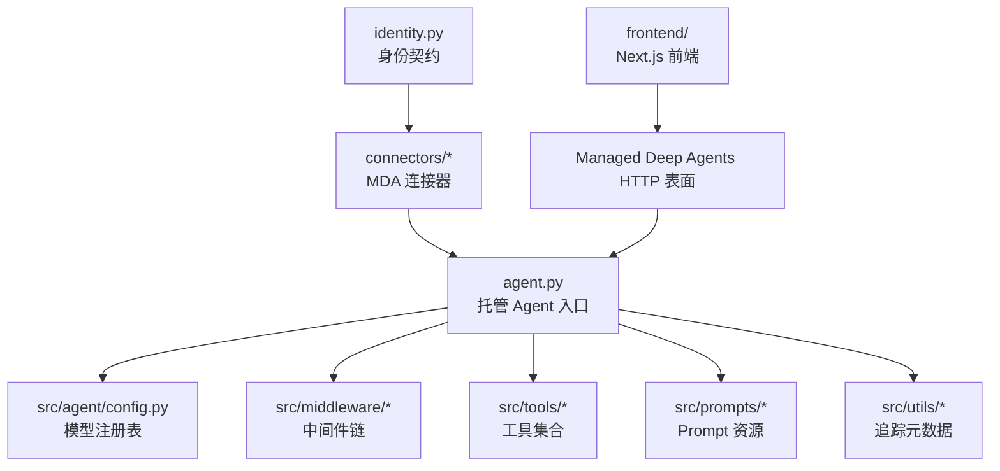
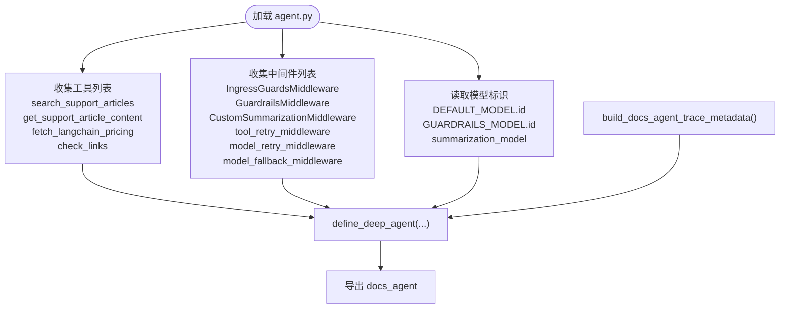
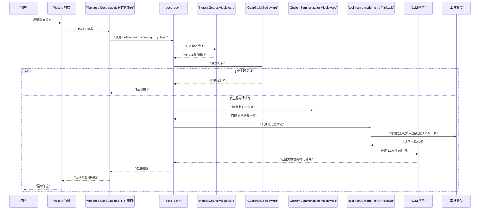
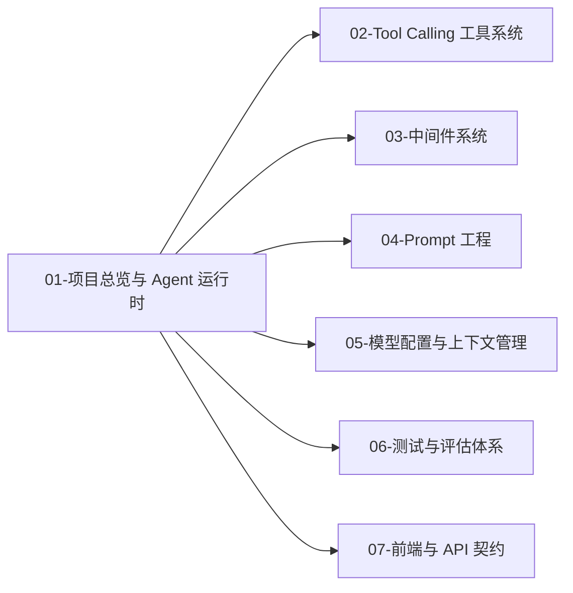

# 01-项目总览与 Agent 运行时

<cite>
**本文引用的文件**   
- [agent.py](file://agent.py)
- [README.md](file://README.md)
- [pyproject.toml](file://pyproject.toml)
- [src/agent/config.py](file://src/agent/config.py)
- [src/middleware/guardrails_middleware.py](file://src/middleware/guardrails_middleware.py)
- [src/middleware/ingress_guards_middleware.py](file://src/middleware/ingress_guards_middleware.py)
- [src/middleware/summarization_middleware.py](file://src/middleware/summarization_middleware.py)
- [src/middleware/retry_middleware.py](file://src/middleware/retry_middleware.py)
- [src/middleware/tool_retry_middleware.py](file://src/middleware/tool_retry_middleware.py)
- [src/prompts/context_summary_prompt.py](file://src/prompts/context_summary_prompt.py)
- [src/tools/link_check_tools.py](file://src/tools/link_check_tools.py)
- [src/tools/pricing_tools.py](file://src/tools/pricing_tools.py)
- [src/tools/pylon_tools.py](file://src/tools/pylon_tools.py)
- [connectors/langsmith.py](file://connectors/langsmith.py)
- [connectors/mcp.py](file://connectors/mcp.py)
- [identity.py](file://identity.py)
</cite>

## 目录
1. [项目定位](#项目定位)
2. [技术栈速查表](#技术栈速查表)
3. [顶层目录职责一览](#顶层目录职责一览)
4. [Agent 组装入口：define_deep_agent](#agent-组装入口-definedeep_agent)
5. [请求生命周期全景图](#请求生命周期全景图)
6. [文档导航与边界说明](#文档导航与边界说明)

## 项目定位
本项目是一个基于 Managed Deep Agents 的 LangChain 官方文档客服 Agent。它面向 LangChain、LangGraph、LangSmith 生态的技术问题，通过检索官方文档、Pylon 支持知识库、价格信息，并对输出链接做校验，最终生成可部署的托管 Agent。

核心特征：
- 后端以 Python + LangGraph + MCP + FastAPI（由 Managed Deep Agents 提供 HTTP 表面）为主。
- 前端是 Next.js + Supabase Auth 的公开聊天界面。
- 入口 `agent.py` 通过 `define_deep_agent` 把模型、工具、中间件和追踪元数据装配成一个可运行的 Agent。
- 身份认证、MCP 连接器、LangSmith 反馈等基础设施由 MDA 运行时或 `connectors/`、`identity.py` 管理。

本文件只给出鸟瞰视图；各模块细节由后续 02~07 号文档分别展开。

**章节来源**
- [README.md:9-25](file://README.md#L9-L25)
- [README.md:89-144](file://README.md#L89-L144)

## 技术栈速查表
| 类别 | 技术 | 在本项目中的作用 | 参考位置 |
| --- | --- | --- | --- |
| 运行时框架 | Managed Deep Agents | 托管部署、身份、HTTP 入口、Checkpointer、MCP 工具注入 | [README.md:129-144](file://README.md#L129-L144) |
| Agent 框架 | LangChain / LangGraph | Agent 创建、中间件链、工具调用、状态机基础 | [pyproject.toml:12-18](file://pyproject.toml#L12-L18) |
| 模型提供方 | Anthropic、OpenAI、Google GenAI、Baseten | 通过 LangChain 多模型适配层接入主模型与 Guardrails 模型 | [pyproject.toml:14-19](file://pyproject.toml#L14-L19) |
| 外部连接 | MCP、Pylon、LangSmith | 文档检索、支持知识库、反馈与追踪 | [README.md:95-97](file://README.md#L95-L97) |
| 前端 | Next.js + Supabase Auth | 公开聊天 UI、访客令牌、会话标题 | [README.md:77-87](file://README.md#L77-L87) |
| 依赖管理 | uv / pip + pyproject.toml | 安装、开发依赖、包名映射 | [pyproject.toml:1-44](file://pyproject.toml#L1-L44) |

**章节来源**
- [pyproject.toml:1-25](file://pyproject.toml#L1-L25)
- [README.md:26-87](file://README.md#L26-L87)
- [README.md:129-144](file://README.md#L129-L144)

## 顶层目录职责一览
| 目录或文件 | 主要职责 | 是否深入展开 |
| --- | --- | --- |
| `agent.py` | 定义并导出托管 Agent；绑定模型、工具、中间件、追踪元数据 | 本篇重点 |
| `identity.py` | MDA 身份契约：Supabase 访问令牌验证、访客令牌签发 | 仅概述 |
| `instructions.md` | Managed Deep Agent 系统提示词 | 仅概述 |
| `connectors/` | LangSmith 反馈/追踪代理、Managed MCP 文档连接器 | 仅概述 |
| `src/agent/` | 模型配置、LLM 相关逻辑 | 详见「05-模型配置与上下文管理」 |
| `src/middleware/` | IngressGuards、Guardrails、摘要、重试等中间件 | 详见「03-中间件系统」 |
| `src/tools/` | Pylon 知识库、定价查询、链接校验工具 | 详见「02-Tool Calling 工具系统」 |
| `src/prompts/` | 文档 Agent 提示词、Guardrails 提示词、上下文摘要提示词 | 详见「04-Prompt 工程」 |
| `src/utils/` | Prompt provenance、LangSmith 根追踪元数据构建 | 仅概述 |
| `frontend/` | Next.js 公开聊天界面、API 契约、streaming 数据格式 | 仅概述 API 契约 |
| `tests/` | 单元测试、评估用例 | 详见「06-测试与评估体系」 |
| `pyproject.toml` | Python 项目依赖、包名映射、开发工具配置 | 本篇速查 |
| `README.md` | 项目说明、快速开始、部署说明、目录结构 | 本篇鸟瞰 |

**图表来源**
- [agent.py:3-65](file://agent.py#L3-L65)
- [README.md:95-144](file://README.md#L95-L144)

**章节来源**
- [README.md:89-115](file://README.md#L89-L115)
- [pyproject.toml:35-44](file://pyproject.toml#L35-L44)

## Agent 组装入口：define_deep_agent
`agent.py` 是托管 Agent 的唯一装配点。它不实现业务逻辑，而是把以下四类能力组合起来：

1. **模型**：默认模型来自 `src/agent/config.py` 中的 `DEFAULT_MODEL.id`，Guardrails 使用独立模型，摘要压缩使用 `summarization_model`。
2. **工具**：包括 Pylon 支持文章搜索与内容获取、LangChain 定价查询、链接校验，以及由 MDA 在编译期附加的 MCP 文档工具。
3. **中间件**：按执行顺序串联输入守卫、主题守卫、上下文摘要、工具重试、模型重试、模型降级。
4. **追踪元数据**：通过 `build_docs_agent_trace_metadata()` 把 LangSmith 根运行元数据注入到 Agent。

关键装配关系如下：

**图表来源**
- [agent.py:22-65](file://agent.py#L22-L65)
- [src/agent/config.py](file://src/agent/config.py)

### 工具绑定方式
`docs_agent_tools` 是一个函数列表，包含：
- `search_support_articles`
- `get_support_article_content`
- `fetch_langchain_pricing`
- `check_links`

此外，注释明确说明 MCP 文档工具在 `connectors/mcp.py` 中声明，由 Managed Deep Agents 运行时在编译阶段追加。因此，最终 Agent 的工具集是“本地工具 + MCP 工具”的组合。

**章节来源**
- [agent.py:22-29](file://agent.py#L22-L29)
- [README.md:95-97](file://README.md#L95-L97)

### 中间件绑定方式
`docs_agent_middleware` 定义了中间件的执行顺序，这也是理解请求生命周期的关键：

1. `IngressGuardsMiddleware`：限制超大用户输入，并配合 `metadata=...` 把追踪元数据落到 LangSmith 根运行。
2. `GuardrailsMiddleware`：判断问题是否与 LangChain 生态相关，可阻断非主题请求。
3. `CustomSummarizationMiddleware`：当上下文超过 token 阈值时触发摘要压缩，保留最近一段上下文。
4. `tool_retry_middleware`：对工具调用失败进行重试。
5. `model_retry_middleware`：对模型调用失败进行重试。
6. `model_fallback_middleware`：在主模型不可用时降级到其他模型。

这些中间件不是独立服务，而是被 `define_deep_agent` 包装进 Agent 的执行管道。

**章节来源**
- [agent.py:31-51](file://agent.py#L31-L51)

### 模型绑定方式
模型标识来自 `src/agent/config.py`：
- 主模型：`DEFAULT_MODEL.id`
- Guardrails 模型：`GUARDRAILS_MODEL.id`
- 摘要模型：`summarization_model`

`pyproject.toml` 中声明了多个 LangChain 模型提供方依赖，但具体选择由 `config.py` 与环境变量驱动，而不是在 `agent.py` 中硬编码。

**章节来源**
- [agent.py:5-12](file://agent.py#L5-L12)
- [pyproject.toml:12-19](file://pyproject.toml#L12-L19)

## 请求生命周期全景图
从用户消息到响应返回，Agent 的运行路径可以概括为：

**图表来源**
- [agent.py:31-65](file://agent.py#L31-L65)
- [src/middleware/ingress_guards_middleware.py](file://src/middleware/ingress_guards_middleware.py)
- [src/middleware/guardrails_middleware.py](file://src/middleware/guardrails_middleware.py)
- [src/middleware/summarization_middleware.py](file://src/middleware/summarization_middleware.py)
- [src/middleware/tool_retry_middleware.py](file://src/middleware/tool_retry_middleware.py)
- [src/middleware/retry_middleware.py](file://src/middleware/retry_middleware.py)
- [src/tools/pylon_tools.py](file://src/tools/pylon_tools.py)
- [src/tools/pricing_tools.py](file://src/tools/pricing_tools.py)
- [src/tools/link_check_tools.py](file://src/tools/link_check_tools.py)
- [connectors/mcp.py](file://connectors/mcp.py)

### 生命周期要点
- 用户消息首先经过输入守卫，防止过大输入影响性能或稳定性。
- Guardrails 负责保持对话围绕 LangChain 生态，避免无关话题。
- 上下文摘要中间件在 token 数达到阈值时压缩历史，避免超出模型上下文窗口。
- 工具重试与模型重试共同提升鲁棒性。
- MCP 文档工具由 MDA 在编译期附加，不在 `docs_agent_tools` 列表中显式出现。
- 最终响应由 Managed Deep Agents 暴露的 HTTP 表面返回给前端。

**章节来源**
- [README.md:117-125](file://README.md#L117-L125)
- [agent.py:31-65](file://agent.py#L31-L65)

## 文档导航与边界说明
按照作者指南，本文只承担“项目总览与 Agent 运行时”的职责，不深入单一模块。后续文档分工如下：

| 文档编号 | 主题 | 本文处理方式 |
| --- | --- | --- |
| 02 | Tool Calling 工具系统 | 本文只列出工具名称与来源；详细工作流见「02-Tool Calling 工具系统」 |
| 03 | 中间件系统 | 本文只列出中间件顺序；详细实现见「03-中间件系统」 |
| 04 | Prompt 工程 | 本文只提及 Prompt 存在；详细内容见「04-Prompt 工程」 |
| 05 | 模型配置与上下文管理 | 本文只说明模型来源；详细内容见「05-模型配置与上下文管理」 |
| 06 | 测试与评估体系 | 本文不展开；详细内容见「06-测试与评估体系」 |
| 07 | 前端与 API 契约 | 本文只说明前端角色；详细内容见「07-前端与 API 契约」 |

[本图为概念导航图，不对应具体源码结构，因此不附图表来源]

**章节来源**
- [agent.py:1-66](file://agent.py#L1-L66)
- [README.md:1-155](file://README.md#L1-L155)