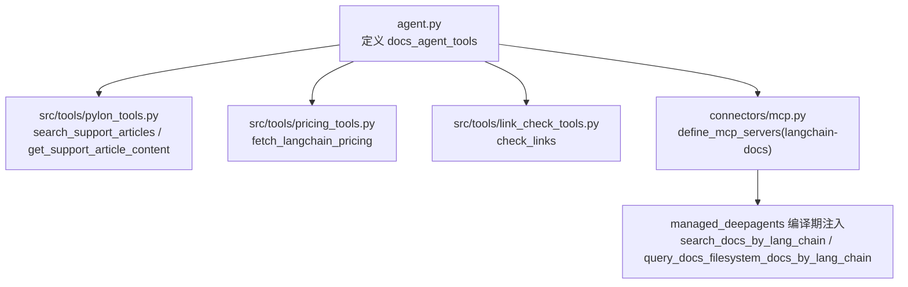
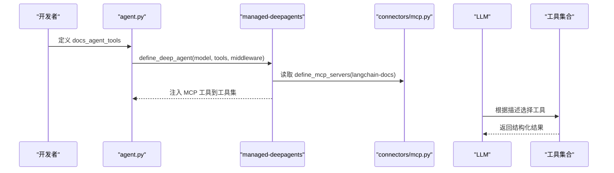
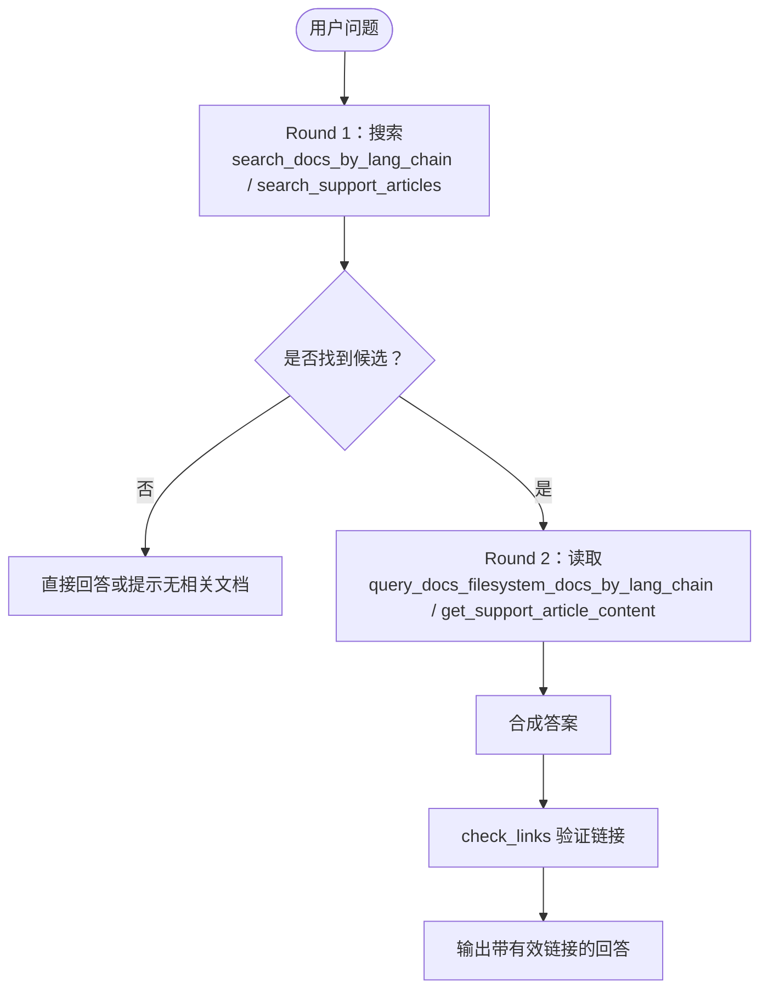
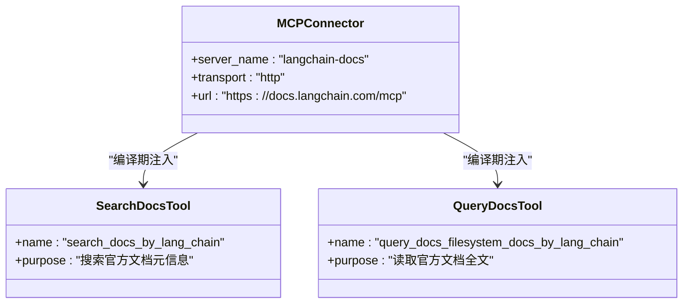
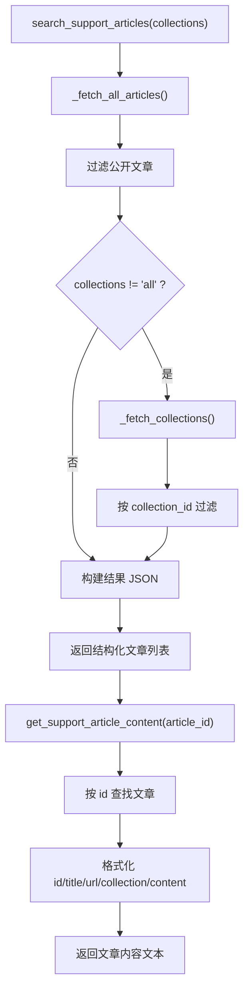
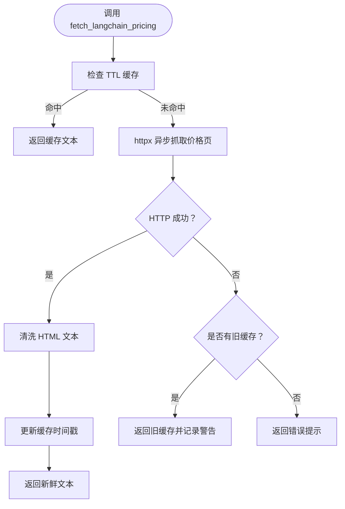
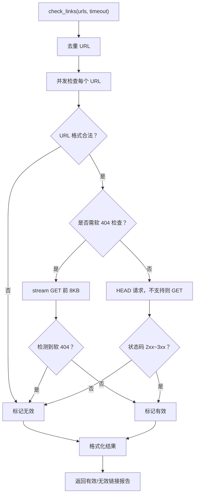
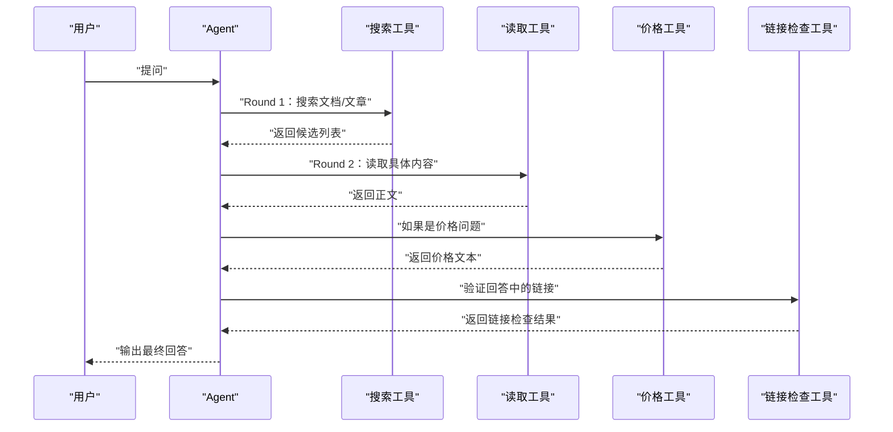
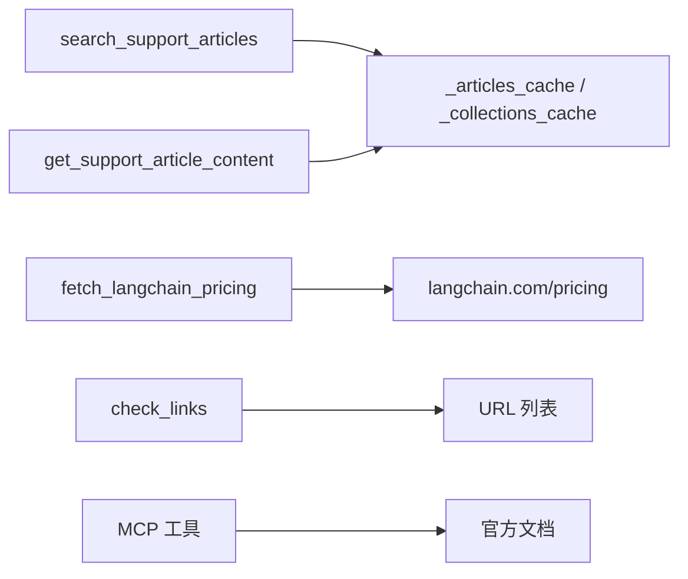

# 02-Tool Calling 工具系统

<cite>
**本文引用的文件**   
- [agent.py](file://agent.py)
- [connectors/mcp.py](file://connectors/mcp.py)
- [src/tools/pylon_tools.py](file://src/tools/pylon_tools.py)
- [src/tools/pricing_tools.py](file://src/tools/pricing_tools.py)
- [src/tools/link_check_tools.py](file://src/tools/link_check_tools.py)
- [src/prompts/docs_agent_prompt.py](file://src/prompts/docs_agent_prompt.py)
- [instructions.md](file://instructions.md)
</cite>

## 目录
1. [引言](#引言)
2. [项目结构中的工具层](#项目结构中的工具层)
3. [核心组件总览](#核心组件总览)
4. [架构总览：工具注册、MCP 注入与两轮调用工作流](#架构总览工具注册mcp-注入与两轮调用工作流)
5. [详细组件分析](#详细组件分析)
6. [依赖关系分析](#依赖关系分析)
7. [性能与可靠性特性](#性能与可靠性特性)
8. [故障排查指南](#故障排查指南)
9. [结论](#结论)

## 引言
本篇文档聚焦 Agent 开发中的“工具系统”，围绕以下目标展开：
- 工具注册方式：`@tool` 装饰器 + `docs_agent_tools` 列表。
- MCP 文档工具：搜索与读取的分工，以及 `connectors/mcp.py` 如何在 DeepAgents 编译期注入 MCP 工具。
- Pylon KB 工具：`search_support_articles` 按 collection 过滤 → `get_support_article_content` 按 id 读取。
- `fetch_langchain_pricing`：直连价格页，绕过文档搜索。
- `check_links`：回答前 URL 验证，防止链接失效。
- 两轮并行调用工作流：Round 1 搜索 → Round 2 读取 → 合成。

本说明以源码为主线，重点解释“哪些函数是工具”“它们如何被注册”“Agent 如何组织搜索与读取”“异常与缓存如何处理”。

**章节来源**
- [agent.py:1-66](file://agent.py#L1-L66)
- [src/prompts/docs_agent_prompt.py:1-430](file://src/prompts/docs_agent_prompt.py#L1-L430)

## 项目结构中的工具层
工具代码集中在 `src/tools/` 下，每个工具模块负责一个能力域：
- `pylon_tools.py`：Pylon Support KB 文章检索与内容读取。
- `pricing_tools.py`：LangChain 官方价格页抓取与缓存。
- `link_check_tools.py`：URL 有效性检查，包含软 404 检测与并发校验。
- MCP 文档工具不在本地实现，而是通过 `connectors/mcp.py` 声明 MCP Server，由托管运行时在编译期注入。

**图表来源**
- [agent.py:22-29](file://agent.py#L22-L29)
- [connectors/mcp.py:5-13](file://connectors/mcp.py#L5-L13)

**章节来源**
- [agent.py:17-29](file://agent.py#L17-L29)
- [connectors/mcp.py:1-14](file://connectors/mcp.py#L1-L14)

## 核心组件总览
| 组件 | 文件 | 角色 | 关键行为 |
|---|---|---|---|
| `docs_agent_tools` | [agent.py:24-29](file://agent.py#L24-L29) | 工具注册列表 | 聚合 Pylon KB、价格、链接检查工具；MCP 工具由运行时追加 |
| MCP 连接器 | [connectors/mcp.py:5-13](file://connectors/mcp.py#L5-L13) | 声明 langchain-docs MCP Server | 配置 HTTP transport 与 URL，交由 managed-deepagents 注入工具 |
| Pylon KB 工具 | [src/tools/pylon_tools.py:130-363](file://src/tools/pylon_tools.py#L130-L363) | 支持知识库检索与内容读取 | 分页拉取、collection 过滤、HTML 内容截断 |
| 价格工具 | [src/tools/pricing_tools.py:55-111](file://src/tools/pricing_tools.py#L55-L111) | 直连价格页 | 异步抓取、TTL 缓存、超时/状态码降级 |
| 链接检查工具 | [src/tools/link_check_tools.py:183-203](file://src/tools/link_check_tools.py#L183-L203) | URL 有效性检查 | 并发 HEAD/GET、软 404 检测、结果格式化 |
| 工具调用约束 | [src/prompts/docs_agent_prompt.py:1-430](file://src/prompts/docs_agent_prompt.py#L1-L430) | 强制“搜索后必须读取” | 要求 search 工具后必须调用对应 read 工具 |

**章节来源**
- [agent.py:22-29](file://agent.py#L22-L29)
- [connectors/mcp.py:5-13](file://connectors/mcp.py#L5-L13)
- [src/tools/pylon_tools.py:130-363](file://src/tools/pylon_tools.py#L130-L363)
- [src/tools/pricing_tools.py:55-111](file://src/tools/pricing_tools.py#L55-L111)
- [src/tools/link_check_tools.py:183-203](file://src/tools/link_check_tools.py#L183-L203)
- [src/prompts/docs_agent_prompt.py:1-430](file://src/prompts/docs_agent_prompt.py#L1-L430)

## 架构总览：工具注册、MCP 注入与两轮调用工作流
### 工具注册机制
Agent 入口使用 `define_deep_agent` 组装模型、中间件和工具。本地工具通过 Python 函数列表显式传入：
- `docs_agent_tools = [search_support_articles, get_support_article_content, fetch_langchain_pricing, check_links]`
- MCP 文档工具不写进该列表，而是在 `connectors/mcp.py` 中声明 MCP Server，由托管运行时在编译期自动注入 `search_docs_by_lang_chain` 与 `query_docs_filesystem_docs_by_lang_chain`。

**图表来源**
- [agent.py:53-65](file://agent.py#L53-L65)
- [connectors/mcp.py:5-13](file://connectors/mcp.py#L5-L13)

### 两轮并行调用工作流
Prompt 明确要求：
- 如果调用搜索类工具（如 `search_docs_by_lang_chain`、`search_support_articles`），必须继续调用对应的读取类工具（如 `query_docs_filesystem_docs_by_lang_chain`、`get_support_article_content`）。
- 不能只搜索不读取。

因此典型流程为：
1. Round 1：搜索候选文档或文章。
2. Round 2：根据搜索结果调用读取工具获取完整内容。
3. 合成：基于读取内容生成最终回答，并附带有效链接。

**图表来源**
- [src/prompts/docs_agent_prompt.py:1-430](file://src/prompts/docs_agent_prompt.py#L1-L430)
- [src/tools/pylon_tools.py:130-363](file://src/tools/pylon_tools.py#L130-L363)
- [src/tools/link_check_tools.py:183-203](file://src/tools/link_check_tools.py#L183-L203)

**章节来源**
- [agent.py:22-65](file://agent.py#L22-L65)
- [connectors/mcp.py:5-13](file://connectors/mcp.py#L5-L13)
- [src/prompts/docs_agent_prompt.py:1-430](file://src/prompts/docs_agent_prompt.py#L1-L430)

## 详细组件分析

### 工具注册：`@tool` 装饰器与 `docs_agent_tools`
- 所有本地工具均使用 LangChain 的 `@tool` 装饰器暴露给 LLM。
- `agent.py` 将工具函数放入 `docs_agent_tools`，并通过 `define_deep_agent(tools=docs_agent_tools)` 注册。
- MCP 工具不在该列表中，而是由 `connectors/mcp.py` 声明，由托管运行时注入。

关键点：
- 工具描述（docstring）决定 LLM 是否选择该工具。
- 工具返回值通常是字符串或结构化 JSON，供 LLM 解析。
- 工具异常通常被包装为错误消息，便于上层重试或降级。

**章节来源**
- [agent.py:22-29](file://agent.py#L22-L29)
- [src/tools/pylon_tools.py:130-155](file://src/tools/pylon_tools.py#L130-L155)
- [src/tools/pricing_tools.py:55-66](file://src/tools/pricing_tools.py#L55-L66)
- [src/tools/link_check_tools.py:183-193](file://src/tools/link_check_tools.py#L183-L193)

### MCP 文档工具：搜索与读取分离
MCP 文档工具由 `connectors/mcp.py` 声明：
- server name：`langchain-docs`
- transport：`http`
- url：`https://docs.langchain.com/mcp`

托管运行时根据该声明注入两个关键工具：
- `search_docs_by_lang_chain`：用于搜索官方文档标题、路径等元信息。
- `query_docs_filesystem_docs_by_lang_chain`：用于读取具体文档页面内容。

Prompt 明确约束：
- 调用搜索工具后必须调用读取工具。
- 不能仅凭搜索结果回答。

**图表来源**
- [connectors/mcp.py:5-13](file://connectors/mcp.py#L5-L13)
- [src/prompts/docs_agent_prompt.py:1-430](file://src/prompts/docs_agent_prompt.py#L1-L430)

**章节来源**
- [connectors/mcp.py:1-14](file://connectors/mcp.py#L1-L14)
- [src/prompts/docs_agent_prompt.py:1-430](file://src/prompts/docs_agent_prompt.py#L1-L430)

### Pylon KB 工具：`search_support_articles` 与 `get_support_article_content`
Pylon KB 工具提供两类能力：
1. 搜索支持文章：`search_support_articles(collections="all")`
   - 从 Pylon API 拉取文章列表，支持分页。
   - 过滤公开文章、有标题、有 identifier/slug 的文章。
   - 可选按 collection 名称过滤，内部映射 collection_id。
   - 返回结构化 JSON，包含 id、title、url、collection。
2. 读取文章内容：`get_support_article_content(article_id)`
   - 复用已缓存的文章数据，避免重复请求。
   - 根据 article_id 查找文章，返回 HTML 内容片段（最多 5000 字符）。
   - 同时返回 id、title、url、collection。

**图表来源**
- [src/tools/pylon_tools.py:130-286](file://src/tools/pylon_tools.py#L130-L286)
- [src/tools/pylon_tools.py:289-357](file://src/tools/pylon_tools.py#L289-L357)

**章节来源**
- [src/tools/pylon_tools.py:22-35](file://src/tools/pylon_tools.py#L22-L35)
- [src/tools/pylon_tools.py:51-122](file://src/tools/pylon_tools.py#L51-L122)
- [src/tools/pylon_tools.py:130-286](file://src/tools/pylon_tools.py#L130-L286)
- [src/tools/pylon_tools.py:289-357](file://src/tools/pylon_tools.py#L289-L357)

### 价格工具：`fetch_langchain_pricing`
该工具专门用于回答 LangChain 定价相关问题，绕过文档搜索，因为文档不包含实时价格数据。

关键特性：
- 直连 `https://www.langchain.com/pricing`。
- 使用 `httpx.AsyncClient` 异步抓取。
- 进程内 TTL 缓存（默认 1 小时）。
- 超时或 HTTP 错误时优先返回旧缓存，否则返回错误提示。
- 对 HTML 进行清洗，去除 script/style 标签，压缩空白。

**图表来源**
- [src/tools/pricing_tools.py:44-52](file://src/tools/pricing_tools.py#L44-L52)
- [src/tools/pricing_tools.py:55-111](file://src/tools/pricing_tools.py#L55-L111)

**章节来源**
- [src/tools/pricing_tools.py:1-111](file://src/tools/pricing_tools.py#L1-L111)

### 链接检查工具：`check_links`
该工具用于在回答前验证 URL 有效性，防止引用失效链接。

关键特性：
- 支持批量 URL 并发检查。
- 对已知存在软 404 的域名（如 `docs.langchain.com`、`support.langchain.com`）进行内容检查。
- 非 LangChain 域名优先使用 HEAD 请求，提升性能。
- 结果去重、格式化，区分有效/无效链接。

**图表来源**
- [src/tools/link_check_tools.py:72-145](file://src/tools/link_check_tools.py#L72-L145)
- [src/tools/link_check_tools.py:148-203](file://src/tools/link_check_tools.py#L148-L203)

**章节来源**
- [src/tools/link_check_tools.py:1-203](file://src/tools/link_check_tools.py#L1-L203)

### 两轮并行调用工作流的实现机制
虽然实际调度由 DeepAgents/LangGraph 控制，但 Prompt 明确了工具调用契约：
- 搜索工具必须配合读取工具。
- 不能只搜索不读取。
- 价格问题应直接使用价格工具，不走文档搜索。
- 链接应在最终回答前验证。

**图表来源**
- [src/prompts/docs_agent_prompt.py:1-430](file://src/prompts/docs_agent_prompt.py#L1-L430)
- [src/tools/pylon_tools.py:130-363](file://src/tools/pylon_tools.py#L130-L363)
- [src/tools/pricing_tools.py:55-111](file://src/tools/pricing_tools.py#L55-L111)
- [src/tools/link_check_tools.py:183-203](file://src/tools/link_check_tools.py#L183-L203)

**章节来源**
- [src/prompts/docs_agent_prompt.py:1-430](file://src/prompts/docs_agent_prompt.py#L1-L430)
- [instructions.md:76-105](file://instructions.md#L76-L105)

## 依赖关系分析
工具之间的依赖主要体现在数据流与调用顺序上：
- `search_support_articles` 与 `get_support_article_content` 共享 `_articles_cache` 与 `_collections_cache`。
- `fetch_langchain_pricing` 独立于文档搜索，直接访问外部网站。
- `check_links` 可作用于其他工具返回的 URL。
- MCP 工具由运行时注入，与本地工具并列存在于工具集中。

**图表来源**
- [src/tools/pylon_tools.py:42-43](file://src/tools/pylon_tools.py#L42-L43)
- [src/tools/pylon_tools.py:79-122](file://src/tools/pylon_tools.py#L79-L122)
- [src/tools/pricing_tools.py:17-24](file://src/tools/pricing_tools.py#L17-L24)
- [src/tools/link_check_tools.py:27-28](file://src/tools/link_check_tools.py#L27-L28)
- [connectors/mcp.py:5-13](file://connectors/mcp.py#L5-L13)

**章节来源**
- [src/tools/pylon_tools.py:42-122](file://src/tools/pylon_tools.py#L42-L122)
- [src/tools/pricing_tools.py:17-24](file://src/tools/pricing_tools.py#L17-L24)
- [src/tools/link_check_tools.py:27-28](file://src/tools/link_check_tools.py#L27-L28)
- [connectors/mcp.py:5-13](file://connectors/mcp.py#L5-L13)

## 性能与可靠性特性
| 工具 | 性能优化 | 可靠性处理 |
|---|---|---|
| Pylon KB | 分页拉取 + 内存缓存 | 捕获 ValueError、RequestException、通用异常 |
| 价格工具 | 进程内 TTL 缓存（1 小时） | 超时/HTTP 错误时回退旧缓存 |
| 链接检查 | 并发 HEAD/GET、软 404 检测 | 超时、重定向过多、连接失败统一封装 |
| MCP 工具 | 由托管运行时管理客户端生命周期 | 由上层中间件与重试机制处理 |

**章节来源**
- [src/tools/pylon_tools.py:278-286](file://src/tools/pylon_tools.py#L278-L286)
- [src/tools/pylon_tools.py:349-357](file://src/tools/pylon_tools.py#L349-L357)
- [src/tools/pricing_tools.py:69-110](file://src/tools/pricing_tools.py#L69-L110)
- [src/tools/link_check_tools.py:134-145](file://src/tools/link_check_tools.py#L134-L145)

## 故障排查指南
常见问题与定位建议：
1. **Pylon KB 无法访问**
   - 检查环境变量 `PYLON_KB_ID` 与 `PYLON_API_KEY`。
   - 确认 Pylon API 返回的文章是否为公开且已发布。
   - 查看 `search_support_articles` 返回的错误 JSON。

2. **价格工具返回过期信息**
   - 检查 TTL 缓存是否过期。
   - 观察网络超时或 HTTP 状态码错误日志。
   - 若缓存存在，会返回旧缓存而非报错。

3. **链接检查大量失败**
   - 检查 URL 格式是否合法。
   - 关注软 404 域名（如 `docs.langchain.com`）。
   - 查看并发请求是否触发重定向过多或连接失败。

4. **MCP 工具未生效**
   - 确认 `connectors/mcp.py` 是否正确声明 MCP Server。
   - 检查托管运行时是否在编译期注入工具。
   - 查看 Prompt 是否正确使用搜索与读取工具。

**章节来源**
- [src/tools/pylon_tools.py:22-35](file://src/tools/pylon_tools.py#L22-L35)
- [src/tools/pricing_tools.py:82-105](file://src/tools/pricing_tools.py#L82-L105)
- [src/tools/link_check_tools.py:41-56](file://src/tools/link_check_tools.py#L41-L56)
- [connectors/mcp.py:5-13](file://connectors/mcp.py#L5-L13)

## 结论
本项目的工具系统以“搜索 → 读取 → 验证”为核心工作流：
- 本地工具通过 `@tool` 装饰器暴露，并由 `docs_agent_tools` 列表注册。
- MCP 文档工具由 `connectors/mcp.py` 声明，托管运行时在编译期注入。
- Pylon KB 工具提供按 collection 过滤与按 id 读取的能力。
- 价格工具直连官网，绕过文档搜索。
- 链接检查工具确保回答中的 URL 有效。
- Prompt 强制“搜索后必须读取”，保证回答质量。

这套设计使 Agent 既能检索官方文档与支持知识库，又能直接获取实时价格信息，并在输出前验证链接有效性，形成完整的工具调用闭环。