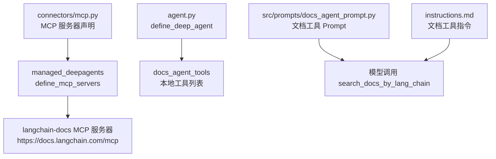
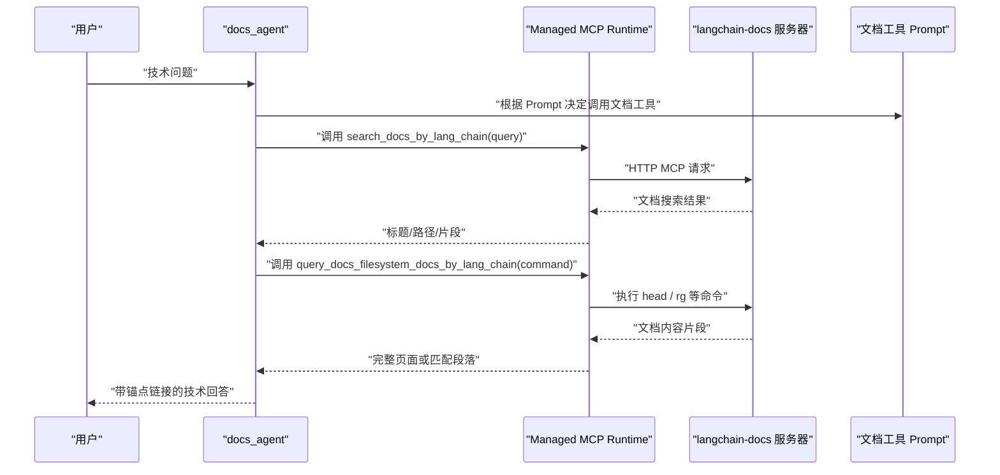
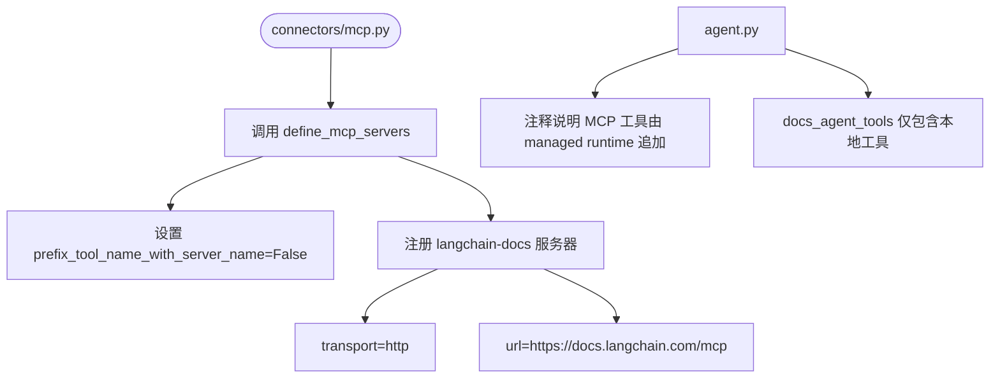
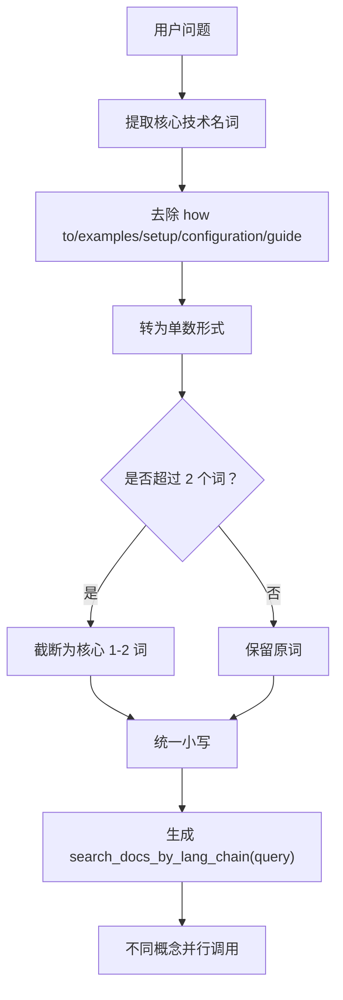
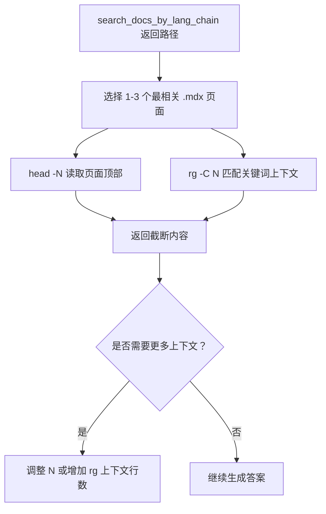
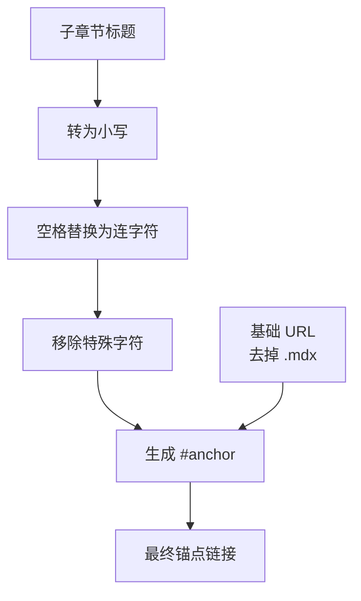
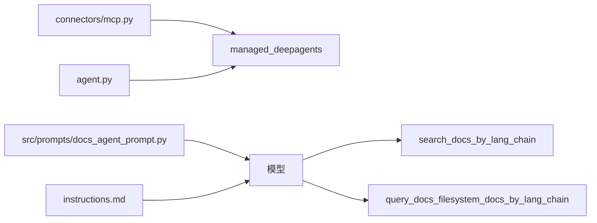

# 02a-MCP 连接器与文档工具

<cite>
**本文引用的文件**   
- [connectors/mcp.py](file://connectors/mcp.py)
- [agent.py](file://agent.py)
- [src/prompts/docs_agent_prompt.py](file://src/prompts/docs_agent_prompt.py)
- [instructions.md](file://instructions.md)
</cite>

## 目录
1. [引言](#引言)
2. [项目结构定位](#项目结构定位)
3. [核心组件总览](#核心组件总览)
4. [架构概览](#架构概览)
5. [详细组件分析](#详细组件分析)
6. [依赖关系分析](#依赖关系分析)
7. [性能与行为特征](#性能与行为特征)
8. [故障排查指南](#故障排查指南)
9. [结论](#结论)

## 引言
本篇聚焦本仓库中与“官方文档检索与阅读”相关的两个层面：
- MCP 连接器声明：`connectors/mcp.py` 如何注册 LangChain 官方文档的 MCP 服务器，以及该声明如何被 Agent 装配。
- 文档工具使用规则：Prompt 层对 `search_docs_by_lang_chain` 和 `query_docs_filesystem_docs_by_lang_chain` 的行为约束，包括查询词提取、长度限制、大小写规范，文件系统读取命令（`head -N` / `rg -C`），以及锚点链接构造规则。

需要特别说明的是：在本仓库中，`search_docs_by_lang_chain` 与 `query_docs_filesystem_docs_by_lang_chain` 是作为 MCP 工具暴露给模型使用的函数名；它们的实际实现由 `managed_deepagents.connectors.define_mcp_servers` 在运行时注入，而不是直接定义在当前 Python 源码里。因此，本文对这两个工具的“规则说明”以 Prompt 与指令为准，对“连接器配置”则以 `connectors/mcp.py` 为准。

## 项目结构定位
与本文主题直接相关的代码集中在以下位置：
- MCP 连接器声明：`connectors/mcp.py`
- Agent 入口与工具装配：`agent.py`
- 文档工具使用说明与规则：`src/prompts/docs_agent_prompt.py`
- 面向模型的指令补充：`instructions.md`

**图表来源**
- [connectors/mcp.py:3-13](file://connectors/mcp.py#L3-L13)
- [agent.py:22-29](file://agent.py#L22-L29)
- [src/prompts/docs_agent_prompt.py:32-159](file://src/prompts/docs_agent_prompt.py#L32-L159)
- [instructions.md:42-163](file://instructions.md#L42-L163)

**章节来源**
- [connectors/mcp.py:1-14](file://connectors/mcp.py#L1-L14)
- [agent.py:1-66](file://agent.py#L1-L66)

## 核心组件总览
| 组件 | 职责 | 关键行为 |
|---|---|---|
| `connectors/mcp.py` | 声明 LangChain 官方文档 MCP 服务器 | 通过 `define_mcp_servers` 注册名为 `langchain-docs` 的 HTTP MCP 服务 |
| `agent.py` | 组装 Deep Agent | 将本地工具加入 `docs_agent_tools`，并注释说明 MCP 文档工具由 managed runtime 在编译阶段追加 |
| `src/prompts/docs_agent_prompt.py` | 定义文档工具使用规则 | 规定 `search_docs_by_lang_chain` 的查询提取规则、`query_docs_filesystem_docs_by_lang_chain` 的文件系统读取方式与锚点链接规则 |
| `instructions.md` | 面向模型的指令补充 | 重复强调查询词提取、`head -N` / `rg -C` 用法、路径转 URL、锚点生成规则 |

**章节来源**
- [connectors/mcp.py:1-14](file://connectors/mcp.py#L1-L14)
- [agent.py:22-29](file://agent.py#L22-L29)
- [src/prompts/docs_agent_prompt.py:32-159](file://src/prompts/docs_agent_prompt.py#L32-L159)
- [instructions.md:42-163](file://instructions.md#L42-L163)

## 架构概览
从 Agent 到文档工具的调用链路可以理解为三层：
1. **Agent 层**：`agent.py` 通过 `define_deep_agent` 创建 `docs_agent`，并将本地工具列表传入。
2. **MCP 层**：`connectors/mcp.py` 只负责声明 MCP 服务器；实际的 MCP 客户端生命周期、工具发现与注入由 `managed_deepagents` 管理。
3. **Prompt 层**：`src/prompts/docs_agent_prompt.py` 和 `instructions.md` 告诉模型如何使用 `search_docs_by_lang_chain` 与 `query_docs_filesystem_docs_by_lang_chain`。

**图表来源**
- [agent.py:53-65](file://agent.py#L53-L65)
- [connectors/mcp.py:3-13](file://connectors/mcp.py#L3-L13)
- [src/prompts/docs_agent_prompt.py:32-159](file://src/prompts/docs_agent_prompt.py#L32-L159)

## 详细组件分析

### MCP 连接器配置与工具注入机制
`connectors/mcp.py` 的核心作用非常明确：它不是实现 MCP 客户端，而是声明一个名为 `langchain-docs` 的 MCP 服务器，并使用 HTTP 传输连接到 `https://docs.langchain.com/mcp`。

关键点如下：
- 使用 `define_mcp_servers` 创建连接器。
- `prefix_tool_name_with_server_name=False` 表示工具名不会自动加上服务器名前缀。
- 仅声明一个 `langchain-docs` 服务器，传输类型为 `http`，URL 指向 LangChain 官方文档 MCP 端点。
- `agent.py` 中的注释明确指出：MCP 文档工具由 managed runtime 在编译阶段追加，因此 `docs_agent_tools` 列表中不包含 `search_docs_by_lang_chain` 或 `query_docs_filesystem_docs_by_lang_chain` 的直接引用。

**图表来源**
- [connectors/mcp.py:3-13](file://connectors/mcp.py#L3-L13)
- [agent.py:22-29](file://agent.py#L22-L29)

**章节来源**
- [connectors/mcp.py:1-14](file://connectors/mcp.py#L1-L14)
- [agent.py:22-29](file://agent.py#L22-L29)

### `search_docs_by_lang_chain` 的查询规则
`search_docs_by_lang_chain` 在本项目中是一个面向模型的 MCP 工具名称，其输入参数和输出语义由 Prompt 层严格约束。核心规则可归纳为“核心名词提取 + 1-2 词限制 + 小写统一”。

具体规则如下：
1. **只提取核心技术名词**：例如把 “How do I add middleware?” 转换为 `query="middleware"`。
2. **去除描述性词语**：去掉 “how to”“examples”“setup”“configuration”“guide” 等修饰语。
3. **使用单数形式**：例如用 “middleware” 而不是 “middlewares”，因为模糊匹配会处理复数。
4. **最多 1-2 个词**：更长查询会降低缓存命中率。
5. **不要动词或疑问句**：例如用 “streaming” 而不是 “how to stream”。
6. **统一小写**：一致的大小写能提升缓存命中率。
7. **多概念并行搜索**：不同核心概念应并行调用，而不是同一概念的变体。
8. **语言相关时可在 query 中包含 Python/JavaScript**：但主体仍应是核心名词。

这些规则同时出现在 `src/prompts/docs_agent_prompt.py` 和 `instructions.md` 中，说明它们是面向模型的强约束，而不是可选建议。

**图表来源**
- [src/prompts/docs_agent_prompt.py:41-50](file://src/prompts/docs_agent_prompt.py#L41-L50)
- [src/prompts/docs_agent_prompt.py:102-117](file://src/prompts/docs_agent_prompt.py#L102-L117)
- [instructions.md:42-73](file://instructions.md#L42-L73)

**章节来源**
- [src/prompts/docs_agent_prompt.py:32-117](file://src/prompts/docs_agent_prompt.py#L32-L117)
- [instructions.md:42-73](file://instructions.md#L42-L73)

### `query_docs_filesystem_docs_by_lang_chain` 的文件系统读取方式
`query_docs_filesystem_docs_by_lang_chain` 用于在搜索到相关文档页后，读取 `.mdx` 文档内容。它的核心思想是：**先搜索定位路径，再用 shell 命令读取内容**。

主要行为如下：
- 推荐优先使用 `head -N` 读取页面顶部内容，适合快速了解整页结构。
- 推荐优先使用 `rg -C N "关键词"` 精准匹配上下文，适合定位子章节或代码示例。
- 不推荐直接使用 `cat`，因为大文件会被截断。
- 一次调用通常只读 1-3 个最相关的 `.mdx` 页面。
- 支持同时读取多个文件，例如对 `streaming.mdx` 和 `subgraphs.mdx` 一起查看。
- 文件系统路径需要以 `/oss/python/langgraph/streaming.mdx` 这类形式传入。

**图表来源**
- [src/prompts/docs_agent_prompt.py:122-147](file://src/prompts/docs_agent_prompt.py#L122-L147)
- [instructions.md:121-146](file://instructions.md#L121-L146)

**章节来源**
- [src/prompts/docs_agent_prompt.py:122-147](file://src/prompts/docs_agent_prompt.py#L122-L147)
- [instructions.md:121-146](file://instructions.md#L121-L146)

### 锚点链接构造规则
当模型从文档中找到某个子章节时，需要构造可直接跳转的锚点链接。规则分为两部分：路径转换和锚点生成。

#### 路径转换
文件系统路径需要转换为公开 URL：
- 基础路径：`/oss/python/langgraph/streaming.mdx`
- 公开 URL：`https://docs.langchain.com/oss/python/langgraph/streaming`
- 转换方式：去掉末尾的 `.mdx`，并在前面拼接 `https://docs.langchain.com`。

#### 锚点生成
锚点基于子章节标题生成，步骤如下：
1. 将标题转为小写。
2. 将空格替换为连字符 `-`。
3. 移除特殊字符。
4. 在基础 URL 后追加 `#锚点`。

示例逻辑：
- 子章节标题：“Stream Subgraph Outputs”
- 处理后锚点：“stream-subgraph-outputs”
- 最终链接：“https://docs.langchain.com/path/to/page#stream-subgraph-outputs”

**图表来源**
- [src/prompts/docs_agent_prompt.py:147-159](file://src/prompts/docs_agent_prompt.py#L147-L159)
- [instructions.md:143-163](file://instructions.md#L143-L163)

**章节来源**
- [src/prompts/docs_agent_prompt.py:147-159](file://src/prompts/docs_agent_prompt.py#L147-L159)
- [instructions.md:143-163](file://instructions.md#L143-L163)

## 依赖关系分析
从模块依赖角度看，本项目对 MCP 文档工具的使用呈现“声明与实现分离”的特点：

| 模块 | 依赖方向 | 说明 |
|---|---|---|
| `connectors/mcp.py` | 依赖 `managed_deepagents.connectors.define_mcp_servers` | 声明 MCP 服务器，不直接实现工具 |
| `agent.py` | 依赖 `managed_deepagents.define_deep_agent` 和本地工具 | 组装 Agent，MCP 工具由 managed runtime 追加 |
| `src/prompts/docs_agent_prompt.py` | 面向模型，约束工具调用行为 | 定义 `search_docs_by_lang_chain` 与 `query_docs_filesystem_docs_by_lang_chain` 的使用规则 |
| `instructions.md` | 面向模型指令 | 强化查询词提取、文件系统读取、锚点链接规则 |

**图表来源**
- [connectors/mcp.py:3-13](file://connectors/mcp.py#L3-L13)
- [agent.py:22-65](file://agent.py#L22-L65)
- [src/prompts/docs_agent_prompt.py:32-159](file://src/prompts/docs_agent_prompt.py#L32-L159)
- [instructions.md:42-163](file://instructions.md#L42-L163)

**章节来源**
- [connectors/mcp.py:1-14](file://connectors/mcp.py#L1-L14)
- [agent.py:22-65](file://agent.py#L22-L65)
- [src/prompts/docs_agent_prompt.py:32-159](file://src/prompts/docs_agent_prompt.py#L32-L159)
- [instructions.md:42-163](file://instructions.md#L42-L163)

## 性能与行为特征
结合代码与 Prompt 规则，可以总结以下行为特征：

1. **MCP 工具由 managed runtime 管理生命周期**  
   `connectors/mcp.py` 只做声明，避免在业务代码中硬编码 MCP 客户端细节，便于部署和扩展。

2. **查询词越短越稳定**  
   Prompt 明确要求 1-2 词、小写、单数，目的是提高缓存命中率和搜索结果一致性。

3. **搜索与读取分离**  
   `search_docs_by_lang_chain` 只返回标题、路径和少量片段；真正的答案必须通过 `query_docs_filesystem_docs_by_lang_chain` 读取完整页面或上下文。

4. **文件系统读取优先轻量命令**  
   推荐使用 `head -N` 和 `rg -C`，避免一次性 `cat` 超大文件导致输出被截断。

5. **锚点链接增强可追溯性**  
   通过标准化锚点规则，模型可以把答案精确指向文档子章节，而不是只给一个页面 URL。

[本节为通用行为总结，不直接分析具体代码行]

## 故障排查指南
在实际使用中，常见问题通常来自 Prompt 行为偏差或 MCP 配置不完整：

| 问题现象 | 可能原因 | 排查建议 |
|---|---|---|
| 搜索结果不稳定或缓存命中率低 | 查询词过长、包含动词、大小写不一致 | 检查 Prompt 是否遵循“核心名词、1-2 词、小写”规则 |
| 搜索不到相关内容 | 使用了同义变体而非核心名词 | 改为更短、更核心的名词，如 “middleware”“streaming” |
| 答案缺乏具体内容 | 只调用了搜索工具，没有读取文档 | 必须再调用 `query_docs_filesystem_docs_by_lang_chain` |
| 读取内容被截断 | 使用了 `cat` 或 N 太小 | 改用 `head -N` 或 `rg -C`，适当增大 N |
| 锚点链接无法跳转 | 锚点生成不符合规则 | 检查是否小写、空格换连字符、去特殊字符 |
| MCP 工具未生效 | MCP 服务器声明缺失或 managed runtime 未注入 | 检查 `connectors/mcp.py` 是否存在，且 Agent 已启用 managed MCP |

**章节来源**
- [src/prompts/docs_agent_prompt.py:32-159](file://src/prompts/docs_agent_prompt.py#L32-L159)
- [instructions.md:42-163](file://instructions.md#L42-L163)
- [connectors/mcp.py:1-14](file://connectors/mcp.py#L1-L14)
- [agent.py:22-29](file://agent.py#L22-L29)

## 结论
本项目的 MCP 文档工具体系可以概括为：
- **连接器层**：`connectors/mcp.py` 声明 LangChain 官方文档 MCP 服务器，交由 managed runtime 管理客户端生命周期。
- **Agent 层**：`agent.py` 组装 Agent，并将 MCP 文档工具与本地工具一起暴露给模型。
- **Prompt 层**：`src/prompts/docs_agent_prompt.py` 和 `instructions.md` 强制模型遵守查询词提取、文件系统读取和锚点链接规则。
- **行为目标**：让模型先搜索、再读取、最后给出带精确锚点的技术回答，从而减少幻觉、提升可追溯性。

对于开发者而言，最重要的实践是：不要把 MCP 工具当成普通 Python 函数理解，而应把它视为“由 managed runtime 注入、受 Prompt 规则约束的模型能力”。如果你要扩展文档检索能力，应优先维护 Prompt 规则与 MCP 服务器声明，而不是在业务代码中手写 MCP 客户端。

[本节为总结性内容，不直接分析具体文件]