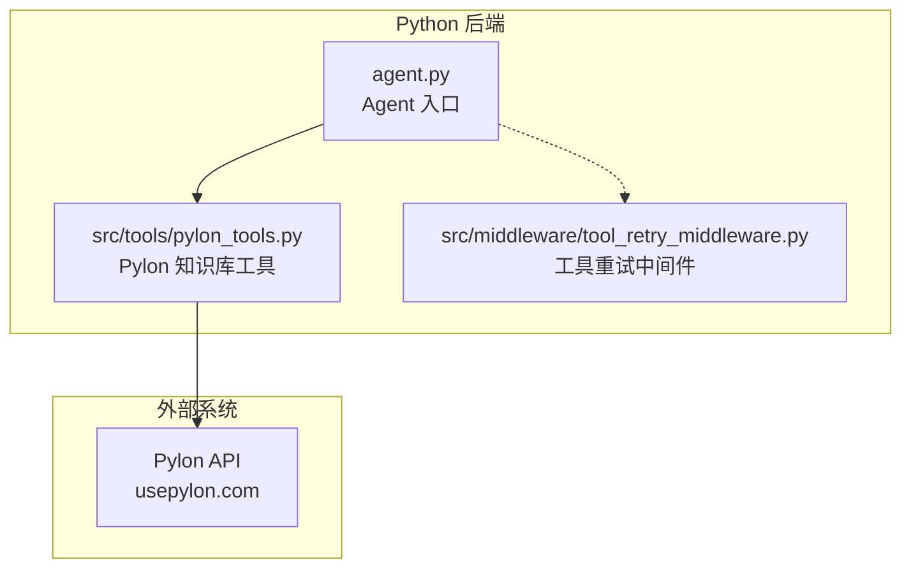
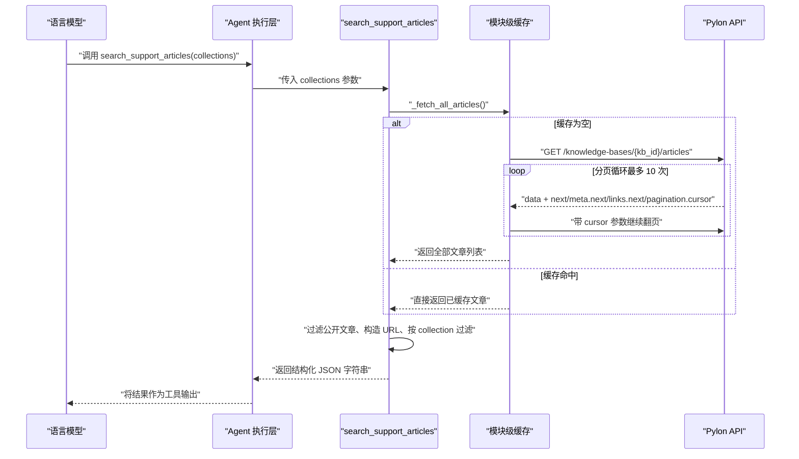
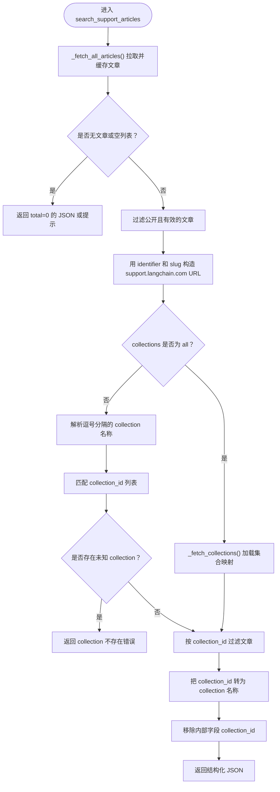
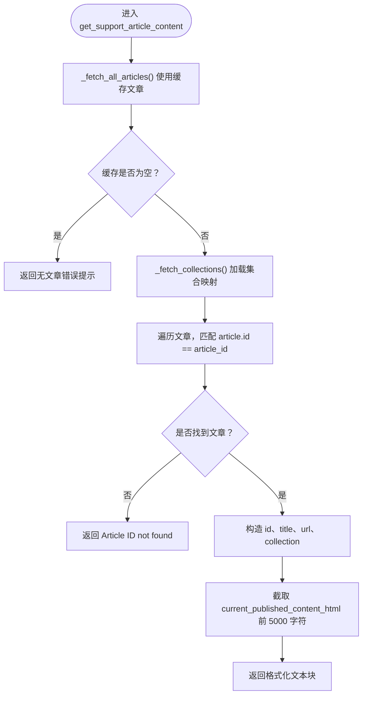
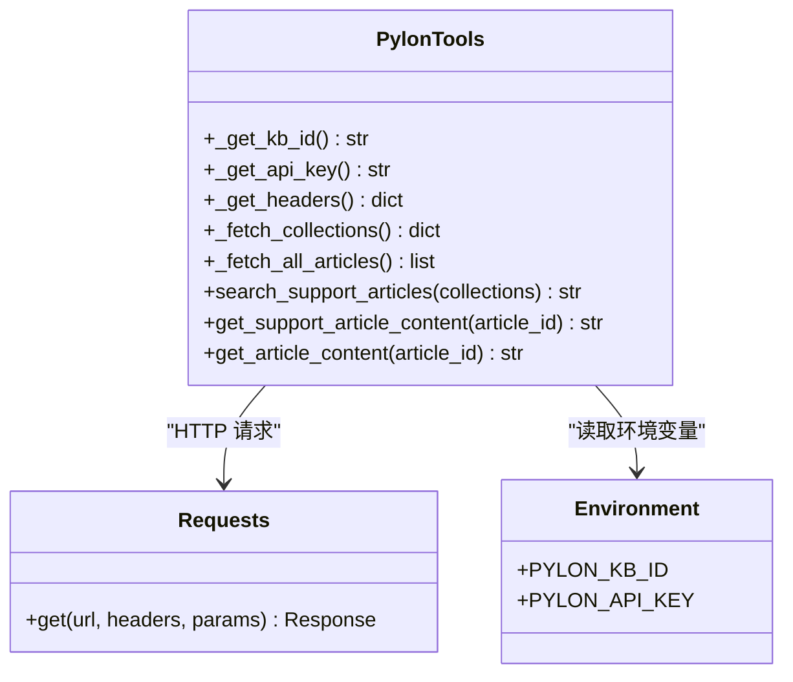

# 02b-Pylon 知识库工具

<cite>
**本文引用的文件**   
- [src/tools/pylon_tools.py](file://src/tools/pylon_tools.py)
- [tests/unit/test_pylon_pagination.py](file://tests/unit/test_pylon_pagination.py)
</cite>

## 目录
1. [引言](#引言)
2. [项目结构定位](#项目结构定位)
3. [核心组件总览](#核心组件总览)
4. [架构与数据流](#架构与数据流)
5. [search_support_articles 实现分析](#search_support_articles-实现分析)
6. [get_support_article_content 实现分析](#get_support_article_content-实现分析)
7. [依赖关系分析](#依赖关系分析)
8. [性能与缓存特性](#性能与缓存特性)
9. [故障排查指南](#故障排查指南)
10. [结论](#结论)

## 引言
本文件聚焦 `src/tools/pylon_tools.py` 中两个 LangChain Tool：  
- `search_support_articles`：从 Pylon 知识库拉取文章，并按 collection 过滤、分页聚合后返回结构化结果。  
- `get_support_article_content`：根据 `id` 字段获取指定文章的完整内容，不接收 URL。

这两个工具共同构成 Agent 检索官方 Support 知识库的核心路径：先搜索标题列表，再按 ID 拉取正文。

## 项目结构定位
`pylon_tools.py` 位于 `src/tools/` 下，属于 Python 后端工具层，通过 `langchain.tools.tool` 装饰器暴露为模型可调用的工具函数。测试用例位于 `tests/unit/test_pylon_pagination.py`，专门验证 `_fetch_all_articles()` 的分页逻辑。



**图表来源**  
- [src/tools/pylon_tools.py:1-363](file://src/tools/pylon_tools.py#L1-L363)  
- [tests/unit/test_pylon_pagination.py:1-193](file://tests/unit/test_pylon_pagination.py#L1-L193)

**章节来源**  
- [src/tools/pylon_tools.py:1-363](file://src/tools/pylon_tools.py#L1-L363)

## 核心组件总览
`pylon_tools.py` 的核心由三类对象组成：

| 类别 | 名称 | 职责 | 关键行为 |
|---|---|---|---|
| 配置读取 | `_get_kb_id()` | 读取 `PYLON_KB_ID` | 未配置时抛出 `ValueError` |
| 配置读取 | `_get_api_key()` | 读取 `PYLON_API_KEY` | 未配置时抛出 `ValueError` |
| HTTP 辅助 | `_get_headers()` | 构造 Authorization 请求头 | 使用 Bearer Token |
| 集合缓存 | `_fetch_collections()` | 拉取公开 collection 并缓存 | 仅保留 `visibility == public` |
| 文章缓存 | `_fetch_all_articles()` | 分页拉取所有文章并缓存 | 兼容多种分页字段，最多 10 页 |
| 工具函数 | `search_support_articles()` | 搜索支持文章标题 | 按 collection 过滤，返回 JSON |
| 工具函数 | `get_support_article_content()` | 按 ID 获取文章内容 | 只接受 `id`，不接收 URL |
| 别名 | `get_article_content` | 向后兼容导入名 | 指向 `get_support_article_content` |

**章节来源**  
- [src/tools/pylon_tools.py:22-35](file://src/tools/pylon_tools.py#L22-L35)  
- [src/tools/pylon_tools.py:46-122](file://src/tools/pylon_tools.py#L46-L122)  
- [src/tools/pylon_tools.py:130-362](file://src/tools/pylon_tools.py#L130-L362)

## 架构与数据流
整体调用链如下：



**图表来源**  
- [src/tools/pylon_tools.py:79-122](file://src/tools/pylon_tools.py#L79-L122)  
- [src/tools/pylon_tools.py:130-286](file://src/tools/pylon_tools.py#L130-L286)

## search_support_articles 实现分析

### 设计目标
该工具的目标不是直接把全文塞给模型，而是返回“可被模型二次选择”的结构化摘要：每个条目包含 `id`、`title`、`url`、`collection`，并附带 `total` 和 `collections` 元信息。这样模型可以决定是否需要进一步调用 `get_support_article_content`。

### 输入参数
- `collections`：默认值为 `"all"`。
- 支持逗号分隔的多个 collection 名称。
- 文档字符串中列举了可用 collection 名称，例如 General、OSS、LangSmith Observability、LangSmith Evaluation、LangSmith Deployment、SDKs and APIs、LangSmith Studio、Self Hosted、Troubleshooting、Security。

### 处理流程


**图表来源**  
- [src/tools/pylon_tools.py:130-286](file://src/tools/pylon_tools.py#L130-L286)

### Collection 过滤逻辑
1. 如果 `collections.lower() != "all"`，则按逗号拆分请求的 collection 名称。
2. 先在精确匹配的 `_collections_cache` 中查找 collection ID。
3. 如果找不到，再进行大小写不敏感匹配。
4. 如果某个 collection 名称完全无法匹配，直接返回错误 JSON，列出可用 collection。
5. 最终按 `article.collection_id` 是否在请求的 collection ID 列表中过滤文章。

需要注意：collection 名称匹配发生在“文章已经过滤为公开文章之后”，因此即使 Pylon 返回非公开文章，也不会影响 collection 名称解析；但非公开文章不会出现在最终结果中。

### 分页机制
分页逻辑集中在 `_fetch_all_articles()`，其关键规则如下：

| 项目 | 行为 |
|---|---|
| 分页起始 | 首次请求不带 `cursor` |
| 下一页来源 | 优先 `body.next`，其次 `body.meta.next`，再次 `body.links.next`，最后 `body.pagination.cursor` |
| 下一页参数 | 将 `next_cursor` 放入 `params["cursor"]` |
| 终止条件 | 没有 `next_cursor` 或达到最大页数 |
| 安全上限 | 最多拉取 10 页 |
| 缓存策略 | 第一次成功后写入模块级 `_articles_cache`，后续调用直接返回 |

测试用例覆盖了以下场景：
- 单页无 `next`。
- 两页合并。
- 三页合并。
- `meta.next` 分页形状。
- 超过 10 页时强制停止。
- 第二次调用走缓存，不再发起网络请求。
- 空 `data` 列表返回空列表。

**章节来源**  
- [src/tools/pylon_tools.py:79-122](file://src/tools/pylon_tools.py#L79-L122)  
- [src/tools/pylon_tools.py:130-286](file://src/tools/pylon_tools.py#L130-L286)  
- [tests/unit/test_pylon_pagination.py:48-193](file://tests/unit/test_pylon_pagination.py#L48-L193)

### 返回值结构
成功时返回 JSON 字符串，典型字段包括：

| 字段 | 含义 |
|---|---|
| `collections` | 原始传入的 collection 过滤条件 |
| `total` | 过滤后的文章数量 |
| `articles` | 文章列表，每项含 `id`、`title`、`url`、`collection` |
| `note` | 说明性文本，提示使用 `id` 获取全文 |

失败时可能返回：
- 无文章时的空结果 JSON。
- collection 不存在时的错误 JSON。
- 配置缺失或网络异常时的错误 JSON。

**章节来源**  
- [src/tools/pylon_tools.py:130-286](file://src/tools/pylon_tools.py#L130-L286)

## get_support_article_content 实现分析

### 设计目标
该工具用于根据 `search_support_articles` 返回的 `id` 获取文章完整 HTML 内容。它明确不接受 `docs.langchain.com` 或 `support.langchain.com` 的 URL，也不接受 slug、identifier 等路径片段。

### 输入参数
- `article_id`：必须是 `search_support_articles` 返回的文章 `id`。

### 处理流程


**图表来源**  
- [src/tools/pylon_tools.py:289-357](file://src/tools/pylon_tools.py#L289-L357)

### 为什么必须用 `id` 而不是 URL
代码中的查找逻辑是：

```python
for article in articles:
    if article.get("id") == article_id:
```

也就是说，它比较的是 Pylon 文章对象的 `id` 字段，而不是 URL、slug 或 identifier。若传入 URL，几乎必然匹配不到，从而返回 `Article ID {article_id} not found in knowledge base.`。

此外，URL 本身是由 `identifier` 和 `slug` 拼接而成：

```python
support_url = f"https://support.langchain.com/articles/{identifier}-{slug}"
```

这说明 URL 是“展示用途”，而 `id` 才是“查询用途”。

### 返回格式
成功时返回一段纯文本，包含：

- `ID`
- `Title`
- `URL`
- `Collection`
- `Content`

其中 `Content` 来自 `current_published_content_html`，并被截断到最多 5000 个字符。

**章节来源**  
- [src/tools/pylon_tools.py:289-357](file://src/tools/pylon_tools.py#L289-L357)

## 依赖关系分析



**图表来源**  
- [src/tools/pylon_tools.py:1-363](file://src/tools/pylon_tools.py#L1-L363)

### 耦合点
- 与 Pylon API 的耦合集中在 `_get_headers()`、`_fetch_collections()`、`_fetch_all_articles()`。
- 与 LangChain 的耦合通过 `@tool` 装饰器暴露工具签名。
- 与 Agent 的耦合不在本文件中，通常由 `agent.py` 或其他入口组装工具列表。
- 与重试机制的耦合通过上层中间件（如 `tool_retry_middleware.py`）处理工具调用失败。

**章节来源**  
- [src/tools/pylon_tools.py:1-363](file://src/tools/pylon_tools.py#L1-L363)

## 性能与缓存特性

### 模块级缓存
- `_articles_cache`：缓存所有文章列表。
- `_collections_cache`：缓存公开 collection 名称到 ID 的映射。

这意味着同一进程内多次调用 `search_support_articles` 或 `get_support_article_content` 不会重复拉取 Pylon 文章列表。

### 分页安全上限
`_fetch_all_articles()` 最多拉取 10 页。测试中验证了当 API 持续返回 `next` 时，循环会在第 10 页停止，避免无限分页。

### 单次请求成本
- `search_support_articles` 至少触发一次文章列表请求，必要时追加 collection 请求。
- `get_support_article_content` 复用已缓存的文章列表，通常不再额外拉取文章列表。
- 如果缓存尚未初始化，`get_support_article_content` 也会触发 `_fetch_all_articles()`。

### 潜在优化方向
- 当前 `_fetch_all_articles()` 会拉取所有文章，包括 `current_published_content_html`，这可能比只拉标题更重。如果未来只需要标题列表，可考虑新增轻量接口。
- collection 名称解析在每次 `search_support_articles` 调用时都会尝试加载，可考虑在 collection 不变时跳过重复解析。
- 文章内容的 5000 字符截断适合控制上下文长度，但如果需要更长内容，应评估模型 token 限制。

**章节来源**  
- [src/tools/pylon_tools.py:42-122](file://src/tools/pylon_tools.py#L42-L122)  
- [src/tools/pylon_tools.py:130-357](file://src/tools/pylon_tools.py#L130-L357)  
- [tests/unit/test_pylon_pagination.py:136-172](file://tests/unit/test_pylon_pagination.py#L136-L172)

## 故障排查指南

### 常见错误及原因

| 现象 | 可能原因 | 处理方式 |
|---|---|---|
| 报错 `PYLON_KB_ID not configured in .env` | 未设置知识库 ID | 检查 `.env` 中是否配置 `PYLON_KB_ID` |
| 报错 `PYLON_API_KEY not configured in .env` | 未设置 API Key | 检查 `.env` 中是否配置 `PYLON_API_KEY` |
| `search_support_articles` 返回 collection 不存在错误 | 传入的 collection 名称与 Pylon 公开集合不一致 | 使用工具 docstring 中列出的名称，或先查可用 collection |
| `get_support_article_content` 返回 `Article ID not found` | 传入了 URL、slug、identifier 而非 `id` | 改用 `search_support_articles` 返回的 `id` |
| 搜索结果全为空 | 文章未发布、非公开、标题无效或缺少 identifier/slug | 检查 Pylon 后台文章状态和 visibility |
| 分页结果不完整 | 文章总数超过 10 页上限 | 这是当前实现的安全限制，需结合业务判断是否足够 |
| 多次调用仍频繁请求 Pylon | 进程内缓存未生效或模块被重新加载 | 确认工具在同一进程内复用，避免频繁 reload |

### 调试建议
1. 先调用 `search_support_articles("all")`，确认能拿到文章列表。
2. 从返回结果中复制 `id`，再调用 `get_support_article_content`。
3. 如果 collection 过滤结果为空，先缩小范围，例如只查一个已知存在的 collection。
4. 如果怀疑分页问题，可参考 `tests/unit/test_pylon_pagination.py` 中的 mock 方式验证分页行为。

**章节来源**  
- [src/tools/pylon_tools.py:22-35](file://src/tools/pylon_tools.py#L22-L35)  
- [src/tools/pylon_tools.py:130-357](file://src/tools/pylon_tools.py#L130-L357)  
- [tests/unit/test_pylon_pagination.py:1-193](file://tests/unit/test_pylon_pagination.py#L1-L193)

## 结论
`pylon_tools.py` 的两个工具形成了清晰的“先搜后取”模式：  
- `search_support_articles` 负责聚合 Pylon 文章、过滤公开内容、按 collection 筛选，并返回供模型决策的结构化列表。  
- `get_support_article_content` 负责按 `id` 拉取具体文章正文，强调必须使用 `id` 而非 URL。

分页逻辑通过 `_fetch_all_articles()` 统一实现，兼容多种分页字段并带有 10 页安全上限；模块级缓存减少了重复网络请求。对于使用者而言，最关键的使用约束是：**搜索用 collection 名称，取内容用 `id`**。