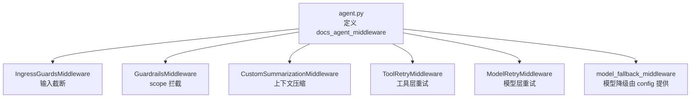
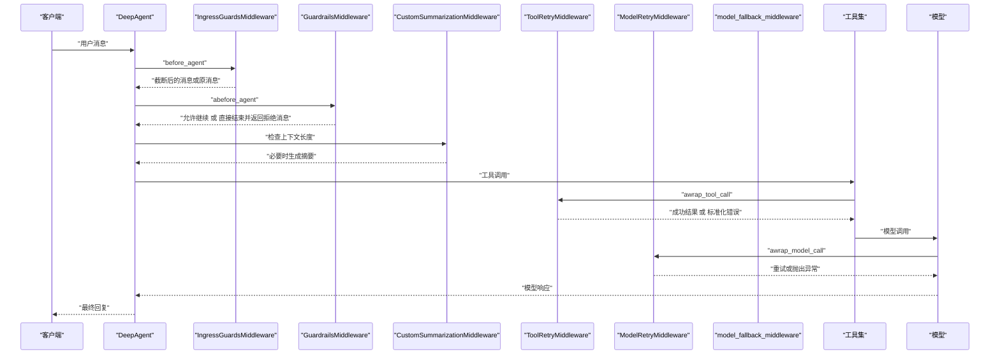
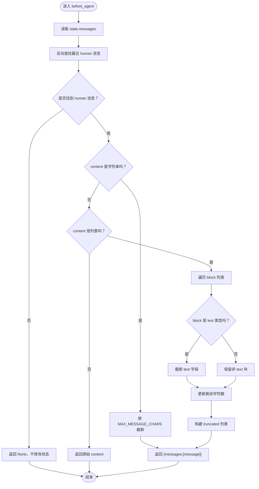
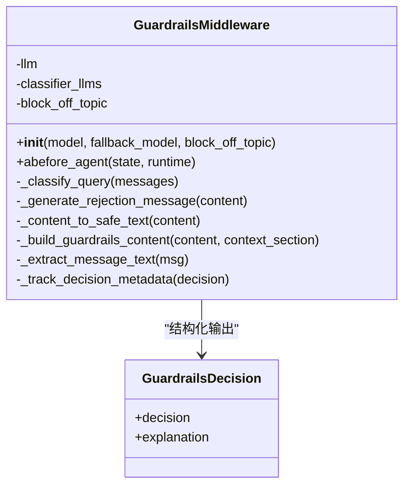
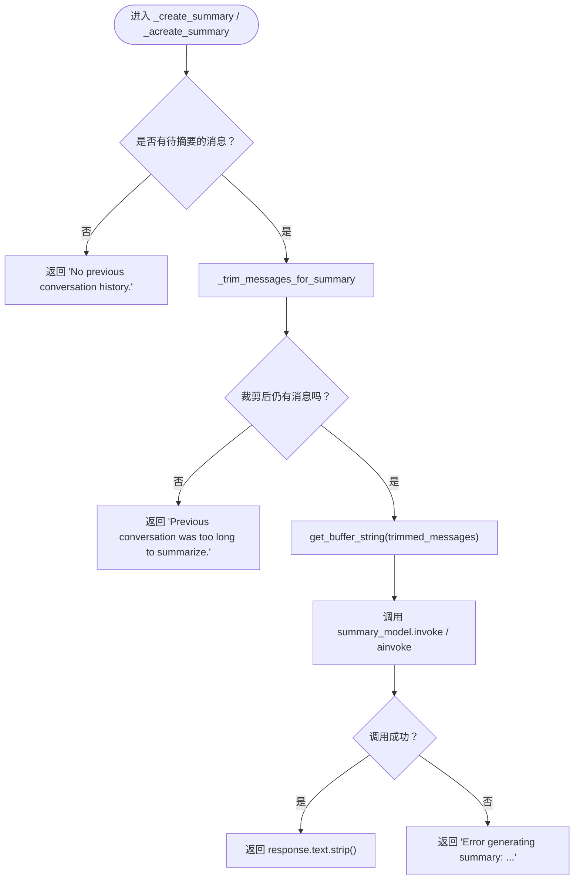
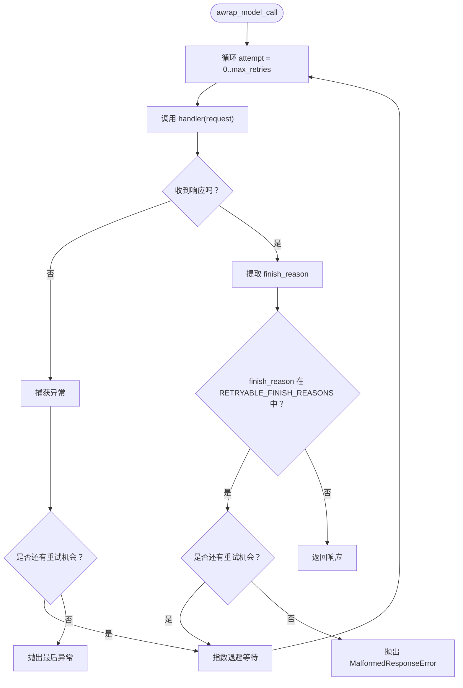
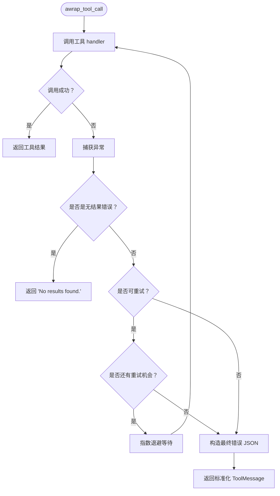
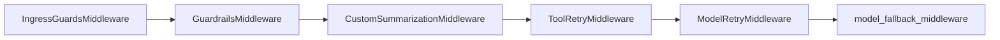

# 03-中间件系统

<cite>
**本文引用的文件**   
- [agent.py](file://agent.py)
- [src/middleware/__init__.py](file://src/middleware/__init__.py)
- [src/middleware/ingress_guards_middleware.py](file://src/middleware/ingress_guards_middleware.py)
- [src/middleware/guardrails_middleware.py](file://src/middleware/guardrails_middleware.py)
- [src/middleware/summarization_middleware.py](file://src/middleware/summarization_middleware.py)
- [src/middleware/retry_middleware.py](file://src/middleware/retry_middleware.py)
- [src/middleware/tool_retry_middleware.py](file://src/middleware/tool_retry_middleware.py)
</cite>

## 目录
1. [引言](#引言)
2. [项目结构与中间件定位](#项目结构与中间件定位)
3. [核心组件总览](#核心组件总览)
4. [架构与请求链路](#架构与请求链路)
5. [详细组件分析](#详细组件分析)
6. [依赖关系分析](#依赖关系分析)
7. [性能与稳定性特征](#性能与稳定性特征)
8. [故障排查指南](#故障排查指南)
9. [结论](#结论)

## 引言
本篇文档聚焦 Agent 工程化中的中间件层，逐一剖析 `src/middleware/` 下的五个关键中间件：输入截断、安全范围拦截、上下文压缩、模型层重试和工具层重试。同时说明 `agent.py` 中中间件的注册顺序如何影响一次用户请求从进入 Agent 到最终返回的完整生命周期。

本仓库是基于 DeepAgents 框架的 LangChain 官方文档客服 Agent，后端使用 LangGraph + MCP + FastAPI，对外暴露能检索官方文档与 Support KB、回答 LangChain 生态技术问题的客服能力。中间件层负责在“用户输入 → 安全判断 → 上下文管理 → 工具调用 → 模型调用”这条链路上做兜底、降级与可观测性增强。

## 项目结构与中间件定位
中间件相关代码集中在 `src/middleware/` 下，并通过 `src/middleware/__init__.py` 统一导出四个核心类；`agent.py` 在应用入口组装这些中间件，形成最终的 Agent 执行管线。

**图表来源**
- [agent.py:31-51](file://agent.py#L31-L51)

**章节来源**
- [agent.py:1-66](file://agent.py#L1-L66)
- [src/middleware/__init__.py:1-14](file://src/middleware/__init__.py#L1-L14)

## 核心组件总览
| 中间件 | 主要职责 | 关键参数或行为 | 触发阶段 |
|---|---|---|---|
| `IngressGuardsMiddleware` | 超长用户输入截断，防止 token 溢出 | `MAX_MESSAGE_CHARS=50_000`，支持纯文本与多模态块 | Agent 入口前 |
| `GuardrailsMiddleware` | 基于 scope 的分类拦截：off-topic、NSFW、提示词泄露、恶意用途等 | 使用 `GUARDRAILS_MODEL` 作为主分类器，`DEFAULT_MODEL` 作为回退；结构化输出 `ALLOWED/BLOCKED` | Agent 入口前 |
| `CustomSummarizationMiddleware` | 上下文过长时触发压缩，保留历史摘要 | 触发阈值 `130k tokens`，保留 `30k tokens`，使用 `context_summary_prompt`，`trim_tokens_to_summarize=None` | 对话缓冲增长时 |
| `ToolRetryMiddleware` | 工具调用失败时的重试与错误归一化 | `max_attempts=3`，指数退避，识别临时网络/网关错误 | 工具执行前后 |
| `ModelRetryMiddleware` | 模型调用失败或可重试 finish reason 的重试 | `RETRYABLE_FINISH_REASONS={"MALFORMED_FUNCTION_CALL"}`，指数退避 | 模型调用前后 |

**章节来源**
- [src/middleware/ingress_guards_middleware.py:22-75](file://src/middleware/ingress_guards_middleware.py#L22-L75)
- [src/middleware/guardrails_middleware.py:53-133](file://src/middleware/guardrails_middleware.py#L53-L133)
- [src/middleware/summarization_middleware.py:11-57](file://src/middleware/summarization_middleware.py#L11-L57)
- [src/middleware/tool_retry_middleware.py:36-48](file://src/middleware/tool_retry_middleware.py#L36-L48)
- [src/middleware/retry_middleware.py:15-37](file://src/middleware/retry_middleware.py#L15-L37)

## 架构与请求链路
`agent.py` 通过 `define_deep_agent` 将模型、工具与中间件装配为最终 Agent。中间件列表的顺序决定了请求处理的先后顺序。

**图表来源**
- [agent.py:31-65](file://agent.py#L31-L65)
- [src/middleware/ingress_guards_middleware.py:29-42](file://src/middleware/ingress_guards_middleware.py#L29-L42)
- [src/middleware/guardrails_middleware.py:187-258](file://src/middleware/guardrails_middleware.py#L187-L258)
- [src/middleware/summarization_middleware.py:19-57](file://src/middleware/summarization_middleware.py#L19-L57)
- [src/middleware/tool_retry_middleware.py:122-172](file://src/middleware/tool_retry_middleware.py#L122-L172)
- [src/middleware/retry_middleware.py:44-94](file://src/middleware/retry_middleware.py#L44-L94)

**章节来源**
- [agent.py:31-65](file://agent.py#L31-L65)

## 详细组件分析

### IngressGuardsMiddleware：超长输入截断
该中间件在 Agent 入口处对最新一条人类消息进行长度限制，避免后续模型或工具处理时被超长输入撑爆上下文。它兼容两种常见内容形态：
- 纯字符串消息：直接按字符上限截断。
- 多模态列表消息：逐块处理，仅对文本块做截断，其他类型块原样保留。

其核心逻辑是反向遍历消息列表，找到最近的人类消息后执行截断，并通过返回新的消息列表让 LangGraph reducer 覆盖原消息。

**图表来源**
- [src/middleware/ingress_guards_middleware.py:29-72](file://src/middleware/ingress_guards_middleware.py#L29-L72)

关键点：
- 常量 `MAX_MESSAGE_CHARS=50_000` 用于控制最大输入长度。
- 截断发生在 Agent 最前端，能有效降低后续所有中间件和模型的 token 压力。
- 如果未找到人类消息，则不做任何修改，保证正常对话流程不受影响。

**章节来源**
- [src/middleware/ingress_guards_middleware.py:1-76](file://src/middleware/ingress_guards_middleware.py#L1-L76)

### GuardrailsMiddleware：scope 拦截与分类决策
Guardrails 中间件负责判断当前用户请求是否属于 LangChain 文档客服的范围，并对明显越界或危险请求进行拦截。它使用一个主分类模型和一个可选的回退模型，以结构化输出形式返回 `ALLOWED` 或 `BLOCKED`。

主要行为包括：
- 从最近的人类消息中提取文本或多模态内容，并转换为安全文本。
- 构造包含上下文历史的 prompt，调用结构化模型进行分类。
- 对分类失败进行有限次重试，并在所有模型都失败后抛出分类异常。
- 若结果为 `BLOCKED`，可选择生成友好拒绝消息并直接跳转到 Agent 结束。
- 将决策结果写入 LangSmith 运行元数据，并按采样策略写入评估数据集。

**图表来源**
- [src/middleware/guardrails_middleware.py:53-133](file://src/middleware/guardrails_middleware.py#L53-L133)
- [src/middleware/guardrails_middleware.py:370-469](file://src/middleware/guardrails_middleware.py#L370-L469)

关键实现要点：
- 初始化时根据传入的 `model` 和 `fallback_model` 构建分类模型链。
- `abefore_agent` 中使用 `hook_config(can_jump_to=["end"])` 支持直接跳过后续 Agent 节点。
- `_classify_query` 会提取最近的人类消息，并拼接最多三条历史问题作为上下文。
- 分类过程支持超时、重试和模型回退，最终失败时抛出 `GuardrailsClassificationError`。
- 被拦截的请求可通过 `_generate_rejection_message` 生成友好拒绝消息，而不是直接报错。

注意：Prompt 的具体内容不在本篇展开，详见「04-Prompt 工程」。

**章节来源**
- [src/middleware/guardrails_middleware.py:1-483](file://src/middleware/guardrails_middleware.py#L1-L483)

### CustomSummarizationMiddleware：上下文压缩
该中间件继承自 LangChain 的 `SummarizationMiddleware`，并通过注入自定义 `summary_model` 来生成对话摘要。当上下文超过配置阈值时，它会裁剪历史消息并调用摘要模型生成一段紧凑的历史摘要，从而控制整体上下文大小。

在 `agent.py` 中，该中间件配置为：
- 触发条件：`trigger=("tokens", 130_000)`
- 保留长度：`keep=("tokens", 30_000)`
- 摘要 Prompt：`context_summary_prompt`
- 摘要裁剪参数：`trim_tokens_to_summarize=None`

**图表来源**
- [src/middleware/summarization_middleware.py:19-57](file://src/middleware/summarization_middleware.py#L19-L57)

关键点：
- 同步和异步两个摘要方法逻辑一致，分别对应 `invoke` 与 `ainvoke`。
- 摘要失败不会中断整个 Agent 流程，而是返回带错误信息的字符串。
- 实际触发阈值、保留长度和 Prompt 由 `agent.py` 中的 `CustomSummarizationMiddleware` 实例决定。

**章节来源**
- [src/middleware/summarization_middleware.py:1-61](file://src/middleware/summarization_middleware.py#L1-L61)
- [agent.py:40-47](file://agent.py#L40-L47)

### ModelRetryMiddleware：模型层重试
该中间件包装模型调用，对异常和特定 finish reason 进行重试。默认只把 `MALFORMED_FUNCTION_CALL` 视为可重试的 finish reason，适用于某些模型返回了无效工具调用语法但并未抛异常的场景。

重试策略：
- 最多重试次数由 `max_retries` 控制。
- 使用指数退避：`initial_delay * (backoff_factor ** attempt)`。
- 如果所有重试都用完仍返回可重试 finish reason，则抛出 `MalformedResponseError`。
- 如果所有重试都因异常失败，则抛出最后一次异常，供上层 fallback 中间件处理。

**图表来源**
- [src/middleware/retry_middleware.py:44-94](file://src/middleware/retry_middleware.py#L44-L94)

**章节来源**
- [src/middleware/retry_middleware.py:1-98](file://src/middleware/retry_middleware.py#L1-L98)

### ToolRetryMiddleware：工具层重试
该中间件在工具调用失败时进行重试，并将部分错误归一化为模型可读的工具消息。它特别关注两类情况：
- “无结果”错误：例如搜索工具返回空结果，不应被视为失败，而应作为正常工具输出返回。
- 临时性错误：如 429、500、502、503、504 以及包含超时、网关错误等关键字的错误信息。

重试策略：
- `max_attempts=3`，指数退避。
- 如果是“无结果”，直接返回标准化的 `ToolMessage`。
- 如果是可重试错误且未达到最大尝试次数，则等待并重试。
- 最终失败时返回包含错误详情的 JSON 工具消息，帮助模型理解工具不可用并给出建议。

**图表来源**
- [src/middleware/tool_retry_middleware.py:122-172](file://src/middleware/tool_retry_middleware.py#L122-L172)

**章节来源**
- [src/middleware/tool_retry_middleware.py:1-176](file://src/middleware/tool_retry_middleware.py#L1-L176)

## 依赖关系分析
中间件之间的耦合较弱，主要通过 LangChain/LangGraph 的中间件接口协作：
- `IngressGuardsMiddleware` 和 `GuardrailsMiddleware` 作用于 Agent 入口，修改 `AgentState`。
- `CustomSummarizationMiddleware` 依赖外部注入的 `summary_model`。
- `ToolRetryMiddleware` 包装工具调用，不影响模型调用路径。
- `ModelRetryMiddleware` 包装模型调用，不影响工具调用路径。
- `model_fallback_middleware` 由 `src/agent/config.py` 提供，位于重试链之后，负责最终降级。

**图表来源**
- [agent.py:31-51](file://agent.py#L31-L51)

**章节来源**
- [agent.py:31-51](file://agent.py#L31-L51)

## 性能与稳定性特征
- 输入截断优先于所有安全判断，能显著降低后续模型和工具的 token 消耗。
- Guardrails 分类使用结构化输出和超时控制，避免长时间阻塞；失败时回退到默认模型，再失败则放行查询，保证可用性。
- 上下文压缩在 130k token 触发，保留 30k token，适合长对话场景，但摘要模型本身也会产生额外延迟。
- 工具层重试针对高频临时错误，减少一次性失败对用户体验的影响。
- 模型层重试针对 finish reason 和异常，配合指数退避提升鲁棒性。

[本节为通用性能讨论，不直接分析具体代码文件]

## 故障排查指南
- 如果用户输入被截断：检查 `MAX_MESSAGE_CHARS` 和输入是否包含大量文本或多模态块。
- 如果查询被误拦截：确认 Guardrails 分类模型是否可用，检查 `GUARDRAILS_MODEL` 和回退模型配置，查看 LangSmith 元数据中的 `guardrails_result` 和 `guardrails_explanation`。
- 如果摘要生成失败：检查 `summary_model` 是否可调用，确认 `context_summary_prompt` 是否正常格式化。
- 如果工具频繁失败：查看 `ToolRetryMiddleware` 日志，确认是否为“无结果”或临时网络错误；检查工具实现是否返回稳定错误信息。
- 如果模型调用反复失败：检查 `RETRYABLE_FINISH_REASONS` 是否覆盖当前模型返回的 finish reason，确认 `ModelRetryMiddleware` 的重试次数和退避策略。

**章节来源**
- [src/middleware/ingress_guards_middleware.py:22-75](file://src/middleware/ingress_guards_middleware.py#L22-L75)
- [src/middleware/guardrails_middleware.py:471-479](file://src/middleware/guardrails_middleware.py#L471-L479)
- [src/middleware/summarization_middleware.py:30-37](file://src/middleware/summarization_middleware.py#L30-L37)
- [src/middleware/tool_retry_middleware.py:81-91](file://src/middleware/tool_retry_middleware.py#L81-L91)
- [src/middleware/retry_middleware.py:15-18](file://src/middleware/retry_middleware.py#L15-L18)

## 结论
`src/middleware/` 下的五个中间件构成了 Chat LangChain Agent 的工程化骨架：先截断输入，再做安全范围判断，随后管理上下文长度，最后在工具和模型层提供重试与降级能力。`agent.py` 中的注册顺序决定了请求链路的安全性与稳定性优先级，使 Agent 在面对超长输入、越界请求、长对话、工具不稳定和模型异常时仍能保持可控、可观测和可恢复。

[本节为总结性内容，不直接分析具体代码文件]