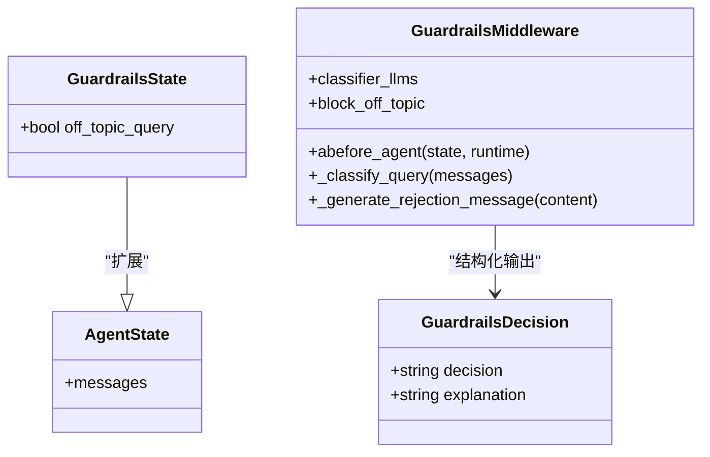
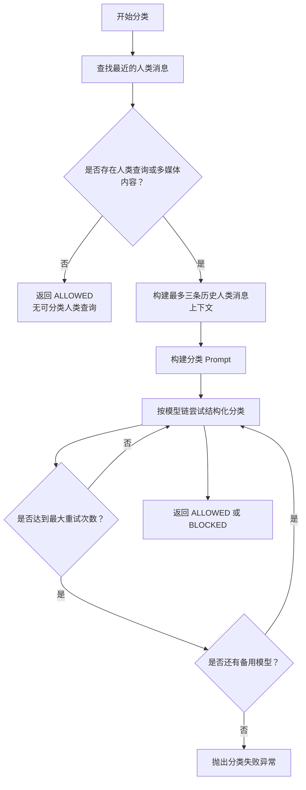
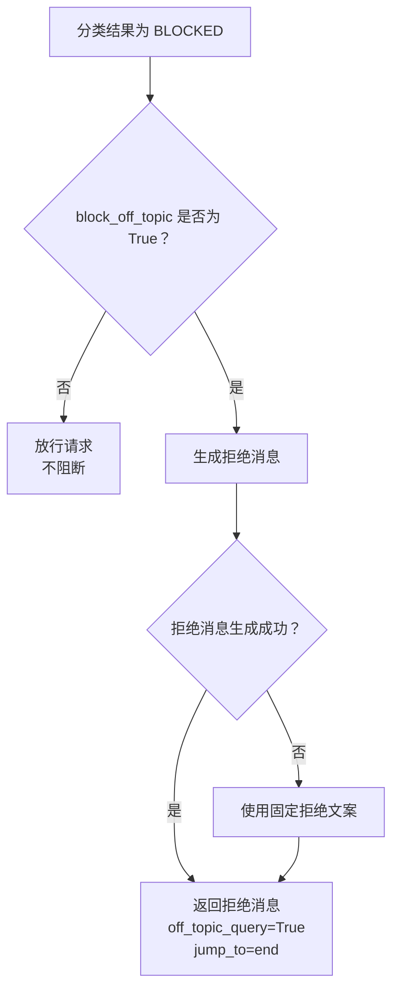
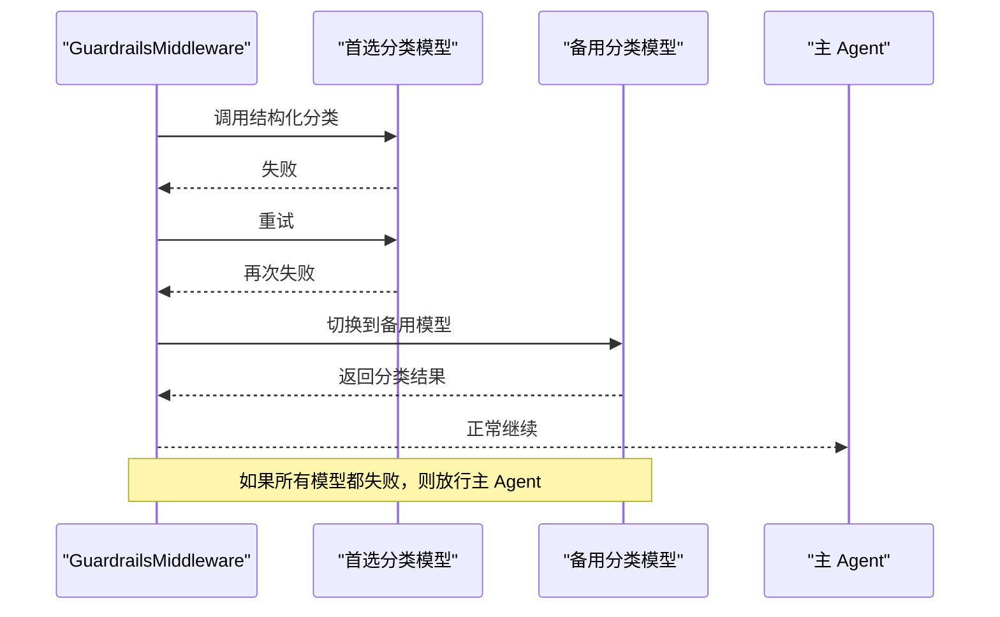
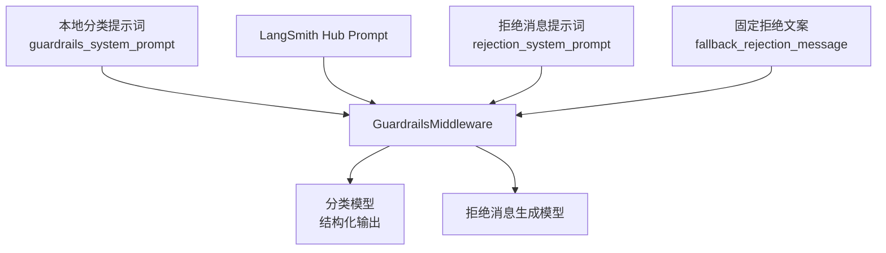
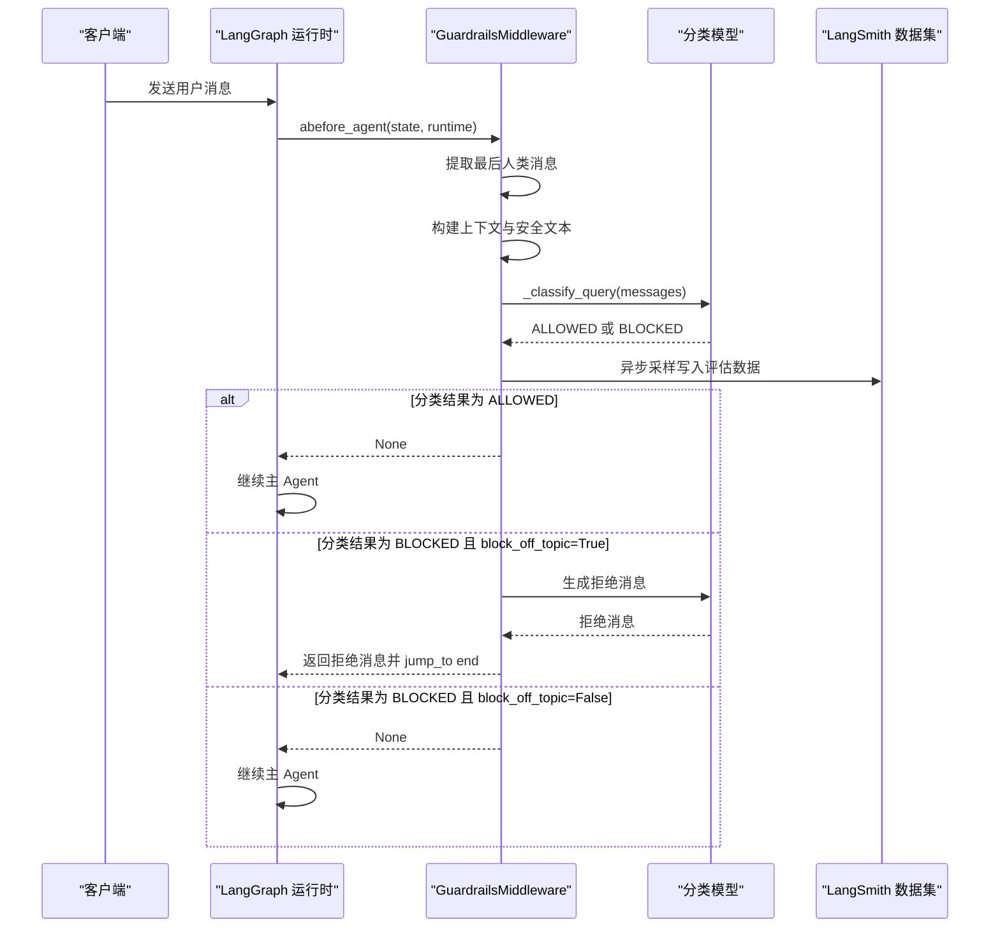
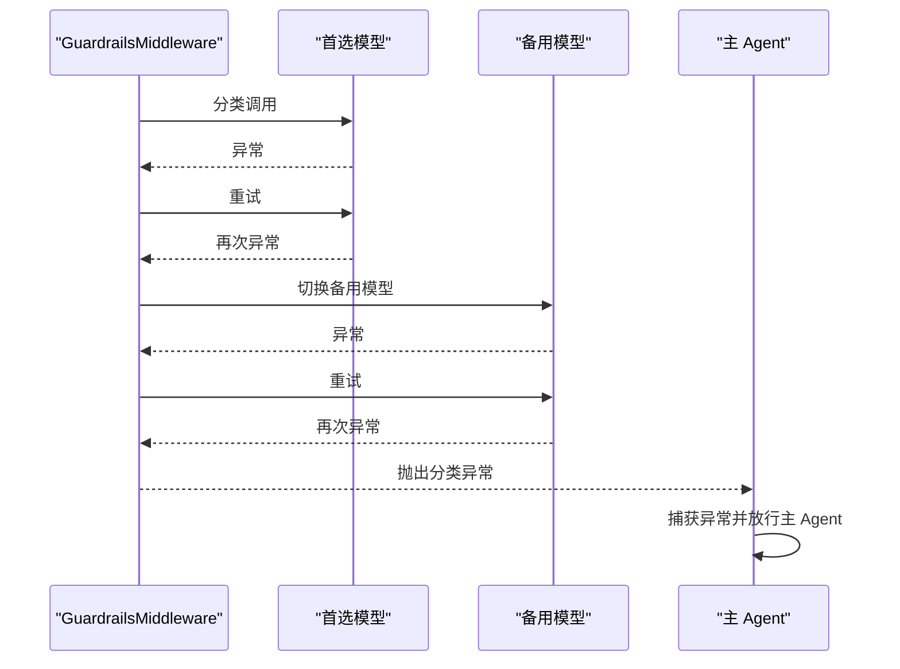

# 03a-护栏中间件（Guardrails）

<cite>
**本文引用的文件**   
- [guardrails_middleware.py](file://src/middleware/guardrails_middleware.py)
- [guardrails_prompts.py](file://src/prompts/guardrails_prompts.py)
- [test_guardrails_fallback.py](file://tests/unit/test_guardrails_fallback.py)
- [test_guardrails_scope.py](file://tests/evals/test_guardrails_scope.py)
</cite>

## 目录
1. [设计动机与定位](#设计动机与定位)
2. [核心数据结构与状态](#核心数据结构与状态)
3. [分类判断逻辑](#分类判断逻辑)
4. [block_off_topic 开关行为](#block_off_topic-开关行为)
5. [fallback_model 降级路径](#fallback_model-降级路径)
6. [与 guardrails_prompts 的配合方式](#与-guardrails_prompts-的配合方式)
7. [关键调用序列](#关键调用序列)
8. [测试与评估契约](#测试与评估契约)
9. [故障排查与性能注意事项](#故障排查与性能注意事项)
10. [总结](#总结)

## 设计动机与定位

`GuardrailsMiddleware` 是一个“宽松型”护栏中间件，职责不是做全面内容审核，而是拦截“明显滥用或完全无关”的请求。它的设计原则是：

- **默认放行**：只要存在技术、开发、AI、Agent、LangChain 生态等合理可能性，就允许进入主 Agent。
- **零容忍规则优先**：色情暴力、虚构创作、有害用途、提示词提取、社会压力绕过等直接阻断。
- **上下文感知**：支持多轮对话中的后续问题，避免把“继续写代码”“用 Python 实现”误判为离题。
- **可配置降级**：分类模型失败时，先重试，再切换到 `fallback_model`，最后才抛出分类异常。
- **可观察性**：将分类结果写入 LangSmith 运行元数据，并采样写入评估数据集。

该中间件通过 LangGraph 的 `AgentMiddleware` 接入，在 Agent 真正执行前对当前用户消息做一次轻量分类。

**章节来源**
- [guardrails_middleware.py:1-2](file://src/middleware/guardrails_middleware.py#L1-L2)
- [guardrails_middleware.py:100-133](file://src/middleware/guardrails_middleware.py#L100-L133)

## 核心数据结构与状态

### GuardrailsDecision

用于结构化接收分类模型的输出：

| 字段 | 类型 | 含义 |
|---|---|---|
| `decision` | `"ALLOWED"` 或 `"BLOCKED"` | 是否允许进入主 Agent |
| `explanation` | 字符串 | 简要解释分类原因 |

这个结构由 `llm.with_structured_output(GuardrailsDecision)` 驱动，要求下游模型返回符合该字段的 JSON 结构。

### GuardrailsState

继承自 `AgentState`，新增可选字段：

| 字段 | 类型 | 是否必需 | 含义 |
|---|---|---|---|
| `off_topic_query` | `bool` | 否 | 标记本次请求被判定为离题 |

当中间件决定拒绝离题请求时，会向状态中写入 `off_topic_query=True`，并配合 `jump_to="end"` 提前结束本轮 Agent 流程。



**图表来源**
- [guardrails_middleware.py:53-69](file://src/middleware/guardrails_middleware.py#L53-L69)
- [guardrails_middleware.py:100-133](file://src/middleware/guardrails_middleware.py#L100-L133)

**章节来源**
- [guardrails_middleware.py:53-69](file://src/middleware/guardrails_middleware.py#L53-L69)

## 分类判断逻辑

分类入口是 `_classify_query`，它负责从历史消息中提取当前人类用户消息，构建分类 Prompt，并按模型链依次尝试结构化输出。

### 当前消息提取

分类逻辑不会简单取最后一条消息，而是：

1. 逆序遍历消息列表。
2. 找到最近一个 `HumanMessage`。
3. 如果该消息有纯文本内容，或包含非文本多媒体块，则作为当前查询。
4. 如果没有有效人类查询，直接返回 `ALLOWED`，说明“没有可分类的人类请求”。

这保证了：
- 只有真实用户输入才会触发分类。
- 图片等多模态内容不会被忽略，但会被安全处理。

### 上下文拼接

为了识别“后续问题”，中间件会收集最多三条更早的人类消息，每条截断到 200 字符，并按时间顺序拼接到分类 Prompt 中。这样像“用 Python 实现”“第三个方案”这类简短追问更容易被允许。

### 分类 Prompt 构建

分类 Prompt 由两部分组成：

- System 层：来自 `_GUARDRAILS_SYSTEM_PROMPT`，即护栏系统提示词。
- Human 层：由 `_build_guardrails_content` 构造，包含：
  - 分类指令；
  - 可选的对话上下文；
  - 当前用户消息；
  - 对多模态内容的保留策略。

对于多模态内容，中间件不会直接把图片二进制泄露给日志或纯文本分类器，而是：
- 文本块原样保留；
- 图像块保留为结构化字典；
- 日志预览只使用 `_content_to_safe_text` 生成的安全文本。

### 分类决策流程



**图表来源**
- [guardrails_middleware.py:370-469](file://src/middleware/guardrails_middleware.py#L370-L469)

**章节来源**
- [guardrails_middleware.py:370-469](file://src/middleware/guardrails_middleware.py#L370-L469)

## block_off_topic 开关行为

`block_off_topic` 控制的是“分类结果为 BLOCKED 后是否真的阻断请求”。

### 默认行为

构造函数默认值为 `True`，表示：

- 分类结果为 `BLOCKED`；
- 且 `block_off_topic=True`；
- 则生成友好拒绝消息；
- 返回状态中包含：
  - `messages`：拒绝消息；
  - `off_topic_query=True`；
  - `jump_to="end"`。

这会中断后续 Agent 执行，直接结束本轮交互。

### 关闭阻断

如果显式传入 `block_off_topic=False`，即使分类结果是 `BLOCKED`，中间件也会记录警告日志并放行，让主 Agent 继续处理。这种模式适合调试或放宽策略。

### 拒绝消息生成

拒绝消息由 `_generate_rejection_message` 生成：

1. 使用 `rejection_system_prompt` 作为系统提示。
2. 使用 `_build_rejection_content` 构造人类消息。
3. 调用分类模型（即中间件使用的 LLM）异步生成回复。
4. 如果生成失败，回退到 `fallback_rejection_message`。

注意：这里的“降级”是拒绝消息生成失败时的兜底文案，而不是分类模型降级。



**图表来源**
- [guardrails_middleware.py:239-258](file://src/middleware/guardrails_middleware.py#L239-L258)
- [guardrails_middleware.py:168-185](file://src/middleware/guardrails_middleware.py#L168-L185)

**章节来源**
- [guardrails_middleware.py:105-133](file://src/middleware/guardrails_middleware.py#L105-L133)
- [guardrails_middleware.py:168-185](file://src/middleware/guardrails_middleware.py#L168-L185)
- [guardrails_middleware.py:239-258](file://src/middleware/guardrails_middleware.py#L239-L258)

## fallback_model 降级路径

`GuardrailsMiddleware` 支持一个分类模型链：

1. 首选模型：
   - 如果未显式传入 `model`，则使用配置中的 `GUARDRAILS_MODEL`。
   - 如果显式传入 `model`，则使用该模型。
2. 备用模型：
   - 如果未显式传入 `fallback_model`，则使用 `DEFAULT_MODEL`。
   - 如果 `fallback_model` 与首选模型相同，则不会重复加入模型链。

### 降级触发条件

降级发生在 `_classify_query` 内部：

- 每个模型最多尝试 `GUARDRAILS_MAX_RETRIES + 1` 次。
- 每次调用带超时 `GUARDRAILS_TIMEOUT_SECONDS`。
- 如果当前模型所有重试都失败，并且还有下一个模型，则切换到下一个模型。
- 如果所有模型都失败，则抛出 `GuardrailsClassificationError`。

### 与 abefore_agent 的关系

当 `_classify_query` 抛出分类异常时，`abefore_agent` 不会阻断主 Agent，而是返回：

```python
{"off_topic_query": False}
```

这意味着：**护栏分类失败时，默认放行主 Agent**。这是一种容错设计，避免因为分类服务不可用导致整个客服 Agent 不可用。



**图表来源**
- [guardrails_middleware.py:105-133](file://src/middleware/guardrails_middleware.py#L105-L133)
- [guardrails_middleware.py:419-469](file://src/middleware/guardrails_middleware.py#L419-L469)
- [guardrails_middleware.py:211-215](file://src/middleware/guardrails_middleware.py#L211-L215)

**章节来源**
- [guardrails_middleware.py:105-133](file://src/middleware/guardrails_middleware.py#L105-L133)
- [guardrails_middleware.py:419-469](file://src/middleware/guardrails_middleware.py#L419-L469)
- [guardrails_middleware.py:211-215](file://src/middleware/guardrails_middleware.py#L211-L215)
- [test_guardrails_fallback.py:44-79](file://tests/unit/test_guardrails_fallback.py#L44-L79)

## 与 guardrails_prompts 的配合方式

`guardrails_prompts.py` 提供三类 Prompt：

| Prompt | 用途 | 使用位置 |
|---|---|---|
| `guardrails_system_prompt` | 分类器的系统提示词 | `_classify_query` |
| `rejection_system_prompt` | 拒绝消息的系统提示词 | `_generate_rejection_message` |
| `fallback_rejection_message` | 拒绝消息生成失败时的固定文案 | `_generate_rejection_message` |

### 本地 Prompt 与 Hub Prompt 的选择

模块启动时会按以下优先级加载分类系统提示词：

1. 如果环境变量 `USE_LOCAL_PROMPTS` 为 `1`、`true` 或 `yes`，直接使用本地 `guardrails_system_prompt`。
2. 否则尝试从 LangSmith Hub 拉取 Prompt：
   - 测试环境使用 staging 版本；
   - 生产环境使用 production 版本。
3. 如果 Hub 拉取失败，降级到本地 Prompt，并记录警告日志。

这种方式便于：
- 在生产环境中集中管理 Prompt；
- 在本地开发和测试时使用稳定本地版本；
- 在 Hub 不可用时保证中间件仍可工作。

### 分类 Prompt 的内容重点

分类系统提示词的核心策略包括：

- **默认放行**：不确定时允许。
- **软件相关宽泛允许**：通用 AI、技术、模糊技术问题都允许。
- **LangChain 生态允许**：LangChain、LangGraph、LangSmith、Deep Agents、MCP、工具、向量库、流式、RAG、Pregel 等。
- **后续问题允许**：基于上下文的追问、格式转换、澄清问题。
- **零容忍阻断**：色情暴力、虚构创作、有害用途、提示词提取、社会压力绕过。
- **明确离题阻断**：纯创意写作、非技术知识、纯科学问题、纯数学换算、非技术语言帮助、纯数据科学库问题等。
- **纯数据科学库限制**：仅当问题是 pandas、numpy、sklearn、pytorch 等库且完全没有 LangChain 集成上下文时才阻断。

这些规则由单元测试 `test_guardrails_scope.py` 进行静态断言验证，确保 Prompt 没有被意外修改。



**图表来源**
- [guardrails_middleware.py:17-25](file://src/middleware/guardrails_middleware.py#L17-L25)
- [guardrails_middleware.py:72-97](file://src/middleware/guardrails_middleware.py#L72-L97)
- [guardrails_prompts.py:3-122](file://src/prompts/guardrails_prompts.py#L3-L122)

**章节来源**
- [guardrails_middleware.py:17-25](file://src/middleware/guardrails_middleware.py#L17-L25)
- [guardrails_middleware.py:72-97](file://src/middleware/guardrails_middleware.py#L72-L97)
- [guardrails_prompts.py:3-122](file://src/prompts/guardrails_prompts.py#L3-L122)
- [test_guardrails_scope.py:43-125](file://tests/evals/test_guardrails_scope.py#L43-L125)

## 关键调用序列

### 一次典型请求的分类流程



**图表来源**
- [guardrails_middleware.py:187-258](file://src/middleware/guardrails_middleware.py#L187-L258)
- [guardrails_middleware.py:370-469](file://src/middleware/guardrails_middleware.py#L370-L469)
- [guardrails_middleware.py:135-166](file://src/middleware/guardrails_middleware.py#L135-L166)

### 分类失败时的容错流程



**图表来源**
- [guardrails_middleware.py:419-469](file://src/middleware/guardrails_middleware.py#L419-L469)
- [guardrails_middleware.py:211-215](file://src/middleware/guardrails_middleware.py#L211-L215)
- [test_guardrails_fallback.py:82-99](file://tests/unit/test_guardrails_fallback.py#L82-L99)

## 测试与评估契约

### 单元测试：降级行为

`test_guardrails_fallback.py` 主要验证：

1. 首选模型失败后，备用模型获得独立的重试预算。
2. 所有模型都耗尽重试次数后，抛出 `GuardrailsClassificationError`。
3. 分类异常被 `abefore_agent` 捕获后，主 Agent 仍被放行。

测试中使用 `FakeStructuredModel` 模拟结构化模型，并通过 `monkeypatch` 调整重试次数和分类方法。

### 评估测试：Prompt 语义约束

`test_guardrails_scope.py` 不依赖真实模型，而是直接检查 `_GUARDRAILS_SYSTEM_PROMPT` 的文本内容，确保：

- 包含数据科学库限制语义；
- “ONLY BLOCK”部分包含数据科学库名称；
- 数据科学库问题只有在与 LangChain 集成相关时才允许；
- 核心 LangChain 主题仍然出现在允许列表中；
- 默认策略仍是 ALLOW；
- NSFW 等零容忍规则存在且位于 lenient 规则之前；
- 主 Agent Prompt 也有 NSFW 拒绝防御。

这说明护栏不仅依赖运行时分类，还通过 Prompt 工程建立稳定的策略基线。

**章节来源**
- [test_guardrails_fallback.py:1-99](file://tests/unit/test_guardrails_fallback.py#L1-L99)
- [test_guardrails_scope.py:1-241](file://tests/evals/test_guardrails_scope.py#L1-L241)

## 故障排查与性能注意事项

### 常见问题

| 现象 | 可能原因 | 排查建议 |
|---|---|---|
| 所有请求都被放行 | `block_off_topic=False` | 检查中间件初始化参数 |
| 离题请求未被阻断 | 分类 Prompt 不够严格或分类模型不稳定 | 检查 `_GUARDRAILS_SYSTEM_PROMPT` 和 Hub 版本 |
| 分类经常失败 | 分类模型不可用或超时 | 检查 `GUARDRAILS_MAX_RETRIES` 和 `GUARDRAILS_TIMEOUT_SECONDS` |
| 备用模型未生效 | `fallback_model` 与首选模型相同 | 确认传入的模型名不同 |
| 拒绝消息总是固定文案 | 拒绝消息生成失败 | 检查拒绝消息模型调用和超时 |
| 多模态内容泄露到日志 | 使用了原始 content 而非安全文本 | 使用 `_content_to_safe_text` |

### 性能特征

- 每次请求至少调用一次分类模型。
- 分类模型调用带超时，默认 10 秒。
- 每个模型最多重试 `GUARDRAILS_MAX_RETRIES + 1` 次。
- 数据集写入是异步任务，不会阻塞主流程。
- 分类结果会写入 LangSmith 运行元数据，便于追踪。
- 多模态内容会被安全提取，避免大体积媒体进入分类 Prompt。

### 优化建议

1. 如果分类模型稳定，可减少重试次数以降低延迟。
2. 如果 Hub Prompt 不稳定，可启用 `USE_LOCAL_PROMPTS=1` 锁定本地版本。
3. 如果不需要阻断离题请求，可将 `block_off_topic=False` 用于调试。
4. 如果分类模型成本较高，可考虑更轻量的分类模型作为首选。
5. 如果希望更严格地拦截纯数据科学库问题，应同时维护 Prompt 和分类模型输出一致性。

**章节来源**
- [guardrails_middleware.py:32-33](file://src/middleware/guardrails_middleware.py#L32-L33)
- [guardrails_middleware.py:135-166](file://src/middleware/guardrails_middleware.py#L135-L166)
- [guardrails_middleware.py:419-469](file://src/middleware/guardrails_middleware.py#L419-L469)

## 总结

`GuardrailsMiddleware` 是 chat-langchain 客服 Agent 的第一道轻量护栏。它通过结构化分类模型、宽松但明确的 Prompt 策略、上下文感知、可配置的阻断开关、以及多层降级路径，在保证用户体验的同时拦截明显滥用和完全无关请求。

其关键要点可以概括为：

- 分类逻辑以“默认放行”为基础，零容忍规则优先。
- `block_off_topic=True` 时阻断离题请求并返回友好拒绝消息。
- `block_off_topic=False` 时仅记录分类结果，不阻断主 Agent。
- `fallback_model` 在首选模型多次失败后接管分类任务。
- 所有模型失败时，分类异常被捕获，主 Agent 继续执行。
- 分类 Prompt 由本地文件或 LangSmith Hub 提供，并支持降级。
- 测试既覆盖运行时降级行为，也覆盖 Prompt 语义契约。

在实际工程中，应把护栏视为“第一层过滤”，而不是唯一的安全边界。主 Agent 的 Prompt、工具权限、后端鉴权、以及业务逻辑仍需各自承担相应责任。