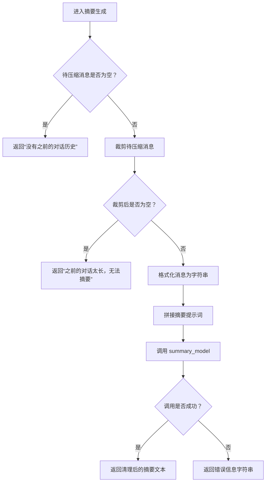
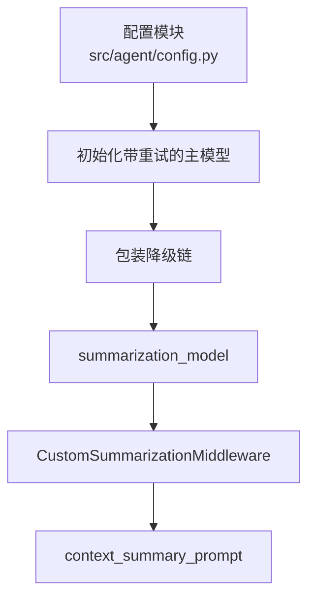
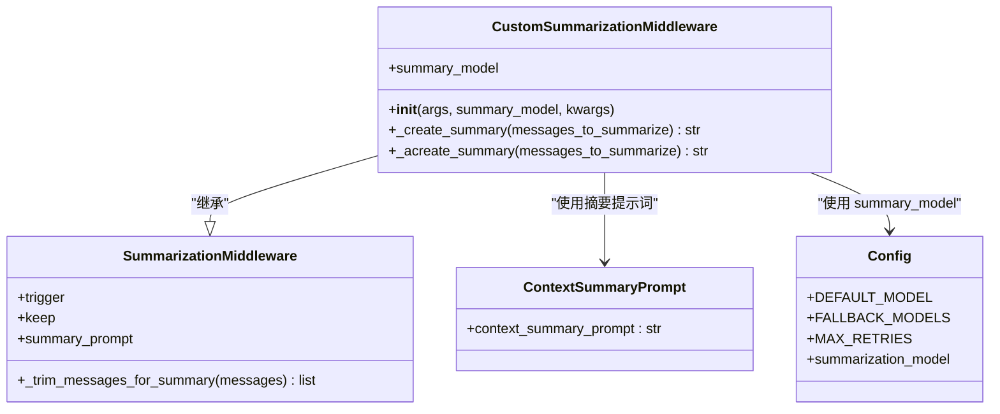

# 03b-上下文压缩中间件（Summarization）

<cite>
**本文引用的文件**   
- [src/middleware/summarization_middleware.py](file://src/middleware/summarization_middleware.py)
- [agent.py](file://agent.py)
- [src/agent/config.py](file://src/agent/config.py)
- [src/prompts/context_summary_prompt.py](file://src/prompts/context_summary_prompt.py)
- [tests/unit/test_summarization_middleware_wiring.py](file://tests/unit/test_summarization_middleware_wiring.py)
</cite>

## 目录
1. [设计动机与定位](#设计动机与定位)
2. [触发与保留阈值设计](#触发与保留阈值设计)
3. [summary_model 调用方式与重试降级链](#summary_model-调用方式与重试降级链)
4. [压缩后的消息替换逻辑](#压缩后的消息替换逻辑)
5. [关键类与依赖关系图](#关键类与依赖关系图)
6. [配置与测试验证](#配置与测试验证)
7. [常见问题与排错建议](#常见问题与排错建议)
8. [结论](#结论)

## 设计动机与定位
本中间件用于在对话历史过长时，把较早的对话内容压缩成一段“摘要”，并用该摘要替换原始历史中的旧消息，从而控制后续模型调用的上下文长度。它继承 LangChain 提供的 `SummarizationMiddleware`，并通过自定义 `summary_model` 复用项目统一的模型重试与降级策略。

需要特别区分：
- **触发/保留阈值**：由 `trigger` 和 `keep` 参数决定何时压缩、保留多少上下文。
- **摘要生成**：由 `summary_model` 负责，使用 `context_summary_prompt` 作为提示词模板。
- **消息替换**：由父类 `SummarizationMiddleware` 完成；本实现主要覆盖摘要生成逻辑。

**章节来源**
- [src/middleware/summarization_middleware.py:11-57](file://src/middleware/summarization_middleware.py#L11-L57)
- [agent.py:40-47](file://agent.py#L40-L47)

## 触发与保留阈值设计
在 Agent 组装阶段，`CustomSummarizationMiddleware` 通过以下参数启用上下文压缩：

| 参数 | 值 | 含义 |
|---|---|---|
| `model` | `DEFAULT_MODEL.id` | 主对话模型标识，用于判断当前会话是否超过压缩阈值 |
| `trigger` | `("tokens", 130_000)` | 当上下文 token 数达到或超过 130,000 时触发压缩 |
| `keep` | `("tokens", 30_000)` | 压缩后至少保留 30,000 token 的最新上下文 |
| `summary_prompt` | `context_summary_prompt` | 摘要生成提示词模板 |
| `trim_tokens_to_summarize` | `None` | 不限制待压缩消息的最大 token 数，交由父类内部处理 |

这意味着：
- 当对话历史膨胀到约 130k token 时，系统会尝试压缩更早的历史。
- 压缩后，最新约 30k token 的消息会被完整保留，其余旧消息被摘要替代。
- 这个阈值是经验值，用于平衡“保留足够近期上下文”和“避免超出模型上下文上限”。

**章节来源**
- [agent.py:40-47](file://agent.py#L40-L47)

## summary_model 调用方式与重试降级链
### 摘要生成入口
`CustomSummarizationMiddleware` 覆盖了同步 `_create_summary` 和异步 `_acreate_summary` 两个方法。两者流程基本一致：

1. 如果待压缩消息为空，返回固定提示：“没有之前的对话历史”。
2. 调用父类的 `_trim_messages_for_summary` 对消息做初步裁剪。
3. 如果裁剪后仍为空，返回固定提示：“之前的对话太长，无法摘要”。
4. 使用 `get_buffer_string` 将消息序列格式化为字符串。
5. 用 `self.summary_prompt.format(messages=formatted_messages)` 构造最终 prompt。
6. 调用 `self.summary_model.invoke` 或 `ainvoke` 生成摘要。
7. 成功时返回 `response.text.strip()`。
8. 异常时返回包含错误信息的字符串，而不是抛出异常。

**图表来源**
- [src/middleware/summarization_middleware.py:19-57](file://src/middleware/summarization_middleware.py#L19-L57)

### 重试与降级策略
`summary_model` 不是裸模型实例，而是经过统一重试与降级包装的 Runnable：

- 主模型：`DEFAULT_MODEL.id` 对应的聊天模型。
- 重试策略：通过 `_init_retrying_model` 包装，最多执行 `MAX_RETRIES + 1` 次。
- 失败原因检查：如果模型返回可重试的 finish reason，会转换为 `MalformedResponseError`，从而触发重试。
- 降级策略：通过 `with_fallbacks` 挂载 `FALLBACK_MODELS`。当前 fallback 列表只包含默认模型本身，因此降级链结构存在，但实际等价于同一模型的多次尝试。

**图表来源**
- [src/agent/config.py:97-113](file://src/agent/config.py#L97-L113)
- [src/middleware/summarization_middleware.py:30-35](file://src/middleware/summarization_middleware.py#L30-L35)
- [src/middleware/summarization_middleware.py:50-55](file://src/middleware/summarization_middleware.py#L50-L55)

**章节来源**
- [src/middleware/summarization_middleware.py:14-57](file://src/middleware/summarization_middleware.py#L14-L57)
- [src/agent/config.py:81-113](file://src/agent/config.py#L81-L113)

## 压缩后的消息替换逻辑
本仓库中，`CustomSummarizationMiddleware` **没有重写**父类的消息替换逻辑。也就是说：

- 触发条件、token 计数、消息裁剪、摘要插入位置等核心行为，来自 LangChain 的 `SummarizationMiddleware`。
- 本实现的职责集中在“如何生成摘要”，即 `_create_summary` 和 `_acreate_summary`。
- 压缩后的消息替换通常表现为：用一条包含摘要的系统消息或结构化消息，替换掉被移除的旧消息片段，同时保留最新的 `keep` 部分。

由于具体替换细节属于父类实现，本仓库文档不再展开其内部代码；读者如需了解底层替换算法，应参考 LangChain 官方 `SummarizationMiddleware` 的实现。

**章节来源**
- [src/middleware/summarization_middleware.py:11-17](file://src/middleware/summarization_middleware.py#L11-L17)
- [src/middleware/summarization_middleware.py:19-57](file://src/middleware/summarization_middleware.py#L19-L57)

## 关键类与依赖关系图
从源码角度，核心关系如下：

**图表来源**
- [src/middleware/summarization_middleware.py:11-57](file://src/middleware/summarization_middleware.py#L11-L57)
- [src/prompts/context_summary_prompt.py:1-58](file://src/prompts/context_summary_prompt.py#L1-L58)
- [src/agent/config.py:28-113](file://src/agent/config.py#L28-L113)

## 配置与测试验证
### Agent 装配
Agent 入口通过 `define_deep_agent` 注册中间件链，其中 `CustomSummarizationMiddleware` 位于 Guardrails 之后、工具重试和模型重试之前。这说明：
- 用户输入先经过入口守卫和护栏。
- 对话历史膨胀后再进行摘要压缩。
- 压缩后的上下文再进入工具调用和模型推理阶段。

**章节来源**
- [agent.py:31-51](file://agent.py#L31-L51)

### 测试断言要点
单元测试验证了以下关键点：
- `config.FALLBACK_MODELS` 只包含默认模型。
- `middleware.model` 对应默认模型名称。
- `middleware.summary_model` 类型是 `RunnableWithFallbacks`。
- 主 runnable 和所有 fallback 的 `max_attempt_number` 都等于 `MAX_RETRIES + 1`。

这证明摘要模型确实复用了项目的重试与降级机制，而不是直接调用裸模型。

**章节来源**
- [tests/unit/test_summarization_middleware_wiring.py:8-34](file://tests/unit/test_summarization_middleware_wiring.py#L8-L34)
- [src/agent/config.py:104-113](file://src/agent/config.py#L104-L113)

## 常见问题与排错建议
| 现象 | 可能原因 | 排查建议 |
|---|---|---|
| 摘要始终返回“没有之前的对话历史” | 触发压缩时传入的待压缩消息为空 | 检查上游消息流是否提前清空历史，或触发时机是否异常 |
| 摘要返回“之前的对话太长，无法摘要” | `_trim_messages_for_summary` 裁剪后无可用消息 | 检查 `trim_tokens_to_summarize` 与 `keep` 配置是否过于保守 |
| 摘要生成报错 | `summary_model.invoke/ainvoke` 抛出异常 | 查看日志中的错误信息；确认 `OPENAI_API_KEY`、模型名、网络可用性 |
| 摘要未触发 | 上下文未达到 130k token | 检查实际对话长度，或调整 `trigger` 阈值 |
| 摘要过长导致上下文仍然超限 | 摘要生成结果超过预期 | 检查 `context_summary_prompt` 的输出约束，必要时降低 `keep` 或优化提示词 |

**章节来源**
- [src/middleware/summarization_middleware.py:21-37](file://src/middleware/summarization_middleware.py#L21-L37)
- [src/middleware/summarization_middleware.py:41-57](file://src/middleware/summarization_middleware.py#L41-L57)
- [src/prompts/context_summary_prompt.py:29-34](file://src/prompts/context_summary_prompt.py#L29-L34)

## 结论
本中间件的核心价值在于：
- 通过 `trigger=("tokens", 130_000)` 和 `keep=("tokens", 30_000)` 控制对话历史的膨胀。
- 通过 `summary_model` 复用统一的模型重试与降级策略，提高摘要生成的稳定性。
- 通过覆盖 `_create_summary` 和 `_acreate_summary`，将摘要生成与父类的消息替换逻辑解耦。
- 通过 `context_summary_prompt` 明确摘要的结构化输出要求，使压缩后的上下文更利于后续 Agent 继续工作。

对于开发者而言，如果需要调整压缩策略，优先修改 `agent.py` 中的 `trigger` 和 `keep`；如果需要改变摘要风格或约束，则修改 `context_summary_prompt`；如果需要更换摘要模型或重试策略，则修改 `src/agent/config.py` 中的 `summarization_model`。