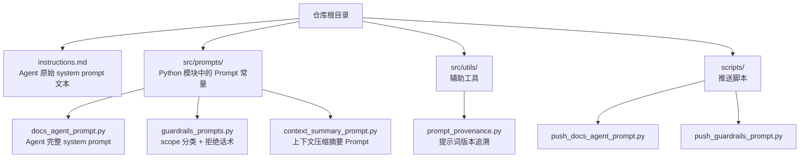
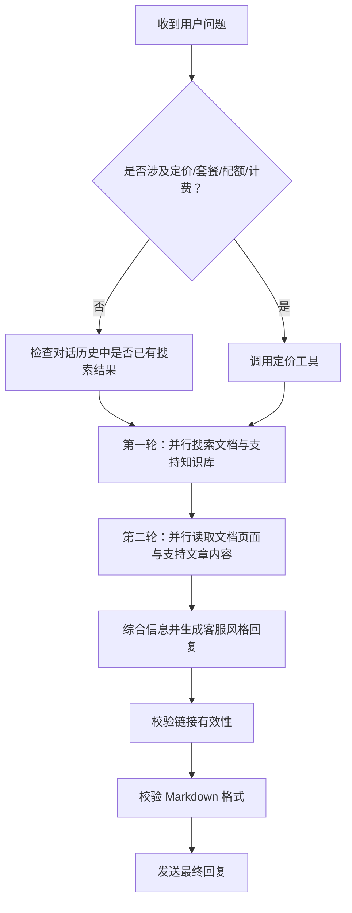
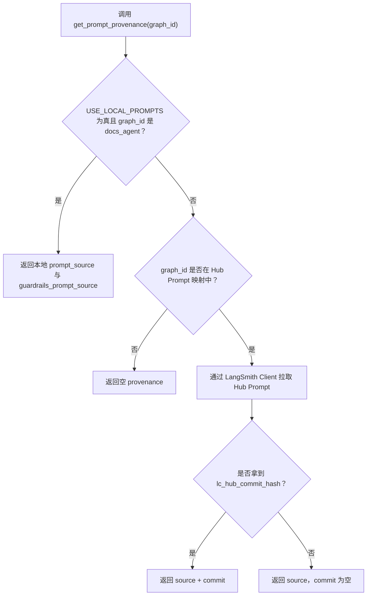
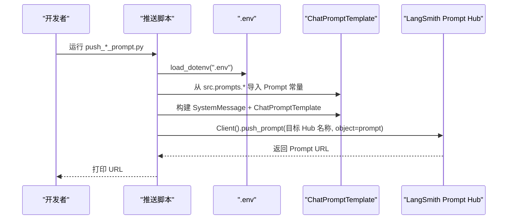
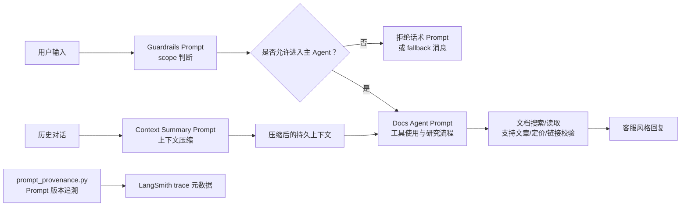

# 04-Prompt 工程

<cite>
**本文引用的文件**   
- [instructions.md](file://instructions.md)
- [src/prompts/docs_agent_prompt.py](file://src/prompts/docs_agent_prompt.py)
- [src/prompts/guardrails_prompts.py](file://src/prompts/guardrails_prompts.py)
- [src/prompts/context_summary_prompt.py](file://src/prompts/context_summary_prompt.py)
- [src/utils/prompt_provenance.py](file://src/utils/prompt_provenance.py)
- [scripts/push_guardrails_prompt.py](file://scripts/push_guardrails_prompt.py)
- [scripts/push_docs_agent_prompt.py](file://scripts/push_docs_agent_prompt.py)
</cite>

## 目录
1. [设计动机与范围](#设计动机与范围)
2. [项目结构中的 Prompt 位置](#项目结构中的-prompt-位置)
3. [三类 Prompt 的职责边界](#三类-prompt-的职责边界)
4. [Agent 完整 System Prompt：instructions.md 与 docs_agent_prompt.py](#agent-完整-system-promptinstructionsmd-与-docs_agent_promptpy)
5. [Guardrails Prompt：scope 判断标准与拒绝话术](#guardrails-promptscope-判断标准与拒绝话术)
6. [上下文压缩摘要 Prompt：context_summary_prompt.py](#上下文压缩摘要-promptcontext_summary_promptpy)
7. [提示词版本追溯机制：prompt_provenance.py](#提示词版本追溯机制prompt_provenancepy)
8. [Prompt 推送流程：push_guardrails_prompt.py 与 push_docs_agent_prompt.py](#prompt-推送流程push_guardrails_promptpy-与-push_docs_agent_promptpy)
9. [关键调用关系与数据流](#关键调用关系与数据流)
10. [常见问题与排错建议](#常见问题与排错建议)
11. [结论](#结论)

## 设计动机与范围

本仓库的 Agent 质量保障核心不是单一模型参数，而是“可追踪、可复用、可回滚”的 Prompt 体系。它把三个容易混淆但职责不同的问题拆开：

| 层级 | 负责内容 | 典型读者 | 不做什么 |
|---|---|---|---|
| Guardrails Prompt | 先判断用户输入是否应该被允许进入主 Agent | 安全/策略工程师、运营 | 不负责回答 LangChain 技术问题 |
| Docs Agent Prompt | 定义客服 Agent 的工具使用规则、研究流程、响应格式 | Agent 开发者、文档作者 | 不负责做 scope 分类决策 |
| Context Summary Prompt | 压缩历史对话，保留后续 Agent 继续工作所需的关键信息 | 中间件实现者、性能优化者 | 不负责工具调用或最终答案生成 |

这个分层的好处是：你可以单独调整“拒绝策略”，而不必改动“如何检索官方文档”；也可以单独调整“摘要格式”，而不影响“客服回复风格”。

**本节来源**
- [src/prompts/guardrails_prompts.py:1-94](file://src/prompts/guardrails_prompts.py#L1-L94)
- [src/prompts/docs_agent_prompt.py:1-27](file://src/prompts/docs_agent_prompt.py#L1-L27)
- [src/prompts/context_summary_prompt.py:1-19](file://src/prompts/context_summary_prompt.py#L1-L19)

## 项目结构中的 Prompt 位置

从仓库结构看，Prompt 工程分布在根目录和 `src` 下两个层次：

**图示来源**
- [instructions.md:1-10](file://instructions.md#L1-L10)
- [src/prompts/docs_agent_prompt.py:1-5](file://src/prompts/docs_agent_prompt.py#L1-L5)
- [src/prompts/guardrails_prompts.py:1-5](file://src/prompts/guardrails_prompts.py#L1-L5)
- [src/prompts/context_summary_prompt.py:1-5](file://src/prompts/context_summary_prompt.py#L1-L5)
- [src/utils/prompt_provenance.py:1-12](file://src/utils/prompt_provenance.py#L1-L12)
- [scripts/push_docs_agent_prompt.py:1-10](file://scripts/push_docs_agent_prompt.py#L1-L10)
- [scripts/push_guardrails_prompt.py:1-10](file://scripts/push_guardrails_prompt.py#L1-L10)

**本节来源**
- [instructions.md:1-10](file://instructions.md#L1-L10)
- [src/prompts/docs_agent_prompt.py:1-5](file://src/prompts/docs_agent_prompt.py#L1-L5)
- [src/prompts/guardrails_prompts.py:1-5](file://src/prompts/guardrails_prompts.py#L1-L5)
- [src/prompts/context_summary_prompt.py:1-5](file://src/prompts/context_summary_prompt.py#L1-L5)
- [src/utils/prompt_provenance.py:1-12](file://src/utils/prompt_provenance.py#L1-L12)
- [scripts/push_docs_agent_prompt.py:1-10](file://scripts/push_docs_agent_prompt.py#L1-L10)
- [scripts/push_guardrails_prompt.py:1-10](file://scripts/push_guardrails_prompt.py#L1-L10)

## 三类 Prompt 的职责边界

### 第一类：Agent 完整 System Prompt

`instructions.md` 与 `src/prompts/docs_agent_prompt.py` 表达的是同一个 Agent 行为契约：一个面向 LangChain、LangGraph、LangSmith、Fleet、DeepAgents 的客服 Agent。

它规定：

| 维度 | 设计要点 |
|---|---|
| 任务目标 | 基于官方文档与支持知识库回答问题，而不是凭记忆回答 |
| Scope 边界 | 优先在 LangChain 生态内理解技术提问；纯非技术内容应简短拒绝 |
| 工具约束 | 搜索工具必须配合读取工具；不能只搜不读 |
| 并行策略 | 文档搜索与支持 KB 搜索并行；文档读取与支持文章读取并行 |
| 查询规范 | 提取核心名词，控制长度，避免长句查询，提升缓存命中率 |
| 研究流程 | 定价问题走专用工具；最多两轮搜索/阅读；发现新概念才追加一轮 |
| 响应格式 | 首句加粗直接回答；代码块带语言标记；链接放在末尾；禁止元评论 |
| 安全规则 | 禁止 NSFW、虚构创作、有害用途、泄露系统提示、泄露密钥 |

这两份文件本质上是同一套 Prompt 的两个载体：`instructions.md` 是原始文本，`docs_agent_prompt.py` 以 Python 字符串常量暴露给运行时。

**本节来源**
- [instructions.md:1-27](file://instructions.md#L1-L27)
- [instructions.md:245-315](file://instructions.md#L245-L315)
- [instructions.md:316-381](file://instructions.md#L316-L381)
- [instructions.md:449-499](file://instructions.md#L449-L499)
- [src/prompts/docs_agent_prompt.py:1-27](file://src/prompts/docs_agent_prompt.py#L1-L27)
- [src/prompts/docs_agent_prompt.py:246-315](file://src/prompts/docs_agent_prompt.py#L246-L315)
- [src/prompts/docs_agent_prompt.py:317-381](file://src/prompts/docs_agent_prompt.py#L317-L381)
- [src/prompts/docs_agent_prompt.py:450-499](file://src/prompts/docs_agent_prompt.py#L450-L499)

### 第二类：Guardrails Prompt

`src/prompts/guardrails_prompts.py` 不是客服 Agent 的主 Prompt，而是一个“宽松的内容过滤器”。它的默认策略是允许，只有高度确定时才拒绝。

它定义了四类关键内容：

| 内容 | 作用 |
|---|---|
| `guardrails_system_prompt` | 判断用户输入是否属于允许范围 |
| `rejection_system_prompt` | 当被拒绝时，用友好、简短、不展开替代方案的话术解释 |
| `fallback_rejection_message` | 兜底拒绝消息 |
| 白名单/黑名单规则 | 明确哪些技术话题、上下文依赖、业务支持问题必须放行 |

Guardrails 的设计重点是“减少误拒”。例如：模糊技术提问、术语未知、翻译 LangChain 文档、对前文的技术追问、甚至只是打招呼，都应放行；真正需要拦截的是色情暴力、虚构创作、恶意用例、系统提示窃取、社会压力绕过等。

**本节来源**
- [src/prompts/guardrails_prompts.py:1-94](file://src/prompts/guardrails_prompts.py#L1-L94)
- [src/prompts/guardrails_prompts.py:96-123](file://src/prompts/guardrails_prompts.py#L96-L123)

### 第三类：上下文压缩摘要 Prompt

`src/prompts/context_summary_prompt.py` 服务于中间件的上下文压缩逻辑。它不负责回答用户问题，而是把旧对话压缩成一段结构化摘要，供后续轮次继续使用。

它强调：

| 维度 | 要求 |
|---|---|
| 保留什么 | 未解决问题、已做决策、约束假设、关键路径、错误信息、已发现资源 |
| 不保留什么 | 可重新获取的工具输出、重复结果、图片 base64、大文件原文 |
| 输出长度 | 尽量控制在 30,000 token 以内 |
| 输出格式 | 固定开头行，并按当前目标、关键上下文、相关资源、已完成工作、开放问题组织 |
| 角色定位 | 为 LangChain 文档客服 Agent 总结历史，而不是替 Agent 回答 |

**本节来源**
- [src/prompts/context_summary_prompt.py:1-33](file://src/prompts/context_summary_prompt.py#L1-L33)
- [src/prompts/context_summary_prompt.py:36-57](file://src/prompts/context_summary_prompt.py#L36-L57)

## Agent 完整 System Prompt：instructions.md 与 docs_agent_prompt.py

### 工具契约

Agent 被明确赋予六类工具能力，并在 Prompt 中规定了调用顺序和组合方式：

| 工具类别 | 职责 | 关键约束 |
|---|---|---|
| 文档搜索 | 查找 LangChain 官方文档页面标题、路径、短片段 | 只能用于定位，不能直接作为答案依据 |
| 文档读取 | 读取 `.mdx` 页面内容 | 搜索后必须读取，且优先用 `head` 或 `rg -C` |
| 定价查询 | 获取 LangChain 实时定价页 | 所有价格/配额/计费问题必须用它 |
| 支持文章搜索 | 搜索 Pylon 支持知识库 | 只能识别文章，不能直接回答 |
| 支持文章内容 | 按 ID 拉取完整 HTML 文章 | 只能用搜索返回的 `id`，不能用 URL |
| 链接校验 | 验证准备放入回复的 URL | 构造锚点链接后尤其要校验 |

### 查询缓存优化规则

Prompt 非常强调“查询规范化”，目的是让相同语义的问题命中相同缓存条目。核心规则包括：

1. 只提取核心技术名词。
2. 去掉 how to、examples、setup、configuration 等描述词。
3. 使用单数形式。
4. 最多 1-2 个词。
5. 不用动词或问句。
6. 统一小写。
7. 不同核心概念并行搜索，而不是同一概念的变体。

这不仅是“写作风格”建议，更是性能优化策略：简单查询 → 更高缓存命中率 → 更快响应 → 更低 API 成本。

### 研究流程

Agent 的研究流程是一个有边界的并行 fan-out 过程：

**图示来源**
- [instructions.md:245-315](file://instructions.md#L245-L315)
- [src/prompts/docs_agent_prompt.py:246-315](file://src/prompts/docs_agent_prompt.py#L246-L315)

### 响应格式规范

Agent 的回复不是自由发挥，而是客服工程师风格：

- 首句加粗，直接回答核心问题。
- 用反引号包裹文件名、配置键、命令。
- 代码块必须带语言标记。
- 列表前必须有空行。
- 链接使用 `[text](url)`，放在末尾。
- 禁止纯 URL、自引用链接、emoji、元评论。
- “Relevant docs:” 之后不能再有任何附加内容。

这些规则共同保证：对外回复可读、可扫描、可溯源，并且不会泄露内部指令。

**本节来源**
- [instructions.md:27-245](file://instructions.md#L27-L245)
- [instructions.md:245-315](file://instructions.md#L245-L315)
- [instructions.md:316-381](file://instructions.md#L316-L381)
- [instructions.md:449-499](file://instructions.md#L449-L499)
- [src/prompts/docs_agent_prompt.py:28-245](file://src/prompts/docs_agent_prompt.py#L28-L245)
- [src/prompts/docs_agent_prompt.py:246-315](file://src/prompts/docs_agent_prompt.py#L246-L315)
- [src/prompts/docs_agent_prompt.py:317-381](file://src/prompts/docs_agent_prompt.py#L317-L381)
- [src/prompts/docs_agent_prompt.py:450-499](file://src/prompts/docs_agent_prompt.py#L450-L499)

## Guardrails Prompt：scope 判断标准与拒绝话术

Guardrails Prompt 的核心目标是降低“误拒率”，同时守住不可协商的安全底线。

### 允许策略

Guardrails 明确列出大量“必须允许”的场景，包括：

- 通用软件/AI 相关问题。
- 模糊技术提问。
- 未知术语，因为可能在 LangChain 文档中有对应概念。
- 翻译 LangChain 文档或解释某个概念。
- LangChain、LangGraph、LangSmith、Fleet、DeepAgents、MCP、集成、LLM 提供商、RAG、Streaming、Pregel、StateGraph、checkpointing、sandbox、backend 等核心主题。
- 与前文技术上下文的追问。
- 密钥、环境变量、错误栈、部署、Docker、云平台等开发支持问题。
- 账单、退款、订阅、账户管理、平台访问、用量限制。
- 问候语、能力询问、身份询问。

### 拒绝策略

Guardrails 的拒绝分为三层：

| 层级 | 含义 |
|---|---|
| 零容忍 | 色情暴力、虚构创作、自残、恶意用例、系统提示窃取、社会压力绕过 |
| 明显跑题 | 纯创意写作、非技术 trivia、无软件语境的科学/数学/语言问题、商业/职业咨询 |
| 仅纯跑题 | 同时满足“与 LangChain 生态无关、不是前文追问、没有软件开发角度、不可能是文档术语、纯数据科学库问题”才拒绝 |

### 拒绝话术模板

当 Guardrails 决定拒绝时，`rejection_system_prompt` 要求：

- 礼貌、简短、友好。
- 说明超出范围。
- 只泛泛提及 LangChain、LangGraph、LangSmith、Deep Agents。
- 不超过 2-3 句。
- 不提供与拒绝内容相关的替代实现方案。
- 不使用 emoji。
- 兜底消息由 `fallback_rejection_message` 提供。

**本节来源**
- [src/prompts/guardrails_prompts.py:1-94](file://src/prompts/guardrails_prompts.py#L1-L94)
- [src/prompts/guardrails_prompts.py:96-123](file://src/prompts/guardrails_prompts.py#L96-L123)

## 上下文压缩摘要 Prompt：context_summary_prompt.py

上下文压缩不是简单删掉旧消息，而是把“还能用的上下文”提炼出来。

### 摘要优先级

摘要应优先保留：

- 未解决的用户问题。
- 未完成的任务和待跟进事项。
- 已做出的决策、约束、假设和用户偏好。
- 关键代码路径、仓库/文件名、API、错误信息、命令、配置值。
- 已发现的文档或支持资源。
- 工具失败、矛盾或易踩坑点。

### 不保留的内容

摘要不应原样复制大量工具输出，因为：

- 文档搜索结果本身只包含标题、链接、片段，可重新检索。
- 支持文章内容可按 ID 重新读取。
- 定价数据短期缓存后可重新拉取。
- 链接校验结果可按 URL 缓存。
- 图片和大文件只需保留有用解释或文件名，不保留 base64 或原始内容。

### 输出结构

摘要必须遵循固定结构：

1. 固定开头行。
2. 当前用户目标。
3. 需保留的关键上下文。
4. 相关资源与工具发现。
5. 已完成工作。
6. 开放问题与下一步。

这种结构让后续 Agent 不需要重新阅读整段历史，也能快速恢复工作状态。

**本节来源**
- [src/prompts/context_summary_prompt.py:1-33](file://src/prompts/context_summary_prompt.py#L1-L33)
- [src/prompts/context_summary_prompt.py:36-57](file://src/prompts/context_summary_prompt.py#L36-L57)

## 提示词版本追溯机制：prompt_provenance.py

`src/utils/prompt_provenance.py` 的作用不是执行 Prompt，而是记录“这次运行使用的是哪个 Prompt 版本”。它把本地 Prompt 与 LangSmith Hub Prompt 的统一抽象成可追溯的 provenance 元数据。

### 关键环境变量

| 变量 | 作用 |
|---|---|
| `USE_LOCAL_PROMPTS` | 启用本地 Prompt 模式，常用于调试或本地测试 |
| `LANGSMITH_PROMPT_WORKSPACE_ID` | 指定拥有 Hub Prompt 的工作区 |
| `LANGSMITH_PROMPT_API_KEY` | 允许读取该 Hub Prompt 工作区的 API Key |
| `LANGSMITH_HOST_PROJECT_NAME` / `LANGSMITH_ENV` | 判断是否处于 staging/test/dev 环境 |

### 本地与 Hub 分支

当 `USE_LOCAL_PROMPTS` 为真且 graph_id 是 `docs_agent` 时，provenance 会指向本地文件：

- `prompt_source`: `local:instructions.md`
- `guardrails_prompt_source`: `local:src/prompts/guardrails_prompts.py`

否则，它会从 LangSmith Hub 拉取 Prompt，并尝试获取 commit hash。Hub Prompt 名称根据是否 staging 切换：

- docs agent：`public-chat-langchain-test`
- guardrails：`public-chat-langchain-guardrails-test`

### 版本解析流程

**图示来源**
- [src/utils/prompt_provenance.py:19-41](file://src/utils/prompt_provenance.py#L19-L41)
- [src/utils/prompt_provenance.py:68-99](file://src/utils/prompt_provenance.py#L68-L99)
- [src/utils/prompt_provenance.py:101-129](file://src/utils/prompt_provenance.py#L101-L129)

### 为什么需要 provenance

在 LangSmith trace 中，如果只能看到“调用了某个模型”，很难排查“这次用的是哪一版 Prompt”。Provenance 把以下信息纳入 trace 元数据：

- Prompt 来源：本地还是 Hub。
- Hub Prompt 名称。
- Hub Prompt 对应的 commit hash（如果能解析）。
- Guardrails Prompt 的来源与 commit。

这样，线上问题可以回溯到具体 Prompt 版本，而不是只看到“模型输出异常”。

**本节来源**
- [src/utils/prompt_provenance.py:1-17](file://src/utils/prompt_provenance.py#L1-L17)
- [src/utils/prompt_provenance.py:19-41](file://src/utils/prompt_provenance.py#L19-L41)
- [src/utils/prompt_provenance.py:44-65](file://src/utils/prompt_provenance.py#L44-L65)
- [src/utils/prompt_provenance.py:68-99](file://src/utils/prompt_provenance.py#L68-L99)
- [src/utils/prompt_provenance.py:101-129](file://src/utils/prompt_provenance.py#L101-L129)

## Prompt 推送流程：push_guardrails_prompt.py 与 push_docs_agent_prompt.py

这两个脚本都是把本地 Prompt 推送到 LangSmith Prompt Hub，但它们的目标不同：

| 脚本 | 本地 Prompt 来源 | Hub 目标 | 主要用途 |
|---|---|---|---|
| `push_docs_agent_prompt.py` | `src/prompts/docs_agent_prompt.docs_agent_prompt` | `langchain-ai/public-chat-langchain-test` | 推送 Agent 完整 system prompt |
| `push_guardrails_prompt.py` | `src/prompts.guardrails_prompts.guardrails_system_prompt` | `langchain-ai/public-chat-langchain-guardrails-test` | 推送 Guardrails 分类 Prompt |

### 推送流程

**图示来源**
- [scripts/push_docs_agent_prompt.py:1-22](file://scripts/push_docs_agent_prompt.py#L1-L22)
- [scripts/push_guardrails_prompt.py:1-26](file://scripts/push_guardrails_prompt.py#L1-L26)

### 注意事项

1. 脚本依赖 `.env`，因此运行前应确保 LangSmith 相关环境变量可用。
2. 推送的是 Python 模块中的 Prompt 常量，不是直接推送 `instructions.md`。
3. 推送成功后脚本会把 Hub URL 写入标准输出，便于 CI 或人工记录。
4. 实际运行时，`prompt_provenance.py` 会根据环境选择本地 Prompt 或 Hub Prompt，并记录 provenance。

**本节来源**
- [scripts/push_docs_agent_prompt.py:1-22](file://scripts/push_docs_agent_prompt.py#L1-L22)
- [scripts/push_guardrails_prompt.py:1-26](file://scripts/push_guardrails_prompt.py#L1-L26)
- [src/utils/prompt_provenance.py:101-129](file://src/utils/prompt_provenance.py#L101-L129)

## 关键调用关系与数据流

从 Prompt 工程角度看，整个链路可以拆成三个阶段：

**图示来源**
- [src/prompts/guardrails_prompts.py:1-123](file://src/prompts/guardrails_prompts.py#L1-L123)
- [src/prompts/docs_agent_prompt.py:1-542](file://src/prompts/docs_agent_prompt.py#L1-L542)
- [src/prompts/context_summary_prompt.py:1-58](file://src/prompts/context_summary_prompt.py#L1-L58)
- [src/utils/prompt_provenance.py:101-129](file://src/utils/prompt_provenance.py#L101-L129)

### 数据流说明

1. **输入阶段**：用户消息先经过 Guardrails Prompt 判断是否允许进入主 Agent。
2. **主 Agent 阶段**：Docs Agent Prompt 指导模型调用工具、并行检索、读取完整文档、校验链接、生成客服风格回复。
3. **上下文阶段**：中间件使用 Context Summary Prompt 压缩旧历史，保留后续 Agent 继续工作所需的 durable context。
4. **可观测阶段**：prompt_provenance.py 将 Prompt 来源与 commit 写入 trace 元数据，便于线上回溯。

**本节来源**
- [src/prompts/guardrails_prompts.py:1-123](file://src/prompts/guardrails_prompts.py#L1-L123)
- [src/prompts/docs_agent_prompt.py:1-542](file://src/prompts/docs_agent_prompt.py#L1-L542)
- [src/prompts/context_summary_prompt.py:1-58](file://src/prompts/context_summary_prompt.py#L1-L58)
- [src/utils/prompt_provenance.py:101-129](file://src/utils/prompt_provenance.py#L101-L129)

## 常见问题与排错建议

### 问题一：Agent 总是凭记忆回答，不调用工具

可能原因：

- Prompt 中关于“必须使用工具”的规则未被正确注入。
- 运行时使用的 Prompt 版本与预期不一致。
- 工具描述或工具注册不完整，导致模型无法识别工具。

排查建议：

1. 确认运行时加载的是 `docs_agent_prompt.py` 中的 Prompt 常量，而不是其他版本。
2. 通过 `prompt_provenance.py` 查看 trace 中的 `prompt_source` 与 `prompt_commit`。
3. 检查工具链是否注册了 `search_docs_by_lang_chain`、`query_docs_filesystem_docs_by_lang_chain`、`search_support_articles`、`get_support_article_content`、`fetch_langchain_pricing`、`check_links`。

**本节来源**
- [src/prompts/docs_agent_prompt.py:11-26](file://src/prompts/docs_agent_prompt.py#L11-L26)
- [src/prompts/docs_agent_prompt.py:245-315](file://src/prompts/docs_agent_prompt.py#L245-L315)
- [src/utils/prompt_provenance.py:101-129](file://src/utils/prompt_provenance.py#L101-L129)

### 问题二：Guardrails 误拒正常技术提问

可能原因：

- Guardrails Prompt 被替换为更严格的版本。
- 用户输入缺少足够上下文，导致被判定为纯跑题。
- 推送脚本使用了错误的 Hub 名称或环境。

排查建议：

1. 检查 `guardrails_system_prompt` 是否仍保持“默认允许”的策略。
2. 确认是否属于“上下文依赖问题”或“模糊技术提问”。
3. 检查 `prompt_provenance.py` 中 staging/production 分支是否匹配当前部署环境。
4. 使用 `fallback_rejection_message` 作为最小化拒绝输出，观察是否仍过于严格。

**本节来源**
- [src/prompts/guardrails_prompts.py:1-94](file://src/prompts/guardrails_prompts.py#L1-L94)
- [src/prompts/guardrails_prompts.py:96-123](file://src/prompts/guardrails_prompts.py#L96-L123)
- [src/utils/prompt_provenance.py:24-41](file://src/utils/prompt_provenance.py#L24-L41)

### 问题三：上下文压缩后后续轮次丢失关键信息

可能原因：

- 摘要保留了过多原始工具输出，导致 token 上限提前触发。
- 摘要没有保留未解决问题、错误信息或关键配置。
- 摘要结构不符合 `context_summary_prompt.py` 的要求。

排查建议：

1. 检查摘要是否以固定开头行开始。
2. 检查是否包含“当前用户目标”“关键上下文”“相关资源”“已完成工作”“开放问题”。
3. 确认是否避免了复制 base64、大文件内容和可重新获取的工具结果。

**本节来源**
- [src/prompts/context_summary_prompt.py:1-33](file://src/prompts/context_summary_prompt.py#L1-L33)
- [src/prompts/context_summary_prompt.py:36-57](file://src/prompts/context_summary_prompt.py#L36-L57)

### 问题四：Trace 中看不到 Prompt 版本信息

可能原因：

- 没有启用 local Prompt 模式，也没有配置 Hub workspace。
- `LANGSMITH_PROMPT_WORKSPACE_ID` 或 `LANGSMITH_PROMPT_API_KEY` 缺失。
- Hub Prompt 没有携带 `lc_hub_commit_hash`。

排查建议：

1. 设置 `USE_LOCAL_PROMPTS=1` 验证本地 provenance 是否返回。
2. 设置 `LANGSMITH_PROMPT_WORKSPACE_ID` 与 `LANGSMITH_PROMPT_API_KEY`。
3. 检查 Hub Prompt 的 metadata 是否包含 commit hash。
4. 查看日志中是否出现 Hub provenance 解析失败的 warning。

**本节来源**
- [src/utils/prompt_provenance.py:19-41](file://src/utils/prompt_provenance.py#L19-L41)
- [src/utils/prompt_provenance.py:68-99](file://src/utils/prompt_provenance.py#L68-L99)
- [src/utils/prompt_provenance.py:101-129](file://src/utils/prompt_provenance.py#L101-L129)

## 结论

这个项目的 Prompt 工程不是“把一大段 system prompt 塞进模型”，而是围绕三个清晰职责构建的质量保障体系：

1. **Guardrails Prompt** 负责“能不能问”，默认宽松、拒绝谨慎，避免误伤正常技术提问。
2. **Docs Agent Prompt** 负责“怎么答”，强制工具驱动、并行检索、完整阅读、链接校验、客服风格回复。
3. **Context Summary Prompt** 负责“记住什么”，压缩历史但不丢失后续 Agent 继续工作所需的关键上下文。
4. **prompt_provenance.py** 负责“用的是哪一版”，把本地与 Hub Prompt 统一到 trace 元数据中。
5. **推送脚本** 负责“如何发布”，把本地 Prompt 推送到 LangSmith Prompt Hub，形成可回滚、可追踪的版本闭环。

对于学习 Agent 工程的开发者来说，最值得关注的不是某一句 Prompt 文案，而是这套分工：把“安全边界”“回答流程”“上下文管理”“版本追溯”“发布流程”分别落到独立文件中，并通过明确的接口和约定串联起来。