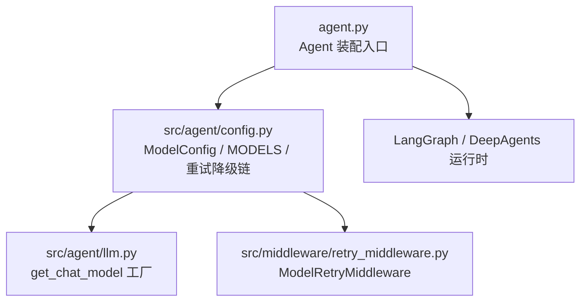
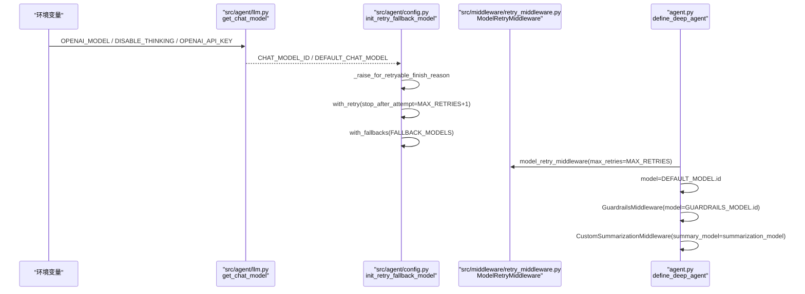
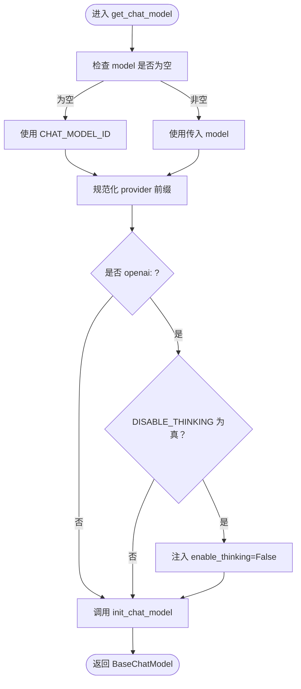
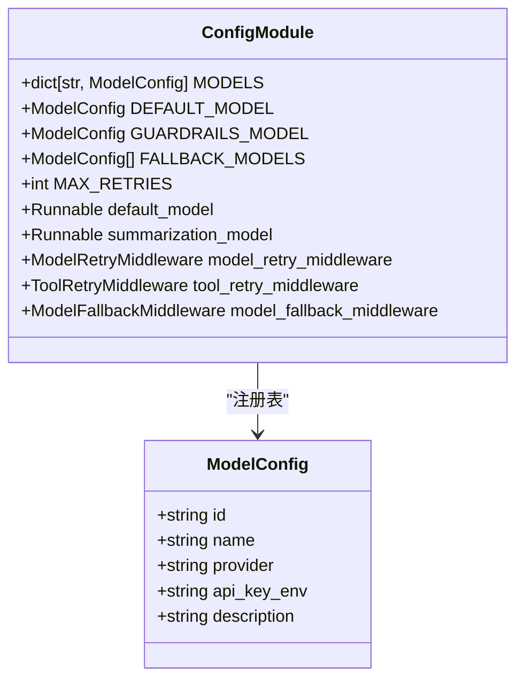
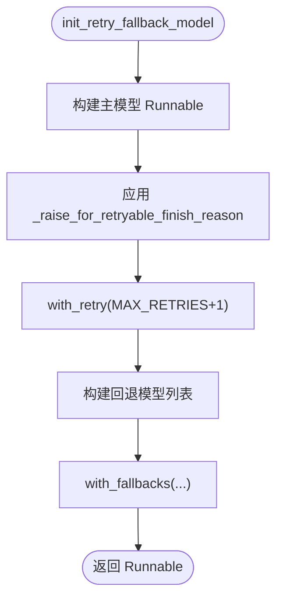
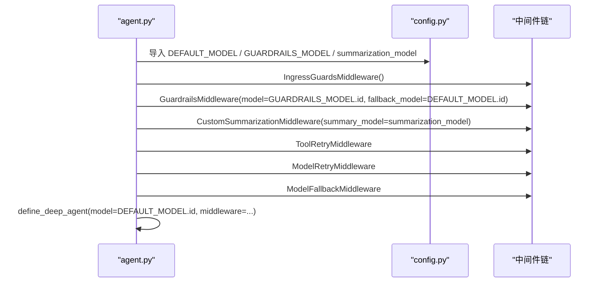
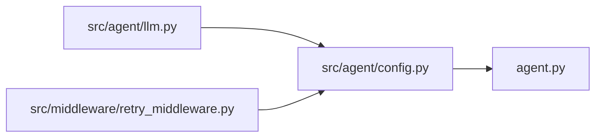
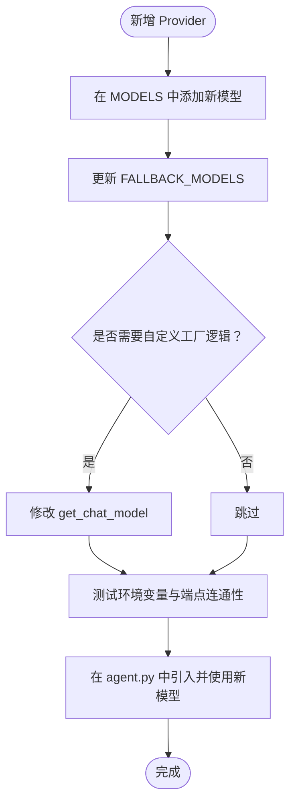

# 05-模型配置与上下文管理

<cite>
**本文引用的文件**   
- [src/agent/llm.py](file://src/agent/llm.py)
- [src/agent/config.py](file://src/agent/config.py)
- [agent.py](file://agent.py)
- [src/middleware/retry_middleware.py](file://src/middleware/retry_middleware.py)
</cite>

## 目录
1. [引言](#引言)
2. [项目结构定位](#项目结构定位)
3. [核心组件](#核心组件)
4. [架构总览](#架构总览)
5. [详细组件分析](#详细组件分析)
6. [依赖关系分析](#依赖关系分析)
7. [性能与行为特征](#性能与行为特征)
8. [故障排查指南](#故障排查指南)
9. [结论](#结论)
10. [附录：扩展新供应商](#附录扩展新供应商)

## 引言
本篇聚焦「模型配置与上下文管理」，围绕以下目标展开：
- `src/agent/llm.py` 的模型工厂如何以环境变量驱动对话模型构造。
- `src/agent/config.py` 中 `ModelConfig` 数据结构与 `MODELS` 注册表的设计。
- 重试与降级链：`init_retry_fallback_model` → `_raise_for_retryable_finish_reason` → `with_retry` + `with_fallbacks`。
- `agent.py` 如何消费 `DEFAULT_MODEL.id`、`GUARDRAILS_MODEL.id` 与 `summarization_model`。
- 当前只接入百炼 DashScope（通过 OpenAI 兼容端点），并说明如何扩展新的 provider。
- 中间件层的 `ModelRetryMiddleware` 实现细节见「03-中间件系统」，本篇仅说明其被消费的位置与职责边界。

## 项目结构定位
本主题涉及三个关键文件：
- `src/agent/llm.py`：统一对话模型工厂，集中处理 provider、base_url、模型名与供应商专属参数。
- `src/agent/config.py`：共享 Agent 配置，包含模型注册表、默认模型、重试/降级策略与中间件实例。
- `agent.py`：Deep Agent 装配入口，消费模型 ID 与中间件，对外暴露客服 Agent。

**图示来源**
- [agent.py:5-12](file://agent.py#L5-L12)
- [src/agent/config.py:11-17](file://src/agent/config.py#L11-L17)
- [src/agent/llm.py:15-16](file://src/agent/llm.py#L15-L16)
- [src/middleware/retry_middleware.py:27-97](file://src/middleware/retry_middleware.py#L27-L97)

**章节来源**
- [agent.py:1-66](file://agent.py#L1-L66)
- [src/agent/config.py:1-148](file://src/agent/config.py#L1-L148)
- [src/agent/llm.py:1-69](file://src/agent/llm.py#L1-L69)

## 核心组件
- 模型工厂：`get_chat_model(model, **kwargs)`，统一注入 provider、思考开关等参数。
- 模型注册表：`ModelConfig` 数据类与 `MODELS` 字典，集中声明可用模型及其元信息。
- 重试与降级：`_init_retrying_model`、`init_retry_fallback_model`、`_raise_for_retryable_finish_reason`。
- Agent 装配：`agent.py` 使用 `DEFAULT_MODEL.id`、`GUARDRAILS_MODEL.id`、`summarization_model` 组装最终 Agent。

**章节来源**
- [src/agent/llm.py:20-60](file://src/agent/llm.py#L20-L60)
- [src/agent/config.py:28-61](file://src/agent/config.py#L28-L61)
- [src/agent/config.py:89-113](file://src/agent/config.py#L89-L113)
- [agent.py:31-51](file://agent.py#L31-L51)

## 架构总览
下图展示从环境变量到最终 Agent 的完整链路：环境变量决定模型 ID 与行为；工厂函数构造 LangChain Chat Model；配置层封装重试与降级；Agent 装配层消费模型 ID 与中间件。

**图示来源**
- [src/agent/llm.py:20-60](file://src/agent/llm.py#L20-L60)
- [src/agent/config.py:82-113](file://src/agent/config.py#L82-L113)
- [src/middleware/retry_middleware.py:27-97](file://src/middleware/retry_middleware.py#L27-L97)
- [agent.py:31-58](file://agent.py#L31-L58)

## 详细组件分析

### 模型工厂：`src/agent/llm.py`
- 环境变量驱动：
  - `OPENAI_MODEL`：对话模型名，未设置时回退为 `qwen3.6-flash`。
  - `DISABLE_THINKING`：是否关闭“思考”模式，默认开启。
  - `OPENAI_API_KEY` / `OPENAI_BASE_URL`：由 LangChain 的 `init_chat_model` 自动读取，指向百炼 DashScope 的 OpenAI 兼容端点。
- 模型 ID 生成：
  - `CHAT_MODEL_ID = f"openai:{DEFAULT_CHAT_MODEL}"`，确保走 `langchain-openai` provider。
- 工厂函数 `get_chat_model`：
  - 若传入的 `model` 不带 provider 前缀，自动补全为 `openai:`。
  - 当 `DISABLE_THINKING` 为真且 model_id 以 `openai:` 开头时，注入 `enable_thinking=False`。
  - 最终调用 `init_chat_model(model=model_id, **kwargs)` 返回 `BaseChatModel`。

**图示来源**
- [src/agent/llm.py:20-60](file://src/agent/llm.py#L20-L60)

**章节来源**
- [src/agent/llm.py:1-69](file://src/agent/llm.py#L1-L69)

### 模型注册表与配置：`src/agent/config.py`
- `ModelConfig` 数据类：
  - 字段包括 `id`、`name`、`provider`、`api_key_env`、`description`。
  - 用于集中描述每个支持的对话模型及其元信息。
- `MODELS` 注册表：
  - 当前仅注册一个默认模型，对应百炼 DashScope（OpenAI 兼容）。
  - 新增模型只需在 `MODELS` 中添加条目，或通过环境变量切换默认模型。
- 默认模型与回退链：
  - `DEFAULT_MODEL` 与 `GUARDRAILS_MODEL` 均指向同一默认模型。
  - `FALLBACK_MODELS` 目前仅包含默认模型，保留重试/降级接线结构。
- API Key 初始化：
  - 启动时校验并清理 `OPENAI_API_KEY` 环境变量。

**图示来源**
- [src/agent/config.py:28-61](file://src/agent/config.py#L28-L61)
- [src/agent/config.py:82-123](file://src/agent/config.py#L82-L123)

**章节来源**
- [src/agent/config.py:1-148](file://src/agent/config.py#L1-L148)

### 重试与降级链
- 可重试 finish reason：
  - `RETRYABLE_FINISH_REASONS` 包含 `MALFORMED_FUNCTION_CALL`，表示工具调用语法异常等场景。
- `_raise_for_retryable_finish_reason`：
  - 解析 response_metadata 中的 `finish_reason`，若属于可重试集合则抛出 `MalformedResponseError`。
- `_init_retrying_model`：
  - 基于 `get_chat_model` 构建 Runnable，并通过 `RunnableLambda` 包装 finish reason 检查。
  - 使用 `with_retry(stop_after_attempt=MAX_RETRIES + 1)` 进行重试。
- `init_retry_fallback_model`：
  - 对主模型与回退模型分别应用重试逻辑，再通过 `with_fallbacks` 组合成降级链。
- `summarization_model`：
  - 复用默认模型的 retry/fallback 能力，供摘要中间件使用。

**图示来源**
- [src/agent/config.py:89-113](file://src/agent/config.py#L89-L113)
- [src/middleware/retry_middleware.py:15-24](file://src/middleware/retry_middleware.py#L15-L24)

**章节来源**
- [src/agent/config.py:82-113](file://src/agent/config.py#L82-L113)
- [src/middleware/retry_middleware.py:15-97](file://src/middleware/retry_middleware.py#L15-L97)

### Agent 装配层消费模型
- `agent.py` 通过 `define_deep_agent` 装配：
  - `model=DEFAULT_MODEL.id`：主模型使用默认模型 ID。
  - `GuardrailsMiddleware(model=GUARDRAILS_MODEL.id, fallback_model=DEFAULT_MODEL.id)`：安全护栏使用守卫模型与回退模型。
  - `CustomSummarizationMiddleware(..., summary_model=summarization_model, ...)`：摘要中间件使用带重试/降级的摘要模型。
  - 中间件顺序：入站守卫 → 安全护栏 → 摘要 → 工具重试 → 模型重试 → 模型回退。

**图示来源**
- [agent.py:5-12](file://agent.py#L5-L12)
- [agent.py:31-51](file://agent.py#L31-L51)
- [agent.py:53-65](file://agent.py#L53-L65)

**章节来源**
- [agent.py:1-66](file://agent.py#L1-L66)

## 依赖关系分析
- `src/agent/config.py` 依赖 `src/agent/llm.py` 提供的 `CHAT_MODEL_ID`、`DEFAULT_CHAT_MODEL`、`get_chat_model`。
- `src/agent/config.py` 依赖 `src/middleware/retry_middleware.py` 的 `RETRYABLE_FINISH_REASONS`、`MalformedResponseError`、`ModelRetryMiddleware`。
- `agent.py` 依赖 `src/agent/config.py` 导出的模型与中间件实例。

**图示来源**
- [src/agent/config.py:11-17](file://src/agent/config.py#L11-L17)
- [agent.py:5-12](file://agent.py#L5-L12)

**章节来源**
- [src/agent/config.py:1-148](file://src/agent/config.py#L1-L148)
- [agent.py:1-66](file://agent.py#L1-L66)

## 性能与行为特征
- 思考模式控制：
  - 默认关闭 `enable_thinking`，减少 token 消耗与响应延迟。
  - 若端点不支持该参数，可将 `DISABLE_THINKING` 设为 `false` 回退为模型默认行为。
- 重试策略：
  - `MODEL_MAX_RETRIES` 默认 2，实际重试次数为 `MAX_RETRIES + 1`。
  - 结合 `ModelRetryMiddleware` 的指数退避，提升鲁棒性。
- 降级策略：
  - 当前仅有一个可用 provider，降级链保持结构以便未来扩展多 provider。

[本节为通用指导，不直接分析具体文件]

## 故障排查指南
- 模型无法连接或鉴权失败：
  - 检查 `OPENAI_API_KEY` 与 `OPENAI_BASE_URL` 是否正确配置。
  - 确认 `OPENAI_MODEL` 是否在百炼 DashScope 支持列表中。
- 思考模式报错：
  - 将 `DISABLE_THINKING` 设为 `false`，避免向不支持的端点发送 `enable_thinking=False`。
- 频繁触发重试：
  - 观察日志中 `finish_reason=MALFORMED_FUNCTION_CALL` 的频率，必要时调整工具调用格式。
  - 检查 `MODEL_MAX_RETRIES` 是否过小导致过早放弃。
- 降级未生效：
  - 当前 `FALLBACK_MODELS` 仅含默认模型，需扩展新 provider 才能体现多模型降级效果。

**章节来源**
- [src/agent/llm.py:20-60](file://src/agent/llm.py#L20-L60)
- [src/agent/config.py:82-113](file://src/agent/config.py#L82-L113)
- [src/middleware/retry_middleware.py:15-97](file://src/middleware/retry_middleware.py#L15-L97)

## 结论
本项目通过 `src/agent/llm.py` 的模型工厂与 `src/agent/config.py` 的注册表，实现了环境变量驱动的模型配置、统一的思考模式控制、以及可复用的重试与降级链。`agent.py` 作为装配入口，消费这些配置与中间件，形成稳定的客服 Agent。当前仅接入百炼 DashScope，但架构已预留扩展新 provider 的能力。

[本节为总结性内容，不直接分析具体文件]

## 附录：扩展新供应商
要扩展新的 provider（例如 Google、Anthropic 等），建议按以下步骤操作：
1. 在 `src/agent/config.py` 的 `MODELS` 注册表中添加新模型条目，指定 `id`、`name`、`provider`、`api_key_env` 与 `description`。
2. 更新 `FALLBACK_MODELS`，将新模型加入降级链，按优先级排序。
3. 如需自定义模型构造逻辑，可在 `src/agent/llm.py` 的 `get_chat_model` 中增加对新 provider 的处理分支。
4. 在 `agent.py` 中按需引入新模型 ID，并在相应中间件中配置 fallback_model。
5. 验证环境变量（如新 provider 的 API Key）是否正确加载，并确保 `init_chat_model` 能识别新 provider 前缀。

**图示来源**
- [src/agent/config.py:43-61](file://src/agent/config.py#L43-L61)
- [src/agent/llm.py:38-60](file://src/agent/llm.py#L38-L60)
- [agent.py:53-65](file://agent.py#L53-L65)

**章节来源**
- [src/agent/config.py:43-61](file://src/agent/config.py#L43-L61)
- [src/agent/llm.py:38-60](file://src/agent/llm.py#L38-L60)
- [agent.py:53-65](file://agent.py#L53-L65)