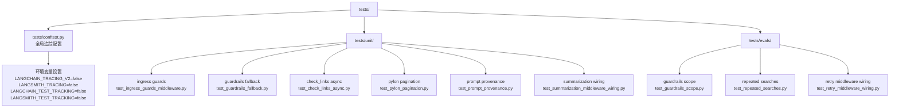
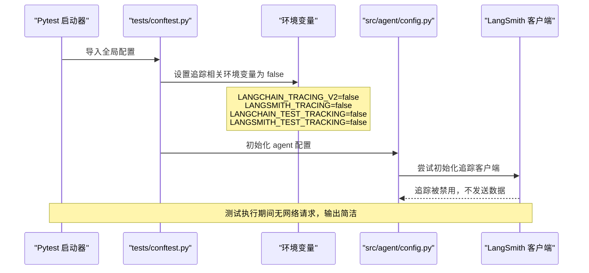
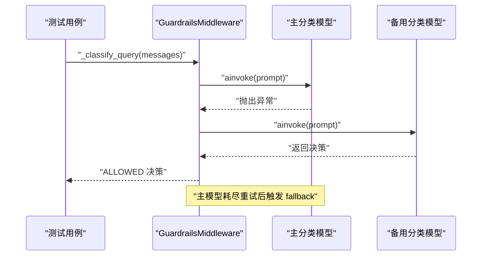
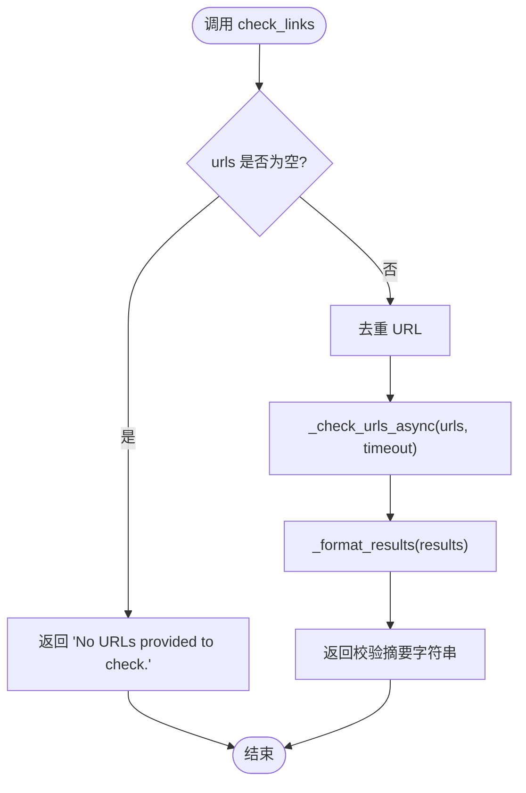
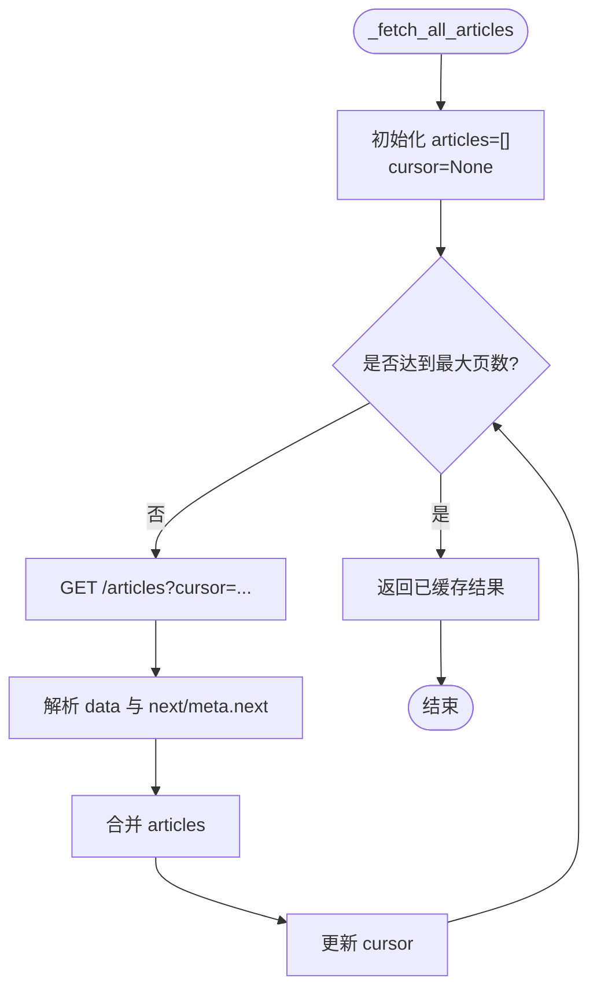
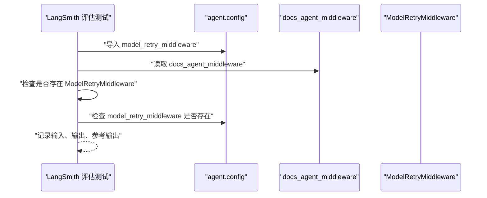
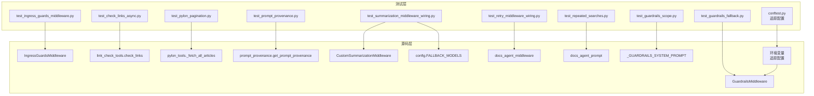
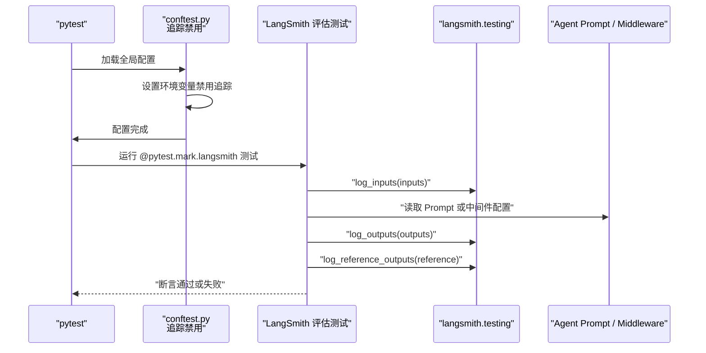

# 06-测试与评估体系

<cite>
**本文引用的文件**   
- [pyproject.toml](file://pyproject.toml)
- [README.md](file://README.md)
- [tests/conftest.py](file://tests/conftest.py)
- [src/agent/config.py](file://src/agent/config.py)
- [connectors/langsmith.py](file://connectors/langsmith.py)
- [tests/unit/test_ingress_guards_middleware.py](file://tests/unit/test_ingress_guards_middleware.py)
- [tests/unit/test_guardrails_fallback.py](file://tests/unit/test_guardrails_fallback.py)
- [tests/unit/test_check_links_async.py](file://tests/unit/test_check_links_async.py)
- [tests/unit/test_pylon_pagination.py](file://tests/unit/test_pylon_pagination.py)
- [tests/unit/test_prompt_provenance.py](file://tests/unit/test_prompt_provenance.py)
- [tests/unit/test_summarization_middleware_wiring.py](file://tests/unit/test_summarization_middleware_wiring.py)
- [tests/evals/test_guardrails_scope.py](file://tests/evals/test_guardrails_scope.py)
- [tests/evals/test_repeated_searches.py](file://tests/evals/test_repeated_searches.py)
- [tests/evals/test_retry_middleware_wiring.py](file://tests/evals/test_retry_middleware_wiring.py)
</cite>

## 更新摘要
**变更内容**   
- 新增 tests/conftest.py 全局配置，系统性地禁用 LangSmith 和 LangChain 追踪功能
- 解决测试执行中出现的 403 Forbidden 错误噪音问题
- 通过环境变量设置确保测试输出简洁并专注于实际测试断言
- 更新 pytest 运行方式章节，增加追踪配置说明

## 目录
1. [引言](#引言)
2. [测试项目结构](#测试项目结构)
3. [测试环境配置](#测试环境配置)
4. [单元测试覆盖范围](#单元测试覆盖范围)
5. [评估测试设计](#评估测试设计)
6. [pytest 运行方式与 LangSmith 集成](#pytest-运行方式与-langsmith-集成)
7. [关键调用关系与架构视图](#关键调用关系与架构视图)
8. [性能与稳定性注意事项](#性能与稳定性注意事项)
9. [故障排查指南](#故障排查指南)
10. [结论](#结论)

## 引言
本文件聚焦项目的测试与评估体系，围绕以下目标展开：
- 说明 `tests/unit/` 中单元测试对 ingress guards、guardrails fallback、check_links async、pylon pagination、prompt provenance、summarization wiring 的覆盖策略。
- 说明 `tests/evals/` 中评估测试的设计意图，包括 guardrails scope 判定、repeated searches 指令检查、retry middleware wiring 验证。
- 说明 pytest 运行方式以及 LangSmith 评估数据集的集成方式。
- 说明测试环境中的 LangSmith 追踪禁用机制，确保测试执行的稳定性和输出整洁性。

该文档以源码实现为主线，重点解释每个测试文件"测什么、怎么测、为什么这样测"，并给出关键调用关系图，帮助读者理解测试如何映射到 Agent 中间件、工具、Prompt 和配置层。

## 测试项目结构
仓库测试代码集中在 `tests/` 下，分为三类：
- `tests/conftest.py`：Pytest 全局配置，负责在测试启动时禁用 LangSmith 和 LangChain 追踪功能。
- `tests/unit/`：面向具体模块行为的单元测试，通常通过 mock、monkeypatch 或轻量 fake 对象隔离外部依赖。
- `tests/evals/`：面向 Prompt 行为、Agent 装配和 LangSmith 评估流程的评估测试，多数使用 `pytest.mark.langsmith` 标记，并通过 `langsmith.testing` 记录输入输出。

**图表来源**
- [tests/conftest.py:1-18](file://tests/conftest.py#L1-L18)
- [tests/unit/test_ingress_guards_middleware.py:1-64](file://tests/unit/test_ingress_guards_middleware.py#L1-L64)
- [tests/unit/test_guardrails_fallback.py:1-99](file://tests/unit/test_guardrails_fallback.py#L1-L99)
- [tests/unit/test_check_links_async.py:1-265](file://tests/unit/test_check_links_async.py#L1-L265)
- [tests/unit/test_pylon_pagination.py:1-193](file://tests/unit/test_pylon_pagination.py#L1-L193)
- [tests/unit/test_prompt_provenance.py:1-85](file://tests/unit/test_prompt_provenance.py#L1-L85)
- [tests/unit/test_summarization_middleware_wiring.py:1-35](file://tests/unit/test_summarization_middleware_wiring.py#L1-L35)
- [tests/evals/test_guardrails_scope.py:1-241](file://tests/evals/test_guardrails_scope.py#L1-L241)
- [tests/evals/test_repeated_searches.py:1-65](file://tests/evals/test_repeated_searches.py#L1-L65)
- [tests/evals/test_retry_middleware_wiring.py:1-36](file://tests/evals/test_retry_middleware_wiring.py#L1-L36)

**章节来源**
- [README.md:89-115](file://README.md#L89-L115)

## 测试环境配置

### LangSmith 追踪禁用机制
`tests/conftest.py` 是 Pytest 的全局配置文件，在测试执行前自动加载，负责系统性地禁用 LangSmith 和 LangChain 的追踪功能。这一配置解决了本地测试环境中因无效或无权限的 LANGSMITH_API_KEY 导致的 "Failed to multipart ingest runs ... 403 Forbidden" 错误噪音问题。

该配置通过设置四个关键环境变量来确保追踪功能完全关闭：
- `LANGCHAIN_TRACING_V2 = "false"`：禁用 LangChain v2 追踪
- `LANGSMITH_TRACING = "false"`：禁用 LangSmith 追踪
- `LANGCHAIN_TEST_TRACKING = "false"`：禁用 LangChain 测试追踪
- `LANGSMITH_TEST_TRACKING = "false"`：禁用 LangSmith 测试追踪

**图表来源**
- [tests/conftest.py:1-18](file://tests/conftest.py#L1-L18)
- [src/agent/config.py:19-86](file://src/agent/config.py#L19-L86)

**章节来源**
- [tests/conftest.py:1-18](file://tests/conftest.py#L1-L18)

## 单元测试覆盖范围

### Ingress Guards 中间件
`test_ingress_guards_middleware.py` 主要验证入口守卫中间件的两大职责：
- 消息长度上限截断：当人类消息超过 `MAX_MESSAGE_CHARS` 时，`before_agent` 应返回包含截断后消息的更新；未超限时返回 `None`。
- 追踪元数据构建：`build_docs_agent_trace_metadata` 在本地 Prompt 模式下应返回 `source_type`、`prompt_source`、`guardrails_prompt_source`，并按环境变量优先级选择 `LANGSMITH_AGENT_VERSION`。

测试通过直接构造 `HumanMessage` 和 `AIMessage`，注入 `state`，再调用中间件方法，从而验证状态更新是否按预期生成。同时使用 `monkeypatch` 模拟环境变量和本地 Prompt 开关，确保追踪元数据的分支路径被覆盖。

**章节来源**
- [tests/unit/test_ingress_guards_middleware.py:19-36](file://tests/unit/test_ingress_guards_middleware.py#L19-L36)
- [tests/unit/test_ingress_guards_middleware.py:39-64](file://tests/unit/test_ingress_guards_middleware.py#L39-L64)

### Guardrails Fallback 模型降级
`test_guardrails_fallback.py` 针对 Guardrails 分类器的多模型重试与降级逻辑进行验证：
- 主模型失败后，fallback 模型应获得独立的重试预算。
- 所有模型都耗尽重试次数后，应抛出 `GuardrailsClassificationError`。
- 如果分类完全失败，`abefore_agent` 应让主 Agent 继续执行，而不是阻断对话。

测试通过自定义 `FakeStructuredModel` 控制 `ainvoke` 的返回值或异常，并使用 `monkeypatch.setattr` 替换模块级 `GUARDRAILS_MAX_RETRIES`，从而精确控制重试次数和降级路径。

**图表来源**
- [tests/unit/test_guardrails_fallback.py:19-41](file://tests/unit/test_guardrails_fallback.py#L19-L41)
- [tests/unit/test_guardrails_fallback.py:44-61](file://tests/unit/test_guardrails_fallback.py#L44-L61)
- [tests/unit/test_guardrails_fallback.py:63-79](file://tests/unit/test_guardrails_fallback.py#L63-L79)
- [tests/unit/test_guardrails_fallback.py:82-99](file://tests/unit/test_guardrails_fallback.py#L82-L99)

**章节来源**
- [tests/unit/test_guardrails_fallback.py:19-41](file://tests/unit/test_guardrails_fallback.py#L19-L41)
- [tests/unit/test_guardrails_fallback.py:44-99](file://tests/unit/test_guardrails_fallback.py#L44-L99)

### check_links 异步工具
`test_check_links_async.py` 的核心目标是验证链接检查工具在异步上下文中的正确性，避免旧实现中在协程内调用 `asyncio.run()` 导致的事件循环冲突。测试覆盖了：
- 在异步上下文中调用 `check_links.ainvoke` 不应抛出 `RuntimeError`。
- 多 URL 校验结果格式、去重逻辑、空列表处理、非法 URL 格式。
- 支持文章 soft 404 的特殊判断：HTTP 200 但内容为"Article Not Found"时应视为无效链接。

测试通过 `unittest.mock.patch` 替换 `_check_urls_async`，并构造最小化的 `_FakeStreamResponse` 与 `_FakeStreamingClient`，使 HTTP 流式读取路径可被确定性验证。

**图表来源**
- [tests/unit/test_check_links_async.py:77-127](file://tests/unit/test_check_links_async.py#L77-L127)
- [tests/unit/test_check_links_async.py:137-180](file://tests/unit/test_check_links_async.py#L137-L180)
- [tests/unit/test_check_links_async.py:187-265](file://tests/unit/test_check_links_async.py#L187-L265)

**章节来源**
- [tests/unit/test_check_links_async.py:1-265](file://tests/unit/test_check_links_async.py#L1-L265)

### Pylon Pagination 分页拉取
`test_pylon_pagination.py` 针对 Pylon 知识库文章的 `_fetch_all_articles` 分页逻辑进行测试，覆盖：
- 单页无 `next` 游标时只请求一次。
- 两页、三页组合结果。
- `meta.next` 分页形状兼容。
- 安全上限：最多拉取 10 页。
- 全局缓存：第二次调用不重复发起网络请求。
- 空数据列表返回空数组。

测试通过 `unittest.mock.patch` 替换 `_get_api_key`、`_get_kb_id` 和 `requests.get`，并用 `_make_response`、`_make_meta_response` 构造符合 Pylon API 结构的响应体。

**图表来源**
- [tests/unit/test_pylon_pagination.py:17-36](file://tests/unit/test_pylon_pagination.py#L17-L36)
- [tests/unit/test_pylon_pagination.py:62-96](file://tests/unit/test_pylon_pagination.py#L62-L96)
- [tests/unit/test_pylon_pagination.py:101-155](file://tests/unit/test_pylon_pagination.py#L101-L155)
- [tests/unit/test_pylon_pagination.py:161-188](file://tests/unit/test_pylon_pagination.py#L161-L188)

**章节来源**
- [tests/unit/test_pylon_pagination.py:1-193](file://tests/unit/test_pylon_pagination.py#L1-L193)

### Prompt Provenance 溯源
`test_prompt_provenance.py` 验证 Prompt 溯源机制在本地模式与 Hub 模式下的行为：
- 本地模式：返回 `local:instructions.md` 与 `local:src/prompts/guardrails_prompts.py`，且不包含 commit。
- Hub 模式：根据 `LANGSMITH_PROMPT_WORKSPACE_ID` 与 `LANGSMITH_PROMPT_API_KEY` 构造 LangSmith Client，拉取 Prompt 并解析 commit。
- 未设置 override 时使用默认 Client，且 prompt source 以 `hub:` 开头。

测试通过 monkeypatch 替换 `_USE_LOCAL_PROMPTS` 和 `langsmith.Client`，并构造 `_FakeTemplate` 模拟 Prompt metadata。

**章节来源**
- [tests/unit/test_prompt_provenance.py:8-22](file://tests/unit/test_prompt_provenance.py#L8-L22)
- [tests/unit/test_prompt_provenance.py:24-58](file://tests/unit/test_prompt_provenance.py#L24-L58)
- [tests/unit/test_prompt_provenance.py:61-85](file://tests/unit/test_prompt_provenance.py#L61-L85)

### Summarization Wiring 压缩中间件装配
`test_summarization_middleware_wiring.py` 验证总结中间件是否正确复用共享的模型重试与 fallback 策略：
- `FALLBACK_MODELS` 应以 `DEFAULT_MODEL` 为默认 fallback。
- `CustomSummarizationMiddleware` 的 `summary_model` 应为 `RunnableWithFallbacks`。
- 主模型与 fallback 模型的 `max_attempt_number` 应与配置的 `MAX_RETRIES + 1` 一致。

测试直接导入 `config` 与 `context_summary_prompt`，构造中间件实例并断言其内部模型装配结构。

**章节来源**
- [tests/unit/test_summarization_middleware_wiring.py:8-35](file://tests/unit/test_summarization_middleware_wiring.py#L8-L35)

## 评估测试设计

### Guardrails Scope 判定
`test_guardrails_scope.py` 不是端到端 LLM 调用测试，而是对 guardrails system prompt 的内容契约进行静态断言，确保：
- Prompt 明确提及数据科学库限制（如 pandas、numpy、sklearn、pyspark 等）。
- `ONLY BLOCK` 部分包含纯数据科学查询的阻断规则。
- 数据科学库仅在具备 LangChain 上下文时才允许。
- 核心 LangChain 主题仍被允许。
- 默认策略仍是 ALLOW，避免过度拦截。
- NSFW/成人内容具有零容忍阻断规则，且位于 `ONLY BLOCK` 之前。
- 主 Agent Prompt 也具备 NSFW 拒绝指令，形成纵深防御。

这些测试通过加载 `_GUARDRAILS_SYSTEM_PROMPT` 与 `docs_agent_prompt`，将其转为小写后进行关键词匹配，从而把 Prompt 工程问题转化为可回归的自动化测试。

**章节来源**
- [tests/evals/test_guardrails_scope.py:24-61](file://tests/evals/test_guardrails_scope.py#L24-L61)
- [tests/evals/test_guardrails_scope.py:69-93](file://tests/evals/test_guardrails_scope.py#L69-L93)
- [tests/evals/test_guardrails_scope.py:101-125](file://tests/evals/test_guardrails_scope.py#L101-L125)
- [tests/evals/test_guardrails_scope.py:133-163](file://tests/evals/test_guardrails_scope.py#L133-L163)
- [tests/evals/test_guardrails_scope.py:171-209](file://tests/evals/test_guardrails_scope.py#L171-L209)
- [tests/evals/test_guardrails_scope.py:219-241](file://tests/evals/test_guardrails_scope.py#L219-L241)

### Repeated Searches 重复搜索防护
`test_repeated_searches.py` 通过 LangSmith 评估框架记录输入输出，并断言主 Agent Prompt 中包含防止重复检索的指令。它检查多种自然语言表达，例如"already search""do not re-search""avoid repeat""already retrieved""history before"等，确保 Prompt 能引导 Agent 在已有对话历史中避免重复调用检索工具。

该测试使用 `pytest.mark.langsmith` 标记，并通过 `t.log_inputs`、`t.log_outputs`、`t.log_reference_outputs` 将 Prompt 长度、指示词存在性与参考期望写入 LangSmith 评估记录。

**章节来源**
- [tests/evals/test_repeated_searches.py:6-32](file://tests/evals/test_repeated_searches.py#L6-L32)
- [tests/evals/test_repeated_searches.py:35-65](file://tests/evals/test_repeated_searches.py#L35-L65)

### Retry Middleware Wiring 重试中间件装配
`test_retry_middleware_wiring.py` 验证 `ModelRetryMiddleware` 是否被正确接入 Agent 中间件栈，以及 `model_retry_middleware` 是否从 `config` 导出且类型正确。

测试通过 `langsmith.testing` 记录中间件类型列表，并断言其中存在 `ModelRetryMiddleware`；同时断言 `config.model_retry_middleware` 存在且类型为 `ModelRetryMiddleware`。

**图表来源**
- [tests/evals/test_retry_middleware_wiring.py:10-23](file://tests/evals/test_retry_middleware_wiring.py#L10-L23)
- [tests/evals/test_retry_middleware_wiring.py:26-36](file://tests/evals/test_retry_middleware_wiring.py#L26-L36)

**章节来源**
- [tests/evals/test_retry_middleware_wiring.py:1-36](file://tests/evals/test_retry_middleware_wiring.py#L1-L36)

## pytest 运行方式与 LangSmith 集成

### pytest 与异步测试
项目依赖 `pytest` 与 `pytest-asyncio`，因此异步测试需要使用 `@pytest.mark.asyncio` 装饰器。`test_check_links_async.py` 中的所有异步用例均使用该标记，并通过 `await check_links.ainvoke(...)` 调用工具，避免在协程内再次启动事件循环。

### LangSmith 评估标记
`tests/evals/` 下的测试普遍使用 `@pytest.mark.langsmith` 标记，表示这些测试属于 LangSmith 评估场景。它们通过 `langsmith.testing` 的 `log_inputs`、`log_outputs`、`log_reference_outputs` 记录评估数据，便于在 LangSmith 中查看 Prompt 变更、Agent 行为与参考答案之间的差异。

### 追踪配置与环境变量
**新增** 测试环境通过 `tests/conftest.py` 自动禁用 LangSmith 和 LangChain 追踪功能，确保测试执行过程中不会产生网络请求或认证错误。这一配置在 pytest 导入任何测试模块之前生效，避免了本地无效或无权限的 LANGSMITH_API_KEY 导致的 "403 Forbidden" 错误。

追踪禁用涉及以下环境变量：
- `LANGCHAIN_TRACING_V2`：控制 LangChain v2 追踪
- `LANGSMITH_TRACING`：控制 LangSmith 追踪
- `LANGCHAIN_TEST_TRACKING`：控制 LangChain 测试追踪
- `LANGSMITH_TEST_TRACKING`：控制 LangSmith 测试追踪

### 运行建议
- 运行全部单元测试：`pytest tests/unit/`
- 运行异步单元测试：`pytest tests/unit/test_check_links_async.py -v`
- 运行 LangSmith 评估测试：`pytest tests/evals/ -m langsmith`
- 若需要更详细的日志或调试信息，可结合 `-s` 或添加 `--tb=long`。

需要注意的是，评估测试可能依赖 LangSmith 环境或 Prompt Hub 配置；如果仅运行单元测试，通常不需要真实 LangSmith 凭据，因为单元测试大多通过 mock 隔离外部依赖，且追踪功能已被全局禁用。

**章节来源**
- [pyproject.toml:73-82](file://pyproject.toml#L73-L82)
- [tests/conftest.py:1-18](file://tests/conftest.py#L1-L18)
- [tests/unit/test_check_links_async.py:77-127](file://tests/unit/test_check_links_async.py#L77-L127)
- [tests/evals/test_repeated_searches.py:6-32](file://tests/evals/test_repeated_searches.py#L6-L32)
- [tests/evals/test_retry_middleware_wiring.py:10-23](file://tests/evals/test_retry_middleware_wiring.py#L10-L23)

## 关键调用关系与架构视图

### 测试到源码组件的映射

**图表来源**
- [tests/unit/test_ingress_guards_middleware.py:12-16](file://tests/unit/test_ingress_guards_middleware.py#L12-L16)
- [tests/unit/test_guardrails_fallback.py:12-16](file://tests/unit/test_guardrails_fallback.py#L12-L16)
- [tests/unit/test_check_links_async.py:21-27](file://tests/unit/test_check_links_async.py#L21-L27)
- [tests/unit/test_pylon_pagination.py:51-56](file://tests/unit/test_pylon_pagination.py#L51-L56)
- [tests/unit/test_prompt_provenance.py:5-6](file://tests/unit/test_prompt_provenance.py#L5-L6)
- [tests/unit/test_summarization_middleware_wiring.py:3-5](file://tests/unit/test_summarization_middleware_wiring.py#L3-L5)
- [tests/evals/test_guardrails_scope.py:15-16](file://tests/evals/test_guardrails_scope.py#L15-L16)
- [tests/evals/test_repeated_searches.py:3](file://tests/evals/test_repeated_searches.py#L3)
- [tests/evals/test_retry_middleware_wiring.py:5-7](file://tests/evals/test_retry_middleware_wiring.py#L5-L7)
- [tests/conftest.py:14-17](file://tests/conftest.py#L14-L17)

### 评估测试与 LangSmith 的数据流

**图表来源**
- [tests/conftest.py:1-18](file://tests/conftest.py#L1-L18)
- [tests/evals/test_repeated_searches.py:6-32](file://tests/evals/test_repeated_searches.py#L6-L32)
- [tests/evals/test_retry_middleware_wiring.py:10-23](file://tests/evals/test_retry_middleware_wiring.py#L10-L23)

## 性能与稳定性注意事项
- 单元测试应避免真实网络请求：`test_check_links_async.py` 与 `test_pylon_pagination.py` 都通过 mock 替代 HTTP 调用，保证测试快速、稳定、可重复。
- Guardrails fallback 测试通过控制 `GUARDRAILS_MAX_RETRIES` 与 fake 模型 outcomes，避免真实 LLM 调用，同时覆盖重试与降级路径。
- Pylon 分页测试显式重置模块级缓存 `_articles_cache`，避免跨测试污染。
- Prompt 相关测试基于字符串匹配，执行开销极低，适合频繁回归。
- **新增** 测试环境通过 `tests/conftest.py` 全局禁用 LangSmith 和 LangChain 追踪，避免测试执行过程中的网络请求和认证错误，显著提升测试稳定性和执行速度。

## 故障排查指南
- 异步测试报错 `RuntimeError: This event loop is already running`：检查是否在协程中调用了会重新创建事件循环的实现；`test_check_links_async.py` 已通过断言确保修复后的 `check_links` 不会在异步上下文中抛出该错误。
- Guardrails 分类失败导致主 Agent 被阻断：确认 fallback 模型是否被正确调用，以及 `abefore_agent` 在分类异常时是否返回 `off_topic_query=False`。
- Pylon 分页无限循环：检查 `next` 或 `meta.next` 游标是否被正确传递，并确认安全上限是否生效。
- Prompt provenance 未包含 commit：确认 `_USE_LOCAL_PROMPTS` 与 LangSmith Prompt Hub 环境变量是否正确设置。
- LangSmith 评估测试未记录数据：确认测试使用了 `pytest.mark.langsmith`，并调用了 `langsmith.testing` 的 `log_inputs`、`log_outputs`、`log_reference_outputs`。
- **新增** 测试输出中出现 "403 Forbidden" 错误：检查 `tests/conftest.py` 是否正确加载，确认环境变量 `LANGCHAIN_TRACING_V2`、`LANGSMITH_TRACING`、`LANGCHAIN_TEST_TRACKING`、`LANGSMITH_TEST_TRACKING` 是否被设置为 `"false"`。

**章节来源**
- [tests/unit/test_check_links_async.py:105-127](file://tests/unit/test_check_links_async.py#L105-L127)
- [tests/unit/test_guardrails_fallback.py:82-99](file://tests/unit/test_guardrails_fallback.py#L82-L99)
- [tests/unit/test_pylon_pagination.py:140-155](file://tests/unit/test_pylon_pagination.py#L140-L155)
- [tests/unit/test_prompt_provenance.py:24-58](file://tests/unit/test_prompt_provenance.py#L24-L58)
- [tests/evals/test_repeated_searches.py:6-32](file://tests/evals/test_repeated_searches.py#L6-L32)
- [tests/conftest.py:1-18](file://tests/conftest.py#L1-L18)

## 结论
本项目的测试与评估体系围绕"中间件可靠性、工具异步兼容性、知识库分页健壮性、Prompt 溯源与约束、Agent 装配正确性"五个维度展开。单元测试侧重实现细节与边界条件，评估测试侧重 Prompt 行为契约与 LangSmith 可观测性。通过 pytest 与 pytest-asyncio 的组合，以及 LangSmith 评估标记与日志接口，项目能够在不依赖真实 LLM 与外部网络的情况下，持续验证 Agent 的关键质量属性。

**新增** 通过 `tests/conftest.py` 的全局追踪禁用机制，测试环境现在能够自动屏蔽 LangSmith 和 LangChain 的网络请求，避免了本地开发中的认证错误和性能损耗，确保了测试执行的稳定性和输出整洁性。这一改进显著提升了开发体验，使开发者能够专注于实际的测试断言而非环境配置问题。