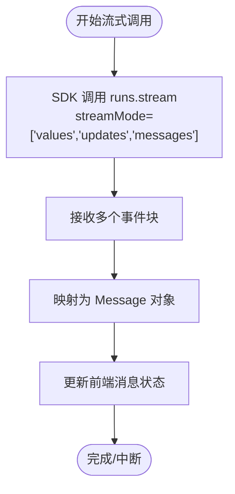
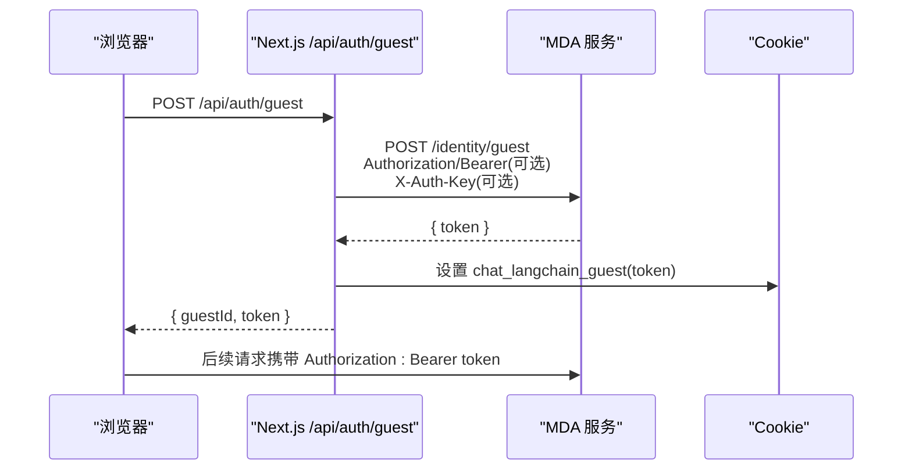
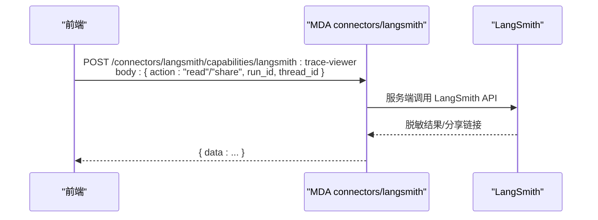
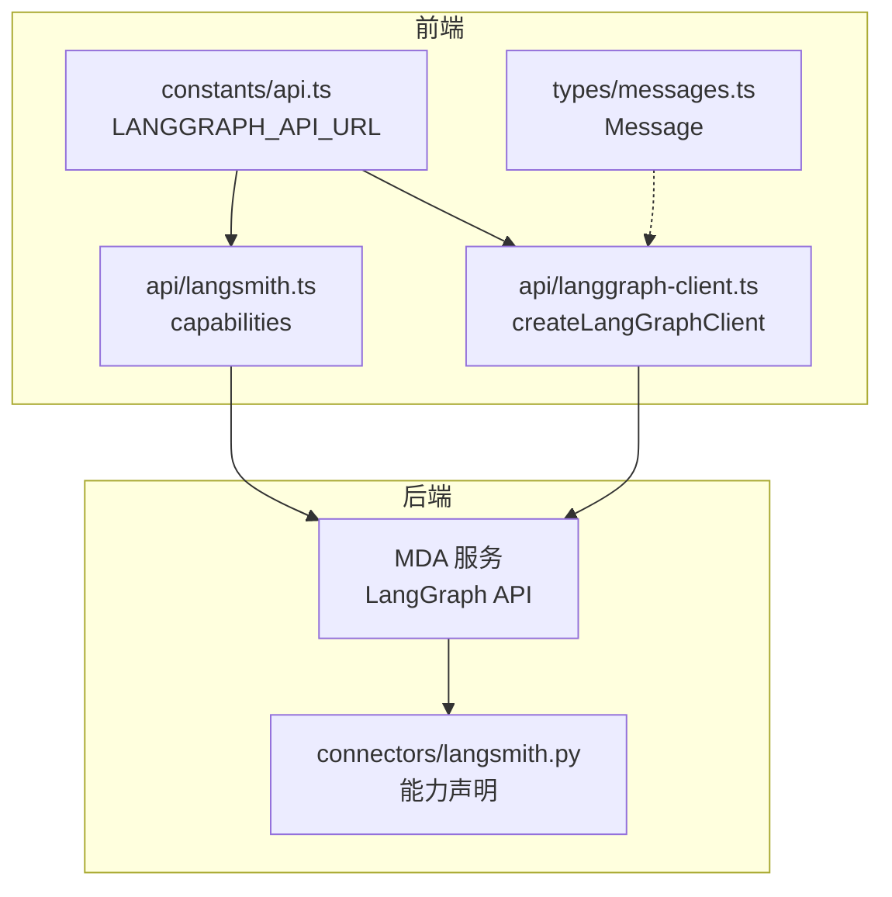
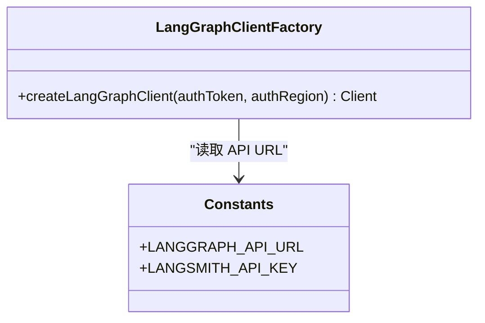
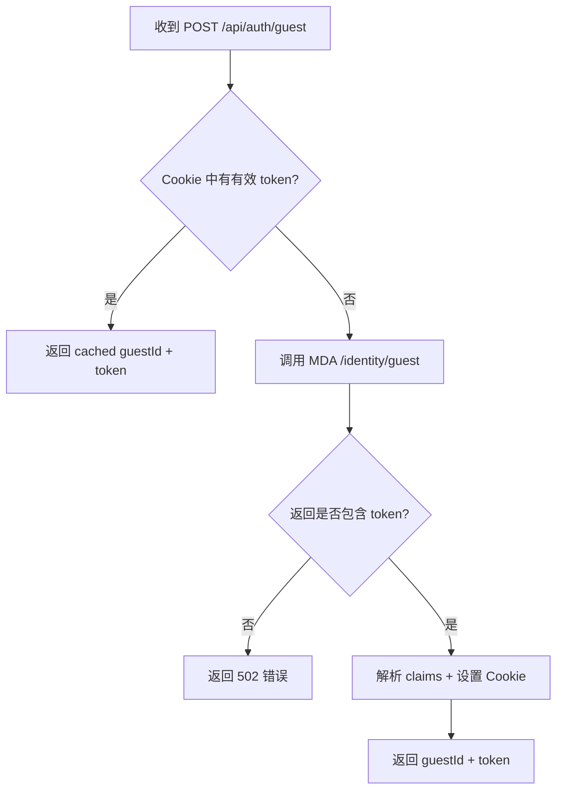
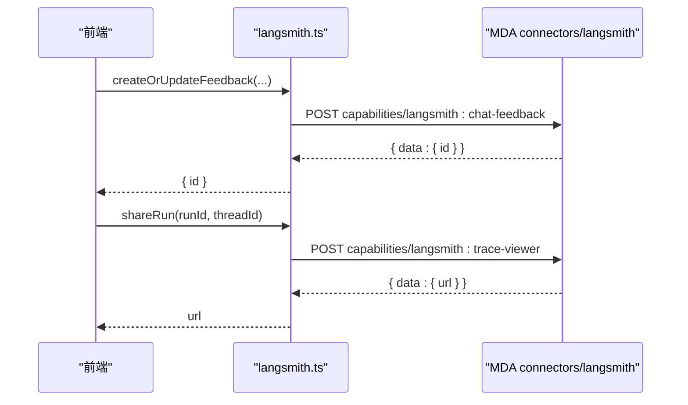
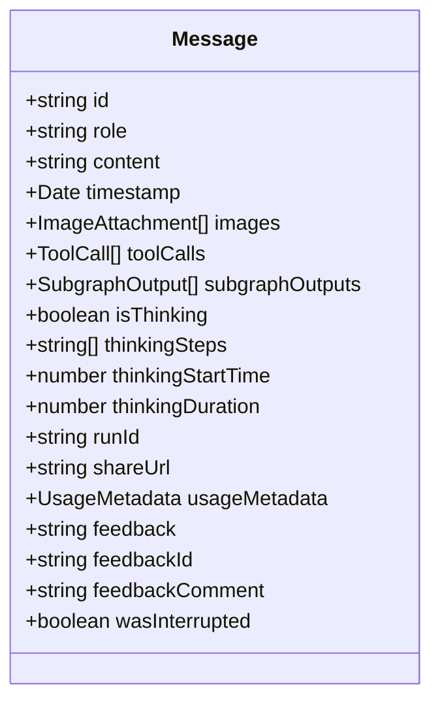
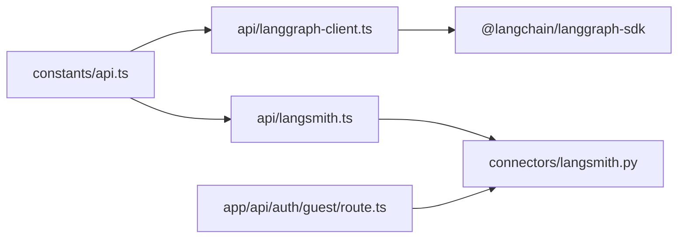

# 07-前端接口契约

<cite>
**本文引用的文件**   
- [frontend/lib/types/messages.ts](file://frontend/lib/types/messages.ts)
- [frontend/app/api/auth/guest/route.ts](file://frontend/app/api/auth/guest/route.ts)
- [frontend/lib/constants/api.ts](file://frontend/lib/constants/api.ts)
- [frontend/lib/api/langgraph-client.ts](file://frontend/lib/api/langgraph-client.ts)
- [frontend/lib/api/langsmith.ts](file://frontend/lib/api/langsmith.ts)
- [connectors/langsmith.py](file://connectors/langsmith.py)
</cite>

## 目录
1. [引言](#引言)
2. [项目结构中的前端契约边界](#项目结构中的前端契约边界)
3. [核心交互契约](#核心交互契约)
4. [架构总览](#架构总览)
5. [详细组件分析](#详细组件分析)
6. [依赖关系分析](#依赖关系分析)
7. [性能与可靠性考虑](#性能与可靠性考虑)
8. [故障排查指南](#故障排查指南)
9. [结论](#结论)

## 引言
本文聚焦于前端与 Agent 后端的“接口契约”，不展开 React 组件实现、TypeScript 类型细节与 UI 样式。重点覆盖：
- Agent API 入口：`NEXT_PUBLIC_LANGGRAPH_API_URL` 指向本地或部署的 MDA（Managed DeepAgents）服务。
- SSE streaming 数据格式：以 `frontend/lib/types/messages.ts` 中定义的 `Message` 为核心契约。
- 认证方式：Guest Token → Supabase → Cookie 的流转路径。
- LangSmith Trace Viewer 集成：前端通过后端 connector 能力调用，再在 iframe 中展示调用链。

后端 Python 实现细节见其他文档，本文仅描述前后端之间的请求/响应约定、头部字段、能力标识与数据模型。

## 项目结构中的前端契约边界
本仓库的前端部分位于 `frontend/`，与 Agent 后端交互的关键代码集中在以下位置：
- 常量与 URL：`frontend/lib/constants/api.ts`
- LangGraph SDK 客户端封装：`frontend/lib/api/langgraph-client.ts`
- Guest Token 签发路由：`frontend/app/api/auth/guest/route.ts`
- LangSmith 前端客户端：`frontend/lib/api/langsmith.ts`
- 消息类型定义：`frontend/lib/types/messages.ts`
- 后端 LangSmith connector 能力声明：`connectors/langsmith.py`

```mermaid
graph TB
FE["前端应用<br/>Next.js"] --> CAPI["API 常量<br/>constants/api.ts"]
FE --> LGC["LangGraph 客户端封装<br/>api/langgraph-client.ts"]
FE --> LS["LangSmith 前端客户端<br/>api/langsmith.ts"]
FE --> MSG["消息类型契约<br/>types/messages.ts"]
FE --> GUEST["Guest Token 路由<br/>app/api/auth/guest/route.ts"]
CAPI --> |提供 LANGGRAPH_API_URL| LGC
CAPI --> |提供 LANGGRAPH_API_URL| LS
LGC --> |Bearer + X-Auth-Key| MDA["MDA 服务<br/>LangGraph API"]
LS --> |POST /connectors/langsmith/capabilities/{id}| MDA
GUEST --> |POST /identity/guest| MDA
```

**图表来源**
- [frontend/lib/constants/api.ts:14-33](file://frontend/lib/constants/api.ts#L14-L33)
- [frontend/lib/api/langgraph-client.ts:25-52](file://frontend/lib/api/langgraph-client.ts#L25-L52)
- [frontend/lib/api/langsmith.ts:39-61](file://frontend/lib/api/langsmith.ts#L39-L61)
- [frontend/app/api/auth/guest/route.ts:8-11](file://frontend/app/api/auth/guest/route.ts#L8-L11)

**章节来源**
- [frontend/lib/constants/api.ts:1-40](file://frontend/lib/constants/api.ts#L1-L40)
- [frontend/lib/api/langgraph-client.ts:1-54](file://frontend/lib/api/langgraph-client.ts#L1-L54)
- [frontend/lib/api/langsmith.ts:1-179](file://frontend/lib/api/langsmith.ts#L1-L179)
- [frontend/app/api/auth/guest/route.ts:1-106](file://frontend/app/api/auth/guest/route.ts#L1-L106)
- [frontend/lib/types/messages.ts:1-50](file://frontend/lib/types/messages.ts#L1-L50)

## 核心交互契约
本节从“请求如何发起、携带什么身份、返回什么数据”的角度，总结前端与 Agent 后端的契约。

### Agent API 入口与基础头
- 目标地址：由 `LANGGRAPH_API_URL` 决定，优先读取 `NEXT_PUBLIC_LANGGRAPH_API_URL`，兼容 `NEXT_PUBLIC_LANGGRAPH_API_URL_EXTERNAL`；开发环境默认回退到 `http://127.0.0.1:2024`。
- 鉴权头：
  - `Authorization: Bearer <token>`：Supabase access token 或 Guest token。
  - `X-Auth-Key`：可选，来自 `NEXT_PUBLIC_LANGGRAPH_AUTH_KEY`，用于部署级访问控制。
  - `X-Supabase-Region`：可选，当存在 Supabase region 时附加，便于服务端校验。
- LangGraph SDK 客户端通过 `createLangGraphClient(authToken, authRegion)` 创建，统一注入上述头部并指向 `LANGGRAPH_API_URL`。

**章节来源**
- [frontend/lib/constants/api.ts:14-33](file://frontend/lib/constants/api.ts#L14-L33)
- [frontend/lib/api/langgraph-client.ts:25-52](file://frontend/lib/api/langgraph-client.ts#L25-L52)

### SSE Streaming 数据契约
前端使用 LangGraph SDK 的 `client.runs.stream(threadId, agentType, { streamMode, streamSubgraphs })` 拉取流式事件，并在前端状态中映射为 `Message`。`Message` 是前后端关于“聊天消息与执行元信息”的核心契约：
- 核心字段：`id`、`role`、`content`、`timestamp`。
- 工具与子图：`toolCalls`、`subgraphOutputs`。
- 思考态与流式进度：`isThinking`、`thinkingSteps`、`thinkingStartTime`、`thinkingDuration`。
- LangSmith 追踪：`runId`、`shareUrl`、`usageMetadata`。
- 用户反馈：`feedback`、`feedbackId`、`feedbackComment`。
- 中断跟踪：`wasInterrupted`。

SSE 本身是传输协议，但前端将服务端产生的事件归一化为 `Message` 对象进行渲染与状态管理。因此，对调用方而言，`Message` 就是可消费的“流式消息契约”。



**图表来源**
- [frontend/lib/hooks/chat/use-stream-handler.ts:442-450](file://frontend/lib/hooks/chat/use-stream-handler.ts#L442-L450)
- [frontend/lib/types/messages.ts:16-48](file://frontend/lib/types/messages.ts#L16-L48)

**章节来源**
- [frontend/lib/types/messages.ts:1-50](file://frontend/lib/types/messages.ts#L1-L50)

### 认证流程：Guest Token → Supabase → Cookie
前端支持两种身份来源：
- 已登录用户：使用 Supabase access token。
- 访客：通过 Next.js Route Handler `/api/auth/guest` 获取 Guest token。

Guest Token 流程要点：
- 路由 `POST /api/auth/guest` 会调用 MDA 服务的 `/identity/guest`。
- 目标地址同样基于 `NEXT_PUBLIC_LANGGRAPH_API_URL` 或外部兼容变量。
- 若配置了 `NEXT_PUBLIC_LANGGRAPH_AUTH_KEY`，会在请求中附带 `X-Auth-Key`。
- 成功返回 `{ token }`，前端将其解析为 JWT claims，缓存到 httpOnly Cookie `chat_langchain_guest`，同时返回 `{ guestId, token }`。
- 后续所有 LangGraph/LangSmith 请求均携带该 token 作为 `Authorization: Bearer`。



**图表来源**
- [frontend/app/api/auth/guest/route.ts:40-62](file://frontend/app/api/auth/guest/route.ts#L40-L62)
- [frontend/app/api/auth/guest/route.ts:64-104](file://frontend/app/api/auth/guest/route.ts#L64-L104)

**章节来源**
- [frontend/app/api/auth/guest/route.ts:1-106](file://frontend/app/api/auth/guest/route.ts#L1-L106)

### LangSmith Trace Viewer 集成
前端不直接持有 LangSmith workspace key，而是通过后端 connector 暴露的能力调用：
- 前端调用：`POST {LANGGRAPH_API_URL}/connectors/langsmith/capabilities/{id}`。
- 能力标识：
  - `langsmith:chat-feedback`：点赞/点踩反馈。
  - `langsmith:trace-viewer`：读取脱敏 run summary、生成公开 trace 分享链接。
- 前端封装在 `lib/api/langsmith.ts`，统一构造 `Authorization: Bearer`、`X-Supabase-Region`、`X-Auth-Key` 等头部。
- 后端 `connectors/langsmith.py` 声明这些能力，并由 MDA 在服务端完成 LangSmith 操作，只返回允许的前端字段。



**图表来源**
- [frontend/lib/api/langsmith.ts:39-61](file://frontend/lib/api/langsmith.ts#L39-L61)
- [frontend/lib/api/langsmith.ts:147-178](file://frontend/lib/api/langsmith.ts#L147-L178)
- [connectors/langsmith.py:1-34](file://connectors/langsmith.py#L1-L34)

**章节来源**
- [frontend/lib/api/langsmith.ts:1-179](file://frontend/lib/api/langsmith.ts#L1-L179)
- [connectors/langsmith.py:1-34](file://connectors/langsmith.py#L1-L34)

## 架构总览
下图展示前端与 Agent 后端的主要交互面：URL、头部、能力标识与消息契约。



**图表来源**
- [frontend/lib/constants/api.ts:14-33](file://frontend/lib/constants/api.ts#L14-L33)
- [frontend/lib/api/langgraph-client.ts:25-52](file://frontend/lib/api/langgraph-client.ts#L25-L52)
- [frontend/lib/api/langsmith.ts:39-61](file://frontend/lib/api/langsmith.ts#L39-L61)
- [connectors/langsmith.py:1-34](file://connectors/langsmith.py#L1-L34)
- [frontend/lib/types/messages.ts:16-48](file://frontend/lib/types/messages.ts#L16-L48)

## 详细组件分析

### Agent API 客户端封装
- 职责：根据 `authToken` 和 `authRegion` 创建 LangGraph SDK 客户端，注入 `Authorization`、`X-Auth-Key`、`X-Supabase-Region`。
- 关键约束：未提供 `authToken` 会抛错，确保所有 LangGraph 请求都带身份。
- 与 URL 的关系：使用 `LANGGRAPH_API_URL`，由环境变量驱动。



**图表来源**
- [frontend/lib/api/langgraph-client.ts:25-52](file://frontend/lib/api/langgraph-client.ts#L25-L52)
- [frontend/lib/constants/api.ts:33-38](file://frontend/lib/constants/api.ts#L33-L38)

**章节来源**
- [frontend/lib/api/langgraph-client.ts:1-54](file://frontend/lib/api/langgraph-client.ts#L1-L54)
- [frontend/lib/constants/api.ts:1-40](file://frontend/lib/constants/api.ts#L1-L40)

### Guest Token 签发路由
- 输入：无 body，仅身份上下文。
- 行为：
  - 优先复用 Cookie 中有效的 Guest token。
  - 否则调用 MDA `/identity/guest`，携带 `X-Auth-Key`（可选）。
  - 解析 JWT claims，校验 `sub`，计算 `maxAge`。
  - 设置 httpOnly Cookie `chat_langchain_guest`，返回 `{ guestId, token }`。
- 错误处理：
  - 未配置 `NEXT_PUBLIC_LANGGRAPH_API_URL` 时报错。
  - 后端返回非 2xx 或无 `token` 字段时报错。



**图表来源**
- [frontend/app/api/auth/guest/route.ts:40-62](file://frontend/app/api/auth/guest/route.ts#L40-L62)
- [frontend/app/api/auth/guest/route.ts:64-104](file://frontend/app/api/auth/guest/route.ts#L64-L104)

**章节来源**
- [frontend/app/api/auth/guest/route.ts:1-106](file://frontend/app/api/auth/guest/route.ts#L1-L106)

### LangSmith 前端客户端
- 能力 URL：`{LANGGRAPH_API_URL}/connectors/langsmith/capabilities/{id}`。
- 能力 ID：
  - `langsmith:chat-feedback`
  - `langsmith:trace-viewer`
- 头部：
  - `Authorization: Bearer <token>`
  - `X-Supabase-Region`（可选）
  - `X-Auth-Key`（可选）
- 主要方法：
  - `createOrUpdateFeedback`
  - `deleteFeedback`
  - `readRun`
  - `shareRun`
- 错误处理：非 2xx 时抛出错误，尝试解析 JSON error 字段。



**图表来源**
- [frontend/lib/api/langsmith.ts:39-61](file://frontend/lib/api/langsmith.ts#L39-L61)
- [frontend/lib/api/langsmith.ts:96-178](file://frontend/lib/api/langsmith.ts#L96-L178)

**章节来源**
- [frontend/lib/api/langsmith.ts:1-179](file://frontend/lib/api/langsmith.ts#L1-L179)

### 消息类型契约
`Message` 是前端消费流式响应的核心数据结构，承载：
- 角色与内容：`role`、`content`。
- 工具调用与子图输出：`toolCalls`、`subgraphOutputs`。
- 思考态与计时：`isThinking`、`thinkingSteps`、`thinkingStartTime`、`thinkingDuration`。
- LangSmith 追踪：`runId`、`shareUrl`、`usageMetadata`。
- 反馈：`feedback`、`feedbackId`、`feedbackComment`。
- 中断标记：`wasInterrupted`。



**图表来源**
- [frontend/lib/types/messages.ts:16-48](file://frontend/lib/types/messages.ts#L16-L48)

**章节来源**
- [frontend/lib/types/messages.ts:1-50](file://frontend/lib/types/messages.ts#L1-L50)

## 依赖关系分析
- `constants/api.ts` 提供 `LANGGRAPH_API_URL`，被 `langgraph-client.ts` 与 `langsmith.ts` 共同依赖。
- `langgraph-client.ts` 依赖 `@langchain/langgraph-sdk`，负责与 LangGraph API 通信。
- `langsmith.ts` 依赖 `constants/api.ts`，并通过 MDA connector 间接依赖 `connectors/langsmith.py`。
- `app/api/auth/guest/route.ts` 依赖环境变量与 MDA `/identity/guest`。



**图表来源**
- [frontend/lib/constants/api.ts:33-38](file://frontend/lib/constants/api.ts#L33-L38)
- [frontend/lib/api/langgraph-client.ts:8-10](file://frontend/lib/api/langgraph-client.ts#L8-L10)
- [frontend/lib/api/langsmith.ts:15-17](file://frontend/lib/api/langsmith.ts#L15-L17)
- [connectors/langsmith.py:1-34](file://connectors/langsmith.py#L1-L34)

**章节来源**
- [frontend/lib/constants/api.ts:1-40](file://frontend/lib/constants/api.ts#L1-L40)
- [frontend/lib/api/langgraph-client.ts:1-54](file://frontend/lib/api/langgraph-client.ts#L1-L54)
- [frontend/lib/api/langsmith.ts:1-179](file://frontend/lib/api/langsmith.ts#L1-L179)
- [connectors/langsmith.py:1-34](file://connectors/langsmith.py#L1-L34)

## 性能与可靠性考虑
- Guest Token 复用：通过 Cookie 缓存有效 token，避免频繁刷新导致身份变化与线程历史丢失。
- 提前刷新策略：在过期前 60 秒即视为需要刷新，减少使用中 token 过期的风险。
- 可选头部最小化：仅在必要时附加 `X-Supabase-Region` 与 `X-Auth-Key`，降低请求体积。
- 流式体验：使用多 `streamMode` 与 `streamSubgraphs`，让前端尽早呈现思考过程与工具调用结果。

[本节为通用指导，不直接分析具体文件]

## 故障排查指南
- 未配置 `NEXT_PUBLIC_LANGGRAPH_API_URL`：
  - 现象：Guest Token 签发或 LangGraph 请求失败。
  - 定位：检查 `constants/api.ts` 与 `guest/route.ts` 的环境变量。
- Guest Token 签发失败：
  - 现象：`/api/auth/guest` 返回 502 或错误消息。
  - 定位：检查 MDA `/identity/guest` 可达性与 `X-Auth-Key`。
- LangSmith 能力调用失败：
  - 现象：`readRun`/`shareRun`/反馈接口报错。
  - 定位：检查 `Authorization`、`X-Supabase-Region`、`X-Auth-Key` 是否正确；确认 MDA connector 能力可用。
- 流式消息异常：
  - 现象：前端长时间显示思考态或消息不完整。
  - 定位：检查 SDK `streamMode` 与 `streamSubgraphs` 配置，以及 `Message` 状态更新逻辑。

**章节来源**
- [frontend/lib/constants/api.ts:20-28](file://frontend/lib/constants/api.ts#L20-L28)
- [frontend/app/api/auth/guest/route.ts:40-62](file://frontend/app/api/auth/guest/route.ts#L40-L62)
- [frontend/lib/api/langsmith.ts:72-91](file://frontend/lib/api/langsmith.ts#L72-L91)

## 结论
本文梳理了前端与 Agent 后端的接口契约：
- Agent API 入口由 `NEXT_PUBLIC_LANGGRAPH_API_URL` 控制，所有客户端请求均携带 `Authorization` 与可选 `X-Auth-Key`、`X-Supabase-Region`。
- SSE streaming 的数据契约以 `Message` 为中心，承载内容、工具调用、思考态与 LangSmith 追踪信息。
- 认证流程通过 Guest Token 与 Supabase token 统一抽象为 Bearer token，并以 Cookie 缓存提升稳定性。
- LangSmith Trace Viewer 通过 MDA connector 能力安全暴露，前端无需持有 workspace key。